<a id="top" name="top" class="lab-anchor"></a>

# Лабораторная работа № 1

Прикладная статистика. Итоговый отчёт.

Исследование трёх случайных величин

**Авторы исследования**

Случайная величина 1 (`ASE_NO2`) — Булавкин Никита — ИСУ 501711.<br/>
Случайная величина 2 (`ASE_T`) — Коненкова Элла — ИСУ 502460.<br/>
Случайная величина 3 (`ASE_CO`) — Пашкова Ксения — ИСУ 505309.<br/>

**КТвД: оформление и дополнительное дизайнерское задание**

Янковская Катерина — ИСУ 409951; Шерстнев Игорь — ИСУ 504632.

Данные: `ASE10.csv`.

<a id="contents" name="contents" class="lab-anchor"></a>

## Оглавление

**[1. Исходные данные](#data)**  

**[2. Сигнал сенсора NO2](#rv-no2)**  
[Описание](#no2-description) · [EDA](#no2-eda) · [Распределение](#no2-model) · [Гипотеза](#no2-test) · [Нормализация](#no2-normalization) · [Оценки](#no2-estimates) · [Выборки](#no2-samples)

**[3. Температура внутри узла (ASE_T)](#rv-temp)**  
[Описание](#temp-description) · [EDA](#temp-eda) · [Распределение](#temp-model) · [Гипотеза](#temp-test) · [Нормализация](#temp-normalization) · [Оценки](#temp-estimates) · [Выборки](#temp-samples)

**[4. Совместная связь трёх каналов](#dependence)**  
[Корреляция](#dependence-test) · [Графики](#dependence-plots) · [Вывод](#dependence-conclusion)

**[5. Сигнал сенсора CO](#rv-co)**  
[Описание](#co-description) · [EDA](#co-eda) · [Распределение](#co-model) · [Гипотеза](#co-test) · [Нормализация](#co-normalization) · [Оценки](#co-estimates) · [Выборки](#co-samples)

**[6. Lab resume](#resume)**  
[Таблица критериев](#criteria)

**[7. Генератор случайных чисел — спринт 2](#sprint2)**<br/>
[Описание](#generator-description) · [Математическая база](#generator-math) · [Реализация](#generator-code) · [Проверки](#generator-tests) · [Выводы](#generator-resume)

**[8. Дополнительное задание КТвД](#additional-assignment)**<br/>
[Рукописные знаки](#additional-assignment) · [Генератор marimo](#additional-assignment)

[Указатель рисунков и таблиц](#figure-index)

<a id="sprint1" name="sprint1" class="lab-anchor"></a>

# Lab01 - Sprint 1

<a id="data" name="data" class="lab-anchor"></a>

## 1 · Исходные данные

Используется файл `ASE10.csv` из набора [Air quality low-cost sensors and monitoring stations NO2 raw dataset in Rouen (France)](https://data.mendeley.com/datasets/82dnstrd93/2), Mendeley Data, версия 2, DOI [10.17632/82dnstrd93.2](https://doi.org/10.17632/82dnstrd93.2), CC BY 4.0. Описание эксперимента: [Thulliez et al., Data in Brief, 2023](https://doi.org/10.1016/j.dib.2023.109398).

Это почасовые средние узла AirSensEUR №10 в Руане за 20.10.2021–25.03.2022. `date` задан в UTC. `ASE_NO2` и `ASE_CO` — сырые электрические сигналы каналов, мкВ, а не откалиброванные концентрации газов. `ASE_T` — температура **внутри узла**, °C, а не отдельное измерение температуры наружного воздуха. Узел находился на площадках SUD3 и QDP; `Location` указывает его положение в соответствующий час.

В файле 3739 строк. По каждому каналу исключаются только его пропуски: остаются 3686 значений NO₂, 3736 температур и 3686 значений CO. Для совместной связи трёх каналов используются 3636 полных строк. Пропуски не заменяются нулями. Смешение площадок и смена сезона могут менять распределения; поэтому приведены общая сводка и коэффициенты отдельно по `Location`.

Под «всей совокупностью» далее понимается **конечный набор доступных значений данного файла**. Выборки из 600 элементов описывают этот набор; они не являются основанием автоматически переносить выводы на будущие часы или другие города.


<a id="notation" name="notation" class="lab-anchor"></a>

### 1.1 · Обозначения, единицы и формулы

Используется файл `ASE10.csv` из набора
[Air quality low-cost sensors and monitoring stations NO₂ raw dataset in Rouen](https://data.mendeley.com/datasets/82dnstrd93/2),
DOI [10.17632/82dnstrd93.2](https://doi.org/10.17632/82dnstrd93.2), CC BY 4.0.
Авторы данных — Michel Bobbia и Emma Thulliez; сбор выполняла ATMO Normandie.
Процедура измерений описана в [статье Thulliez et al.](https://doi.org/10.1016/j.dib.2023.109398).

В файле 3739 почасовых записей за 20.10.2021–25.03.2022; время указано в UTC.
Канал `ASE_NO2` — электрический сигнал сенсора NO₂, мкВ;
`ASE_CO` — электрический сигнал сенсора CO, мкВ;
`ASE_T` — температура внутри измерительного узла, °C.
Электрический сигнал требует калибровки для перевода в концентрацию газа.

Метка `Location` указывает площадку, на которой находился узел:
SUD3 — 2445 строк, QDP — 1291 строка; у трёх строк метка отсутствует.
Во время кампании устройства переставляли между площадками для изучения
устойчивости калибровки. Одномерные распределения описывают объединённую серию;
связи дополнительно рассматриваются отдельно по площадкам.

В таблицах среднее, медиана, минимум, максимум, мода,
перцентиль и стандартное отклонение имеют единицу исходного столбца;
дисперсия — её квадрат. Объём выборки измеряется в наблюдениях.
Нормализованные значения, накопленная доля и корреляция безразмерны.

Используемые обозначения: $n$ — число наблюдений после удаления пропусков,
$x_i$ — значение наблюдения, $\bar{x}$ — выборочное среднее.

```math
\bar{x}=\frac{1}{n}\sum_{i=1}^{n}x_i,\qquad
s^2=\frac{1}{n-1}\sum_{i=1}^{n}(x_i-\bar{x})^2,\qquad s=\sqrt{s^2}.
```

```math
z_i=\frac{x_i-\min_j x_j}{\max_j x_j-\min_j x_j},\qquad
\max_j x_j>\min_j x_j.
```

Эмпирическая функция распределения по исходным значениям:

```math
\widehat F_n(t)=\frac{1}{n}
\sum_{i=1}^{n}\mathbf{1}\{x_i\le t\}.
```

Коэффициент Пирсона для пар наблюдений без пропусков:

```math
r=\frac{\sum_{i=1}^{n}(x_i-\bar{x})(y_i-\bar{y})}
{\sqrt{\sum_{i=1}^{n}(x_i-\bar{x})^2\sum_{i=1}^{n}(y_i-\bar{y})^2}}.
```

В формулах плотности skew-normal в разделах 2.2.1 и 3.2.1 предполагается
$\omega>0$.


<a id="table01" name="table01" class="lab-anchor"></a>

**Таблица 01 · Первые пять строк исходного датасета**

<div class="lab-table-wrap"><div>

<table border="1" class="dataframe lab-table">
<thead>
<tr style="text-align: right;">
<th></th>
<th>date</th>
<th>ASE_NO2</th>
<th>ASE_NO</th>
<th>ASE_CO</th>
<th>ASE_Ox</th>
<th>ASE_T</th>
<th>ASE_HR</th>
<th>ASE_PA</th>
<th>SUD3_NO2</th>
<th>SUD3_NO</th>
<th>QDP_NO</th>
<th>QDP_NO2</th>
<th>QDP_CO</th>
<th>Location</th>
</tr>
</thead>
<tbody>
<tr>
<th>0</th>
<td>2021-10-20 14:00:00+00:00</td>
<td>29123.75000</td>
<td>43733.48438</td>
<td>40791.60938</td>
<td>29087.65625</td>
<td>23.253516</td>
<td>54.889016</td>
<td>1006.269444</td>
<td>11.2</td>
<td>3.5</td>
<td>15.6</td>
<td>22.7</td>
<td>0.139</td>
<td>SUD3</td>
</tr>
<tr>
<th>1</th>
<td>2021-10-20 15:00:00+00:00</td>
<td>29084.31434</td>
<td>42984.14706</td>
<td>40922.12408</td>
<td>29067.22335</td>
<td>22.838591</td>
<td>56.928588</td>
<td>1005.413194</td>
<td>17.8</td>
<td>6.2</td>
<td>20.7</td>
<td>27.1</td>
<td>0.148</td>
<td>SUD3</td>
</tr>
<tr>
<th>2</th>
<td>2021-10-20 16:00:00+00:00</td>
<td>29119.26563</td>
<td>42667.14063</td>
<td>40680.23438</td>
<td>29099.71875</td>
<td>22.751450</td>
<td>54.193586</td>
<td>1004.264236</td>
<td>13.3</td>
<td>2.1</td>
<td>23.9</td>
<td>30.2</td>
<td>0.178</td>
<td>SUD3</td>
</tr>
<tr>
<th>3</th>
<td>2021-10-20 17:00:00+00:00</td>
<td>29110.03125</td>
<td>42470.15625</td>
<td>40709.89063</td>
<td>29097.42188</td>
<td>22.614907</td>
<td>54.335088</td>
<td>1002.840972</td>
<td>13.4</td>
<td>1.1</td>
<td>12.6</td>
<td>28.7</td>
<td>0.129</td>
<td>SUD3</td>
</tr>
<tr>
<th>4</th>
<td>2021-10-20 18:00:00+00:00</td>
<td>29108.90165</td>
<td>42257.46048</td>
<td>40683.00092</td>
<td>29086.15717</td>
<td>21.929122</td>
<td>55.553496</td>
<td>1001.325000</td>
<td>11.8</td>
<td>0.9</td>
<td>8.3</td>
<td>32.6</td>
<td>0.122</td>
<td>SUD3</td>
</tr>
</tbody>
</table>
</div></div>

Числа доступных значений по каналам отличаются из-за пропусков.

Соседние часы не следует считать независимыми только потому, что это разные строки. В таблице 03 приведена описательная корреляция каждого канала с предыдущим часом: учитываются только соседние UTC-часы на одной площадке без пропусков. Это диагностика временной структуры, а не дополнительная проверка гипотезы.


<a id="research-table02" name="research-table02"></a>

**Таблица 02 · Площадки и доступные наблюдения**

<div class="lab-table-wrap"><div>

<table border="1" class="dataframe lab-table">
<thead>
<tr style="text-align: right;">
<th></th>
<th>Строк</th>
<th>Начало_UTC</th>
<th>Конец_UTC</th>
<th>NO2_валидных</th>
<th>T_валидных</th>
<th>CO_валидных</th>
</tr>
<tr>
<th>Location</th>
<th></th>
<th></th>
<th></th>
<th></th>
<th></th>
<th></th>
</tr>
</thead>
<tbody>
<tr>
<th>QDP</th>
<td>1291</td>
<td>2021-12-01 16:00:00+00:00</td>
<td>2022-01-24 10:00:00+00:00</td>
<td>1266</td>
<td>1291</td>
<td>1241</td>
</tr>
<tr>
<th>SUD3</th>
<td>2445</td>
<td>2021-10-20 14:00:00+00:00</td>
<td>2022-03-25 08:00:00+00:00</td>
<td>2420</td>
<td>2445</td>
<td>2445</td>
</tr>
<tr>
<th>NaN</th>
<td>3</td>
<td>2021-12-01 14:00:00+00:00</td>
<td>2022-01-24 11:00:00+00:00</td>
<td>0</td>
<td>0</td>
<td>0</td>
</tr>
</tbody>
</table>
</div></div>

<a id="research-table03" name="research-table03"></a>

**Таблица 03 · Связь соседних часов; коэффициенты безразмерны**

<div class="lab-table-wrap"><div>

<table border="1" class="dataframe lab-table">
<thead>
<tr style="text-align: right;">
<th></th>
<th>Канал</th>
<th>Пар соседних часов</th>
<th>r с предыдущим часом (описательно)</th>
</tr>
</thead>
<tbody>
<tr>
<th>0</th>
<td>ASE_NO2</td>
<td>3681</td>
<td>0.880377</td>
</tr>
<tr>
<th>1</th>
<td>ASE_T</td>
<td>3733</td>
<td>0.979745</td>
</tr>
<tr>
<th>2</th>
<td>ASE_CO</td>
<td>3681</td>
<td>0.862807</td>
</tr>
</tbody>
</table>
</div></div>

<p class="lab-native-navigation"><a href="#contents">↑ Оглавление</a> · <a href="#rv-no2">NO2 →</a></p>

<a id="variable1" name="variable1" class="lab-anchor"></a>
<a id="rv-no2" name="rv-no2" class="lab-anchor"></a>

## 2 · Random Variable 01: Сигнал сенсора NO2

<a id="no2-description" name="no2-description" class="lab-anchor"></a>

### 2.1 · Description

Случайная величина — сигнал no₂ (`ASE_NO2`), измеряемая в мкВ. В эмпирическом опыте равновероятно выбирается один из доступных для канала часов наблюдения. Это электрический сигнал электрохимического канала. Он зависит от состава среды, температурной чувствительности и шума измерительного тракта; без калибровки это не концентрация газа.

По названию канала и времени нельзя однозначно вычислить ещё не наблюдавшееся показание: конкретное значение зависит от состояния среды и измерительной системы. После измерения число уже известно, но случайным остаётся выбор наблюдения из конечного набора. Такая модель не требует утверждать, что физический процесс принципиально не может иметь детерминированного описания.


<a id="no2-eda" name="no2-eda" class="lab-anchor"></a>

### 2.2 · EDA & Distribution

<a id="fig01" name="fig01" class="lab-anchor"></a>

<div class="lab-caption">Рисунки 01–02: распределение и функция распределения NO2</div>

<div class="lab-result" style="white-space:pre-wrap;font-family:inherit;line-height:1.6">Всего строк: 3739; доступных значений: 3686; пропусков: 53<br>
</div>

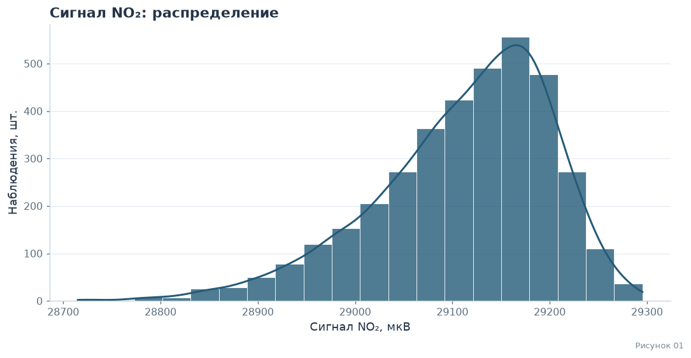

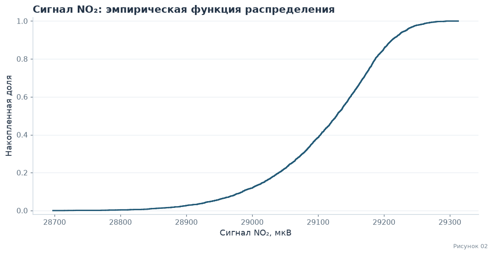

<div class="lab-result" style="white-space:pre-wrap;font-family:inherit;line-height:1.6">Объём, наблюдений: 3686<br>
Сумма: 107306226.23449999<br>
Среднее: 29111.835657759086<br>
Медиана: 29128.038145<br>
Минимум: 28715.0<br>
Максимум: 29295.28125<br>
Стандартное отклонение (ddof=1): 90.41962706444696<br>
95-й перцентиль: 29233.165215<br>
Выборочная дисперсия (ddof=1): 8175.708958473668<br>
Мода / все равноправные моды: 29126.09375 (частота каждого: 4)<br>
Выборочная асимметрия: -0.8395323848361863<br>
</div>

<a id="no2-model" name="no2-model" class="lab-anchor"></a>

#### 2.2.1 · Математическая база распределения

Для описания асимметричной формы рассматривается семейство skew-normal:

```math
f(x)=\frac{2}{\omega}\phi\!\left(\frac{x-\xi}{\omega}\right)\Phi\!\left(\alpha\frac{x-\xi}{\omega}\right),\quad x\in\mathbb R,\quad\omega>0.
```

Здесь $\phi$ и $\Phi$ — плотность и функция стандартного нормального распределения; $\xi$ — сдвиг, $\omega$ — масштаб, $\alpha$ — параметр формы. При $\alpha=0$ получается нормальный закон. Параметр $\xi$ в общем случае не равен математическому ожиданию. Семейство — описательная аппроксимация, а не установленный физический закон. Наличие множества факторов само по себе не доказывает нормальность: центральная предельная теорема требует условий для сумм случайных величин.

Параметры оцениваются максимальным правдоподобием. Сравнение AIC проводится на одних и тех же наблюдениях: $AIC=2k-2\sum_i\log f(x_i;\widehat\theta)$; меньший AIC предпочтителен **среди сравниваемых моделей**, но не доказывает абсолютную правильность модели.

В наблюдаемом сигнале NO₂ левый хвост выражен сильнее; это описывается знаком выборочной асимметрии. Направление хвоста электрического сигнала не переносится напрямую на концентрацию газа без модели калибровки. Для сопоставления приведены normal, skew-normal и отражённая гамма-модель $X=b-\theta G$, где $G\sim\Gamma(a,1)$, $a>0$, $\theta>0$, $x<b$:

```math
f_X(x)=\frac{(b-x)^{a-1}\exp[-(b-x)/\theta]}{\Gamma(a)\theta^a},\quad x<b.
```

В таблице параметры normal записаны как $(\mu,\sigma)$, skew-normal — $(\alpha,\xi,\omega)$, отражённой gamma — $(a,b,\theta)$. В данном наборе наименьший AIC среди этих кандидатов у skew-normal; отражённая gamma несколько уступает ей по AIC. Сравнение не требует объявлять одну из моделей истинной. В интерактивном генераторе используется отражённая гамма-аппроксимация; её выбор является отдельным допущением генератора.


<a id="no2-test" name="no2-test" class="lab-anchor"></a>

#### 2.2.2 · Проверка гипотезы нормальности

$H_0$: одномерное распределение нормально; $H_1$: оно отличается от нормального. Уровень значимости $\alpha=0{,}05$. Применяется критерий Д’Агостино—Пирсона (`normaltest`), объединяющий информацию об асимметрии и эксцессе.

В **iid-модели** предполагаются независимые одинаково распределённые наблюдения. Приведённый p-value рассчитан именно в этой модели. В почасовом временном ряду наблюдения зависимы и объединены разные условия, поэтому это учебная модельная проверка, а не достоверная оценка вероятности для всего физического процесса. Отклонение нормальности не доказывает асимметрию, конкретное семейство распределений или причину отклонения. Параметры подогнанных моделей и AIC ниже описывают приближения к наблюдаемому набору.


<div class="lab-result" style="white-space:pre-wrap;font-family:inherit;line-height:1.6">Размер набора: 3686; уровень значимости: 0.05<br>
Статистика Д’Агостино—Пирсона: 377.24614043412896<br>
p-value в iid-модели: 1.2079291032735805e-82<br>
В iid-модели H₀ нормальности отвергается.<br>
Почасовая зависимость не учтена этим p-value; это не доказательство асимметрии или причин отклонения.<br>
</div>

<a id="research-table04" name="research-table04"></a>

**Таблица 04 · Сигнал NO₂: параметры моделей и AIC**

<div class="lab-table-wrap"><div>

<table border="1" class="dataframe lab-table">
<thead>
<tr style="text-align: right;">
<th></th>
<th>Канал</th>
<th>Модель</th>
<th>Параметры</th>
<th>AIC</th>
</tr>
</thead>
<tbody>
<tr>
<th>0</th>
<td>ASE_NO2</td>
<td>skew-normal</td>
<td>(-4.1159234695617295, 29221.747652407998, 142.31702062822416)</td>
<td>43156.376953</td>
</tr>
<tr>
<th>1</th>
<td>ASE_NO2</td>
<td>normal</td>
<td>(29111.835657759086, 90.40736095477044)</td>
<td>43670.303858</td>
</tr>
<tr>
<th>2</th>
<td>ASE_NO2</td>
<td>отражённая gamma</td>
<td>(5.452534958703689, 29322.206090339172, 38.582131451809865)</td>
<td>43174.760778</td>
</tr>
</tbody>
</table>
</div></div>

<a id="no2-normalization" name="no2-normalization" class="lab-anchor"></a>

#### 2.2.3 · Нормализация

<a id="fig03" name="fig03" class="lab-anchor"></a>

<div class="lab-caption">Рисунок 03: нормализация NO2</div>

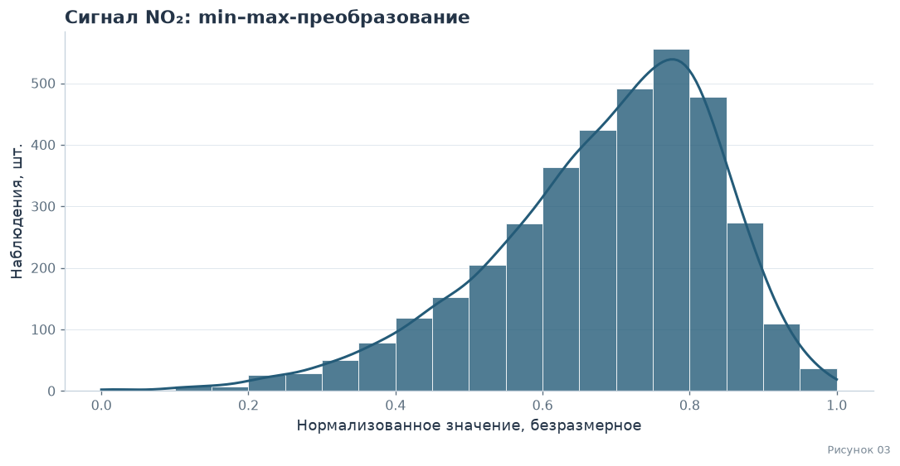

<div class="lab-result" style="white-space:pre-wrap;font-family:inherit;line-height:1.6">Минимум: 0.0<br>
Максимум: 1.0<br>
Среднее: 0.6838677930039768<br>
</div>

<a id="no2-estimates" name="no2-estimates" class="lab-anchor"></a>

### 2.3 · Independence & Estimations

Рассмотрим поведение среднего при росте префикса случайной перестановки конечного набора. Это эмпирическая иллюстрация устойчивости оценки среднего; независимость исходных часов такой перестановкой не проверяется.


<a id="fig04" name="fig04" class="lab-anchor"></a>

<div class="lab-caption">Рисунок 04: оценка среднего NO2</div>

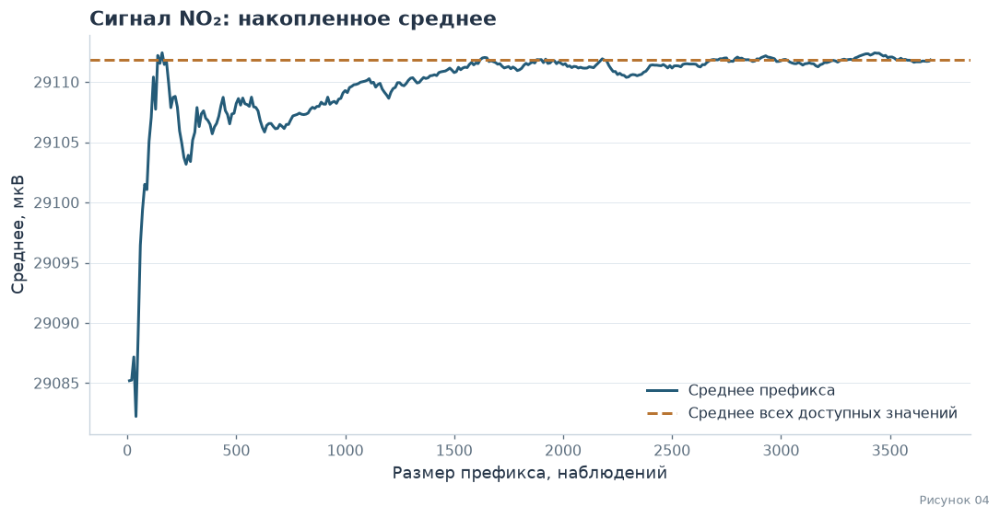

После одной случайной перестановки строк (`random_state=40`) среднее префикса приближается к среднему конечного набора. При размерах от 600 максимальное отклонение на показанном графике равно 5,982509 мкВ. Это эмпирическая иллюстрация устойчивости среднего в данном наборе, а не доказательство независимости исходных часов или универсальная гарантия точности для любого набора из 600 элементов.

Для сопоставления выбраны по 600 значений с возвращением и без него. В таблице приведены объём и все рассчитанные характеристики. Суммы наборов разной длины непосредственно не сравниваются как оценка качества выборки.


<a id="no2-samples" name="no2-samples" class="lab-anchor"></a>

#### 2.3.1 · Сравнение выборок

<a id="table02" name="table02" class="lab-anchor"></a>

**Таблица 05 · Сравнение выборок NO₂**

Объём измеряется в наблюдениях, характеристики значений — в мкВ, дисперсия — в (мкВ)².


<div class="lab-table-wrap"><div>

<table border="1" class="dataframe lab-table">
<thead>
<tr style="text-align: right;">
<th></th>
<th>Все доступные значения</th>
<th>600 без возвращения</th>
<th>600 с возвращением</th>
</tr>
</thead>
<tbody>
<tr>
<th>Объём, наблюдений</th>
<td>3686</td>
<td>600</td>
<td>600</td>
</tr>
<tr>
<th>Сумма</th>
<td>107306226.2345</td>
<td>17464566.20083</td>
<td>17466332.68454</td>
</tr>
<tr>
<th>Среднее</th>
<td>29111.835658</td>
<td>29107.610335</td>
<td>29110.554474</td>
</tr>
<tr>
<th>Медиана</th>
<td>29128.038145</td>
<td>29125.10938</td>
<td>29126.517465</td>
</tr>
<tr>
<th>Минимум</th>
<td>28715.0</td>
<td>28731.98438</td>
<td>28796.90257</td>
</tr>
<tr>
<th>Максимум</th>
<td>29295.28125</td>
<td>29294.5046</td>
<td>29275.98438</td>
</tr>
<tr>
<th>Стандартное отклонение (ddof=1)</th>
<td>90.419627</td>
<td>91.660152</td>
<td>87.874372</td>
</tr>
<tr>
<th>95-й перцентиль</th>
<td>29233.165215</td>
<td>29228.796919</td>
<td>29228.98438</td>
</tr>
<tr>
<th>Выборочная дисперсия (ddof=1)</th>
<td>8175.708958</td>
<td>8401.583415</td>
<td>7721.905335</td>
</tr>
<tr>
<th>Мода / все равноправные моды</th>
<td>29126.09375 (частота каждого: 4)</td>
<td>29061.375; 29108.875; 29129.6875; 29187.1875; 29224.09375 (частота каждого: 2)</td>
<td>29216.07813 (частота каждого: 4)</td>
</tr>
</tbody>
</table>
</div></div>

<a id="no2-conclusion" name="no2-conclusion" class="lab-anchor"></a>

**Вывод по сравнению выборок**

Среднее в выборке без возвращения отличается от среднего конечного набора на -0,0145%, с возвращением — на -0,0044%. Соответствующие отличия выборочной дисперсии: 2,763% и -5,551%. Разные показатели могут быть ближе в разных выборках, поэтому общего превосходства одного подхода этот единственный опыт не устанавливает.

Дублирование строк при выборе с возвращением само по себе не объясняет направление изменения дисперсии. Экстремумы и эмпирические моды чувствительны к составу выборки. Если все значения уникальны, выделенная мода отсутствует; при совпадении максимальных частот перечислены все равноправные моды.

Размер 600 даёт показанное описательное приближение к данным этого файла. Вывод не переносится автоматически на будущие часы, другие площадки или откалиброванные концентрации газов. Использованные $s^2$ и $s$ имеют делитель $n-1$; это выборочные характеристики, а не дисперсия конечной эмпирической совокупности с делителем $N$.


<p class="lab-native-navigation"><a href="#data">← Исходные данные</a> · <a href="#contents">↑ Оглавление</a> · <a href="#rv-temp">Температура →</a></p>

<a id="rv-temp" name="rv-temp" class="lab-anchor"></a>

## 3 · Random Variable 02: Температура внутри узла (ASE_T)


<a id="temp-description" name="temp-description" class="lab-anchor"></a>

### 3.1 · Description

Случайная величина — температура внутри узла (`ASE_T`), измеряемая в °C. В эмпирическом опыте равновероятно выбирается один из доступных для канала часов наблюдения. Это температура внутри корпуса узла, а не наружного воздуха. На неё могут влиять внешние условия и работа самого устройства.

По названию канала и времени нельзя однозначно вычислить ещё не наблюдавшееся показание: конкретное значение зависит от состояния среды и измерительной системы. После измерения число уже известно, но случайным остаётся выбор наблюдения из конечного набора. Такая модель не требует утверждать, что физический процесс принципиально не может иметь детерминированного описания.


<a id="temp-eda" name="temp-eda" class="lab-anchor"></a>

### 3.2 · EDA & Distribution

<a id="fig05" name="fig05" class="lab-anchor"></a>

<div class="lab-caption">Рисунки 05–06: распределение и функция распределения температуры</div>

<div class="lab-result" style="white-space:pre-wrap;font-family:inherit;line-height:1.6">Всего строк: 3739; доступных значений: 3736; пропусков: 3<br>
</div>

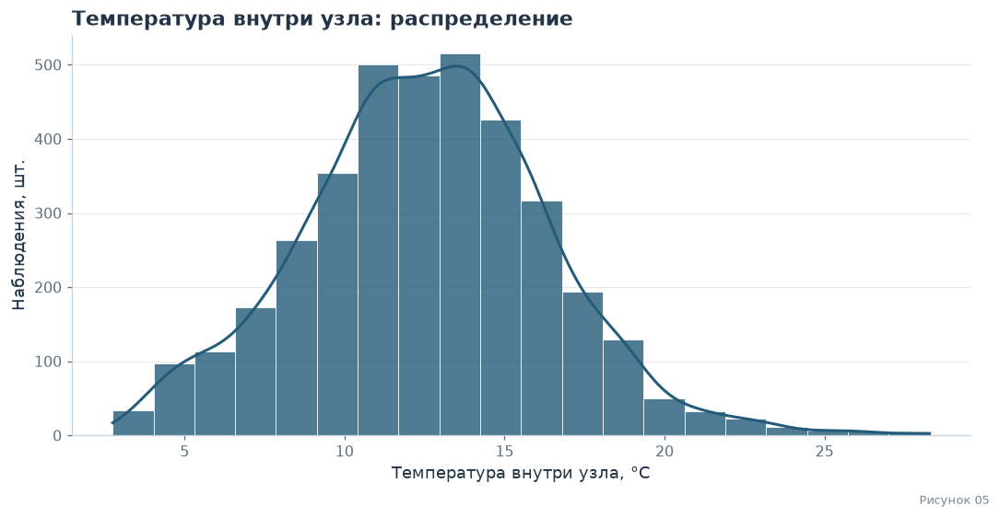

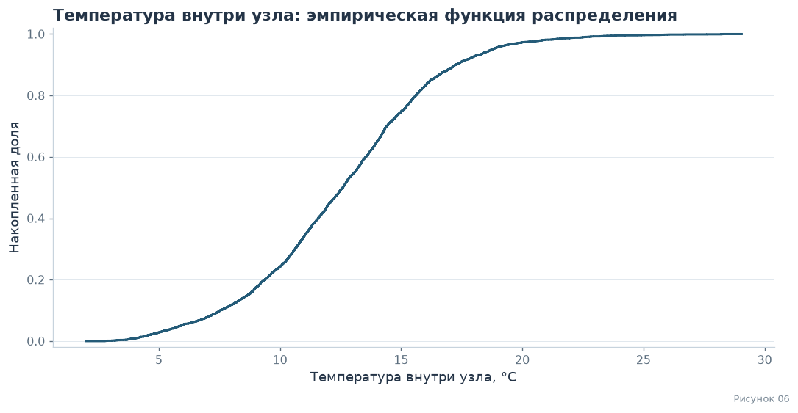

<div class="lab-result" style="white-space:pre-wrap;font-family:inherit;line-height:1.6">Объём, наблюдений: 3736<br>
Сумма: 46886.3627801<br>
Среднее: 12.549882971118842<br>
Медиана: 12.594052795<br>
Минимум: 2.752066326<br>
Максимум: 28.28757534<br>
Стандартное отклонение (ddof=1): 3.842404111246628<br>
95-й перцентиль: 18.747636445<br>
Выборочная дисперсия (ddof=1): 14.76406935412499<br>
Мода / все равноправные моды: 8.736985326; 9.103087409; 10.36312657; 10.399087; 10.99697363; 11.32702627; 12.15807711; 12.24437324; 12.85387579; 12.8986483; 13.17707459; 13.22166908; 13.31134763; 13.88181888; 14.45709672; 15.89088528; 16.36909667 (частота каждого: 2)<br>
Выборочная асимметрия: 0.17137612381506717<br>
</div>

<a id="temp-model" name="temp-model" class="lab-anchor"></a>

#### 3.2.1 · Математическая база распределения

Для описания асимметричной формы рассматривается семейство skew-normal:

```math
f(x)=\frac{2}{\omega}\phi\!\left(\frac{x-\xi}{\omega}\right)\Phi\!\left(\alpha\frac{x-\xi}{\omega}\right),\quad x\in\mathbb R,\quad\omega>0.
```

Здесь $\phi$ и $\Phi$ — плотность и функция стандартного нормального распределения; $\xi$ — сдвиг, $\omega$ — масштаб, $\alpha$ — параметр формы. При $\alpha=0$ получается нормальный закон. Параметр $\xi$ в общем случае не равен математическому ожиданию. Семейство — описательная аппроксимация, а не установленный физический закон. Наличие множества факторов само по себе не доказывает нормальность: центральная предельная теорема требует условий для сумм случайных величин.

Параметры оцениваются максимальным правдоподобием. Сравнение AIC проводится на одних и тех же наблюдениях: $AIC=2k-2\sum_i\log f(x_i;\widehat\theta)$; меньший AIC предпочтителен **среди сравниваемых моделей**, но не доказывает абсолютную правильность модели.

Для температуры внутри узла сравниваются normal и skew-normal. Распределение объединяет разные часы, сезоны и места установки. Небольшая асимметрия или несколько особенностей гистограммы не устанавливают ни конкретную причину, ни точный теоретический закон. Таблица параметров и AIC характеризует только выбранные аппроксимации. Порядок параметров normal — $(\mu,\sigma)$, skew-normal — $(\alpha,\xi,\omega)$.


<a id="temp-test" name="temp-test" class="lab-anchor"></a>

#### 3.2.2 · Проверка гипотезы нормальности

$H_0$: одномерное распределение нормально; $H_1$: оно отличается от нормального. Уровень значимости $\alpha=0{,}05$. Применяется критерий Д’Агостино—Пирсона (`normaltest`), объединяющий информацию об асимметрии и эксцессе.

В **iid-модели** предполагаются независимые одинаково распределённые наблюдения. Приведённый p-value рассчитан именно в этой модели. В почасовом временном ряду наблюдения зависимы и объединены разные условия, поэтому это учебная модельная проверка, а не достоверная оценка вероятности для всего физического процесса. Отклонение нормальности не доказывает асимметрию, конкретное семейство распределений или причину отклонения. Параметры подогнанных моделей и AIC ниже описывают приближения к наблюдаемому набору.


<div class="lab-result" style="white-space:pre-wrap;font-family:inherit;line-height:1.6">Размер набора: 3736; уровень значимости: 0.05<br>
Статистика Д’Агостино—Пирсона: 33.48183282258027<br>
p-value в iid-модели: 5.3642916338179505e-08<br>
В iid-модели H₀ нормальности отвергается.<br>
Почасовая зависимость не учтена этим p-value; это не доказательство асимметрии или причин отклонения.<br>
</div>

<a id="research-table06" name="research-table06"></a>

**Таблица 06 · Температура внутри узла: параметры моделей и AIC**

<div class="lab-table-wrap"><div>

<table border="1" class="dataframe lab-table">
<thead>
<tr style="text-align: right;">
<th></th>
<th>Канал</th>
<th>Модель</th>
<th>Параметры</th>
<th>AIC</th>
</tr>
</thead>
<tbody>
<tr>
<th>0</th>
<td>ASE_T</td>
<td>skew-normal</td>
<td>(0.9898097708155891, 9.94750537582907, 4.64031287219123)</td>
<td>20649.944699</td>
</tr>
<tr>
<th>1</th>
<td>ASE_T</td>
<td>normal</td>
<td>(12.549882971118842, 3.8418898364519474)</td>
<td>20663.354646</td>
</tr>
</tbody>
</table>
</div></div>

<a id="temp-normalization" name="temp-normalization" class="lab-anchor"></a>

#### 3.2.3 · Нормализация

<a id="fig07" name="fig07" class="lab-anchor"></a>

<div class="lab-caption">Рисунок 07: нормализация температуры</div>

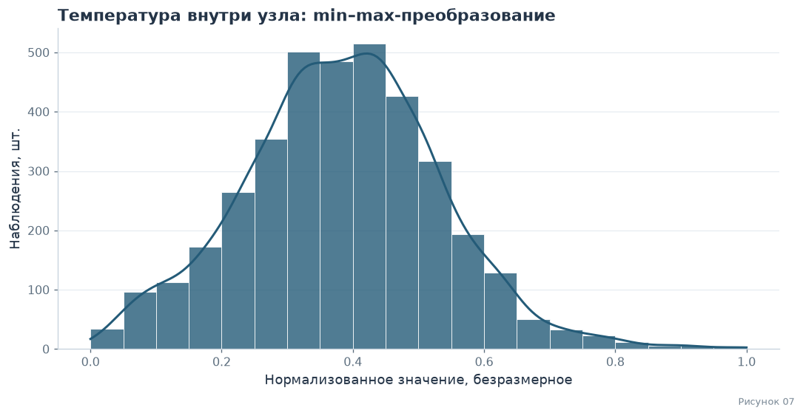

<div class="lab-result" style="white-space:pre-wrap;font-family:inherit;line-height:1.6">Минимум: 0.0<br>
Максимум: 1.0<br>
Среднее: 0.38369380613275145<br>
</div>

<a id="temp-estimates" name="temp-estimates" class="lab-anchor"></a>

### 3.3 · Independence & Estimations

Рассмотрим поведение среднего при росте префикса случайной перестановки конечного набора. Это эмпирическая иллюстрация устойчивости оценки среднего; независимость исходных часов такой перестановкой не проверяется.


<a id="fig08" name="fig08" class="lab-anchor"></a>

<div class="lab-caption">Рисунок 08: оценка среднего температуры</div>

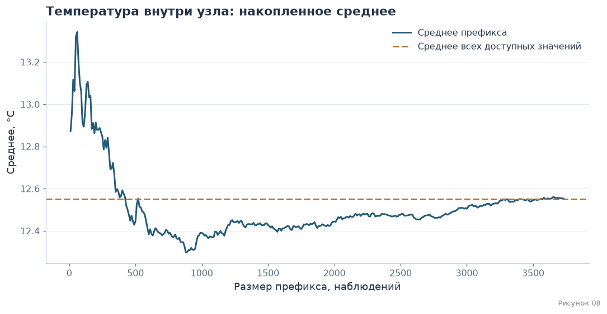

После одной случайной перестановки строк (`random_state=40`) среднее префикса приближается к среднему конечного набора. При размерах от 600 максимальное отклонение на показанном графике равно 0,251882 °C. Это эмпирическая иллюстрация устойчивости среднего в данном наборе, а не доказательство независимости исходных часов или универсальная гарантия точности для любого набора из 600 элементов.

Для сопоставления выбраны по 600 значений с возвращением и без него. В таблице приведены объём и все рассчитанные характеристики. Суммы наборов разной длины непосредственно не сравниваются как оценка качества выборки.


<a id="temp-samples" name="temp-samples" class="lab-anchor"></a>

#### 3.3.1 · Сравнение выборок

<a id="table03" name="table03" class="lab-anchor"></a>

**Таблица 07 · Сравнение выборок температуры внутри узла**

Объём измеряется в наблюдениях, характеристики значений — в °C, дисперсия — в (°C)².


<div class="lab-table-wrap"><div>

<table border="1" class="dataframe lab-table">
<thead>
<tr style="text-align: right;">
<th></th>
<th>Все доступные значения</th>
<th>600 без возвращения</th>
<th>600 с возвращением</th>
</tr>
</thead>
<tbody>
<tr>
<th>Объём, наблюдений</th>
<td>3736</td>
<td>600</td>
<td>600</td>
</tr>
<tr>
<th>Сумма</th>
<td>46886.36278</td>
<td>7430.257399</td>
<td>7604.712319</td>
</tr>
<tr>
<th>Среднее</th>
<td>12.549883</td>
<td>12.383762</td>
<td>12.674521</td>
</tr>
<tr>
<th>Медиана</th>
<td>12.594053</td>
<td>12.568173</td>
<td>12.834649</td>
</tr>
<tr>
<th>Минимум</th>
<td>2.752066</td>
<td>3.220754</td>
<td>2.752066</td>
</tr>
<tr>
<th>Максимум</th>
<td>28.287575</td>
<td>26.63709</td>
<td>25.848898</td>
</tr>
<tr>
<th>Стандартное отклонение (ddof=1)</th>
<td>3.842404</td>
<td>3.698433</td>
<td>3.76488</td>
</tr>
<tr>
<th>95-й перцентиль</th>
<td>18.747636</td>
<td>18.123621</td>
<td>18.818729</td>
</tr>
<tr>
<th>Выборочная дисперсия (ddof=1)</th>
<td>14.764069</td>
<td>13.678408</td>
<td>14.174325</td>
</tr>
<tr>
<th>Мода / все равноправные моды</th>
<td>8.736985326; 9.103087409; 10.36312657; 10.399087; 10.99697363; 11.32702627; 12.15807711; 12.24437324; 12.85387579; 12.8986483; 13.17707459; 13.22166908; 13.31134763; 13.88181888; 14.45709672; 15.89088528; 16.36909667 (частота каждого: 2)</td>
<td>Нет выделенной моды: все значения уникальны</td>
<td>13.0439587 (частота каждого: 4)</td>
</tr>
</tbody>
</table>
</div></div>

<a id="temp-conclusion" name="temp-conclusion" class="lab-anchor"></a>

**Вывод по сравнению выборок**

Среднее в выборке без возвращения отличается от среднего конечного набора на -0,1661 °C, с возвращением — на 0,1246 °C. Для температуры разность указана в °C: процент от среднего по шкале Цельсия зависит от выбора нуля шкалы. Соответствующие отличия выборочной дисперсии: -7,353% и -3,994%. Разные показатели могут быть ближе в разных выборках, поэтому общего превосходства одного подхода этот единственный опыт не устанавливает.

Дублирование строк при выборе с возвращением само по себе не объясняет направление изменения дисперсии. Экстремумы и эмпирические моды чувствительны к составу выборки. Если все значения уникальны, выделенная мода отсутствует; при совпадении максимальных частот перечислены все равноправные моды.

Размер 600 даёт показанное описательное приближение к данным этого файла. Вывод не переносится автоматически на будущие часы, другие площадки или откалиброванные концентрации газов. Использованные $s^2$ и $s$ имеют делитель $n-1$; это выборочные характеристики, а не дисперсия конечной эмпирической совокупности с делителем $N$.


<p class="lab-native-navigation"><a href="#rv-no2">← NO2</a> · <a href="#contents">↑ Оглавление</a> · <a href="#dependence">Зависимость →</a></p>

<a id="dependence" name="dependence" class="lab-anchor"></a>

## 4 · Совместная связь трёх каналов

Рассматривается конечная совместная совокупность часов, в которых доступны все три канала. Случайный опыт — равновероятный выбор одной из этих строк. Для каждой пары вычисляется ковариация **эмпирического распределения** с делителем $N$:

```math
Cov_N(X,Y)=\frac1N\sum_{i=1}^N(x_i-\bar x)(y_i-\bar y).
```

Независимость влечёт нулевую ковариацию при конечных вторых моментах. Следовательно, ненулевая ковариация устанавливает зависимость **в определённом конечном эмпирическом распределении**. Обратное неверно: нулевая корреляция не доказывает независимость. Для этого описания полного набора не требуется считать соседние часы независимой выборкой.

Pearson характеризует линейную связь, Spearman — ранговую. Коэффициенты рассчитаны по всем полным строкам и отдельно по площадкам. Для переноса на будущий процесс понадобятся дополнительные предпосылки о времени, сезонности и способе наблюдения. В этом разделе p-value для такого переноса не заявляется; причинность по корреляциям не устанавливается.


<a id="dependence-test" name="dependence-test" class="lab-anchor"></a>

### 4.1 · Ковариации и коэффициенты

<a id="research-table08" name="research-table08"></a>

**Таблица 08 · Все три пары и обе площадки.** Число N относится к полным строкам совместного набора, а не ко всем доступным значениям каждого канала по отдельности.


<div class="lab-table-wrap"><div>

<table border="1" class="dataframe lab-table">
<thead>
<tr style="text-align: right;">
<th></th>
<th>Набор</th>
<th>Пара</th>
<th>Единица Cov_N</th>
<th>N</th>
<th>Cov_N</th>
<th>Pearson r</th>
<th>Spearman ρ</th>
</tr>
</thead>
<tbody>
<tr>
<th>0</th>
<td>Обе площадки</td>
<td>ASE_T — ASE_NO2</td>
<td>°C × мкВ</td>
<td>3636</td>
<td>-77.929387</td>
<td>-0.228946</td>
<td>-0.239138</td>
</tr>
<tr>
<th>1</th>
<td>Обе площадки</td>
<td>ASE_NO2 — ASE_CO</td>
<td>мкВ × мкВ</td>
<td>3636</td>
<td>-27340.342889</td>
<td>-0.603522</td>
<td>-0.618372</td>
</tr>
<tr>
<th>2</th>
<td>Обе площадки</td>
<td>ASE_T — ASE_CO</td>
<td>°C × мкВ</td>
<td>3636</td>
<td>-490.775576</td>
<td>-0.260881</td>
<td>-0.262846</td>
</tr>
<tr>
<th>3</th>
<td>QDP</td>
<td>ASE_T — ASE_NO2</td>
<td>°C × мкВ</td>
<td>1216</td>
<td>-106.840938</td>
<td>-0.390368</td>
<td>-0.389787</td>
</tr>
<tr>
<th>4</th>
<td>QDP</td>
<td>ASE_NO2 — ASE_CO</td>
<td>мкВ × мкВ</td>
<td>1216</td>
<td>-23392.597175</td>
<td>-0.628903</td>
<td>-0.660410</td>
</tr>
<tr>
<th>5</th>
<td>QDP</td>
<td>ASE_T — ASE_CO</td>
<td>°C × мкВ</td>
<td>1216</td>
<td>-335.554607</td>
<td>-0.198408</td>
<td>-0.158199</td>
</tr>
<tr>
<th>6</th>
<td>SUD3</td>
<td>ASE_T — ASE_NO2</td>
<td>°C × мкВ</td>
<td>2420</td>
<td>-56.383533</td>
<td>-0.155191</td>
<td>-0.169290</td>
</tr>
<tr>
<th>7</th>
<td>SUD3</td>
<td>ASE_NO2 — ASE_CO</td>
<td>мкВ × мкВ</td>
<td>2420</td>
<td>-29717.165760</td>
<td>-0.608708</td>
<td>-0.616438</td>
</tr>
<tr>
<th>8</th>
<td>SUD3</td>
<td>ASE_T — ASE_CO</td>
<td>°C × мкВ</td>
<td>2420</td>
<td>-531.668255</td>
<td>-0.276259</td>
<td>-0.284840</td>
</tr>
</tbody>
</table>
</div></div>

<div class="lab-result" style="white-space:pre-wrap;font-family:inherit;line-height:1.6">Полных совместных часов: 3636<br>
Ненулевые Cov_N означают зависимость в эмпирическом распределении равновероятно выбранного полного часа.<br>
</div>

<a id="dependence-plots" name="dependence-plots" class="lab-anchor"></a>

### 4.2 · Визуализация зависимости

<a id="fig09" name="fig09" class="lab-anchor"></a>

<div class="lab-caption">Рисунок 09: зависимость NO2 от температуры</div>

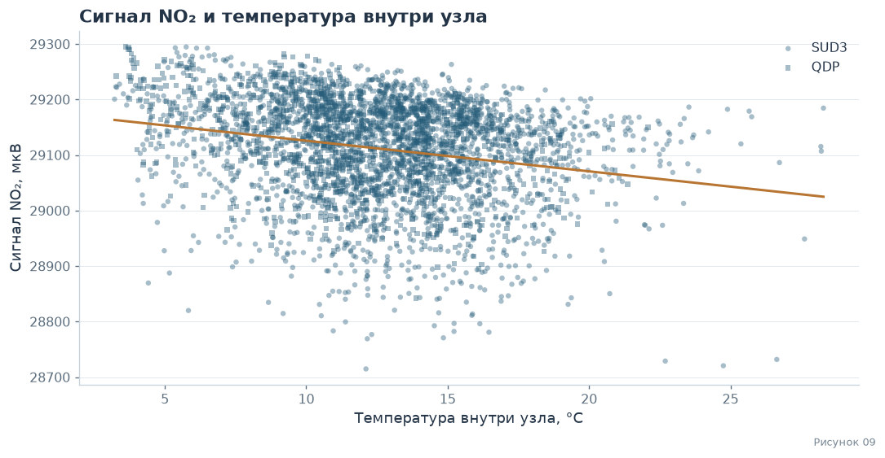

<a id="fig10" name="fig10" class="lab-anchor"></a>

<div class="lab-caption">Рисунок 10: матрица корреляции</div>

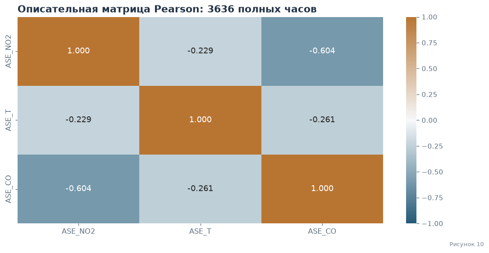

<a id="dependence-conclusion" name="dependence-conclusion" class="lab-anchor"></a>

### 4.3 · Вывод по совместной связи

- ASE_T — ASE_NO2: Pearson -0,2289, Spearman -0,2391; $Cov_N=-77,929387$ °C × мкВ.
- ASE_NO2 — ASE_CO: Pearson -0,6035, Spearman -0,6184; $Cov_N=-27340,342889$ мкВ × мкВ.
- ASE_T — ASE_CO: Pearson -0,2609, Spearman -0,2628; $Cov_N=-490,775576$ °C × мкВ.

Ковариации всех трёх пар ненулевые, поэтому в выбранном эмпирическом распределении есть зависимость, в том числе между двумя газовыми каналами NO₂ и CO. Знак и величина связи по площадкам могут различаться; объединённый коэффициент смешивает эти условия. Линия тренда описывает данные и не доказывает влияние температуры на концентрацию газа.

Температура измеряется внутри узла, газовые каналы не откалиброваны в концентрации. Поэтому отсюда нельзя вывести, что холод, прогрев автомобилей или направление химического отклика вызвали обнаруженную связь. Почасовая зависимость, смена места установки и сезонность ограничивают обобщение. [Связь CO с остальными каналами показана на рисунке 16](#fig16).


<p class="lab-native-navigation"><a href="#rv-temp">← Температура</a> · <a href="#contents">↑ Оглавление</a> · <a href="#rv-co">CO →</a></p>

<a id="rv-co" name="rv-co" class="lab-anchor"></a>

## 5 · Random Variable 03: Сигнал сенсора CO

<a id="co-description" name="co-description" class="lab-anchor"></a>

### 5.1 · Description

Случайная величина — сигнал co (`ASE_CO`), измеряемая в мкВ. В эмпирическом опыте равновероятно выбирается один из доступных для канала часов наблюдения. Это электрический сигнал электрохимического канала. Он зависит от состава среды, температурной чувствительности и шума измерительного тракта; без калибровки это не концентрация газа.

По названию канала и времени нельзя однозначно вычислить ещё не наблюдавшееся показание: конкретное значение зависит от состояния среды и измерительной системы. После измерения число уже известно, но случайным остаётся выбор наблюдения из конечного набора. Такая модель не требует утверждать, что физический процесс принципиально не может иметь детерминированного описания.


<a id="co-eda" name="co-eda" class="lab-anchor"></a>

### 5.2 · EDA & Distribution

<a id="fig11" name="fig11" class="lab-anchor"></a>

<div class="lab-caption">Рисунки 11–12: распределение и функция распределения CO</div>

<div class="lab-result" style="white-space:pre-wrap;font-family:inherit;line-height:1.6">Всего строк: 3739; доступных значений: 3686; пропусков: 53<br>
</div>

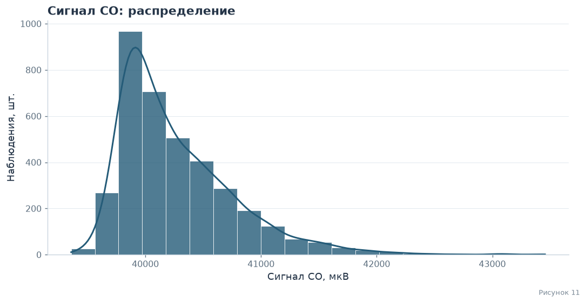

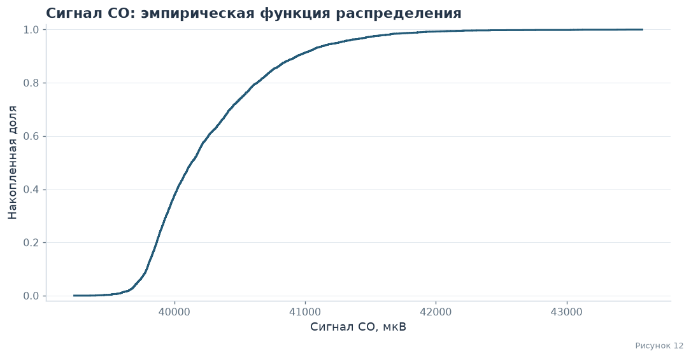

<div class="lab-result" style="white-space:pre-wrap;font-family:inherit;line-height:1.6">Объём, наблюдений: 3686<br>
Сумма: 148429693.67587<br>
Среднее: 40268.50072595497<br>
Медиана: 40132.16728<br>
Минимум: 39358.04688<br>
Максимум: 43455.98346<br>
Стандартное отклонение (ddof=1): 499.6717627929245<br>
95-й перцентиль: 41247.7557475<br>
Выборочная дисперсия (ddof=1): 249671.87053258857<br>
Мода / все равноправные моды: 39752.20313; 39762.34375; 39777.35938; 39789.40625; 39802.5; 39827.95313; 39863.10938; 39875.03125; 39890.90625; 39892.40625; 39898.5625; 39904.85938; 39906.3125; 39927.34375; 39940.375; 39946.60938; 39949.46875; 39951; 39957.10938; 39958.21875; 39958.70313; 39965.34375; 39978.64063; 40018.3125; 40030.26563; 40037.20313; 40050.92188; 40080.84375; 40147.78125; 40176.95313; 40190.45313; 40192.15625; 40217.25; 40272.84375; 40296.1875; 40323.1875; 40370.3125; 40380.9375; 40585.76563; 40638.45313; 40816.03125; 40937.42188; 40939.85938 (частота каждого: 2)<br>
Выборочная асимметрия: 1.4665060371674226<br>
</div>

<a id="co-model" name="co-model" class="lab-anchor"></a>

#### 5.2.1 · Математическая база распределения

Сигнал CO имеет выраженный правый хвост. Сравниваются skew-normal (плотность определена в §2.2.1) и сдвинутое логнормальное распределение:

```math
f(x)=\frac{1}{(x-\ell)s\sqrt{2\pi}}\exp\!\left[-\frac{\{\ln[(x-\ell)/q]\}^2}{2s^2}\right],\qquad x>\ell,\ s>0,\ q>0.
```

$\ell$ — сдвиг в мкВ, $q$ — масштаб в мкВ, $s$ — безразмерный параметр формы. Эквивалентно, $\ln[(X-\ell)/q]\sim N(0,s^2)$. Правый хвост делает эту модель кандидатом, но не доказывает её истинность и не объясняет физическую причину наблюдаемой асимметрии. Подгонка обеих моделей и сравнение AIC выполняются на одном наборе значений.


<a id="co-test" name="co-test" class="lab-anchor"></a>

#### 5.2.2 · Проверка гипотезы нормальности

$H_0$: одномерное распределение нормально; $H_1$: оно отличается от нормального. Уровень значимости $\alpha=0{,}05$. Применяется критерий Д’Агостино—Пирсона (`normaltest`), объединяющий информацию об асимметрии и эксцессе.

В **iid-модели** предполагаются независимые одинаково распределённые наблюдения. Приведённый p-value рассчитан именно в этой модели. В почасовом временном ряду наблюдения зависимы и объединены разные условия, поэтому это учебная модельная проверка, а не достоверная оценка вероятности для всего физического процесса. Отклонение нормальности не доказывает асимметрию, конкретное семейство распределений или причину отклонения. Параметры подогнанных моделей и AIC ниже описывают приближения к наблюдаемому набору.


<div class="lab-result" style="white-space:pre-wrap;font-family:inherit;line-height:1.6">Размер набора: 3686; уровень значимости: 0.05<br>
Статистика Д’Агостино—Пирсона: 1028.7669622714538<br>
p-value в iid-модели: 4.037314305072088e-224<br>
В iid-модели H₀ нормальности отвергается.<br>
Почасовая зависимость не учтена этим p-value; это не доказательство асимметрии или причин отклонения.<br>
</div>

<a id="co-fit" name="co-fit" class="lab-anchor"></a>

#### 5.2.3 · Сравнение теоретических распределений

<a id="fig13" name="fig13" class="lab-anchor"></a>

<div class="lab-caption">Рисунок 13: сравнение моделей CO</div>

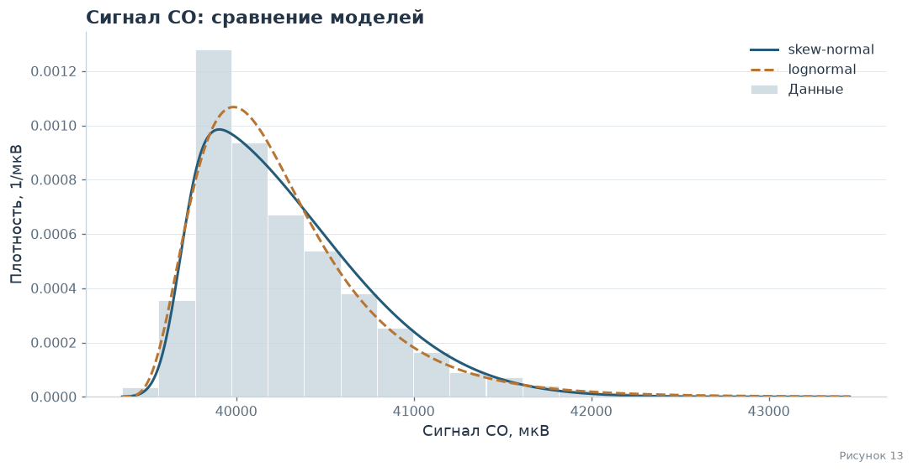

<a id="co-test-repeat" name="co-test-repeat" class="lab-anchor"></a>

#### 5.2.4 · Результат сравнения моделей

В таблице порядок параметров skew-normal — $(\alpha,\xi,\omega)$, lognormal — $(s,\ell,q)$. Обе модели имеют по три оцениваемых параметра.


<a id="research-table09" name="research-table09"></a>

**Таблица 09 · Сигнал CO: параметры моделей и AIC**

<div class="lab-table-wrap"><div>

<table border="1" class="dataframe lab-table">
<thead>
<tr style="text-align: right;">
<th></th>
<th>Канал</th>
<th>Модель</th>
<th>Параметры</th>
<th>AIC</th>
</tr>
</thead>
<tbody>
<tr>
<th>0</th>
<td>ASE_CO</td>
<td>skew-normal</td>
<td>(7.688484711774451, 39687.00571020467, 766.6423906587981)</td>
<td>54990.552815</td>
</tr>
<tr>
<th>1</th>
<td>ASE_CO</td>
<td>lognormal</td>
<td>(0.47402970689079993, 39280.47421925915, 881.9706358772311)</td>
<td>54961.399734</td>
</tr>
</tbody>
</table>
</div></div>

<div class="lab-result" style="white-space:pre-wrap;font-family:inherit;line-height:1.6">AIC lognormal меньше AIC skew-normal на 29.153081.<br>
По AIC среди этих двух кандидатов предпочтительна lognormal. Это не проверка абсолютного согласия модели.<br>
Логнормальная модель: s=0.474029707; сдвиг=39280.4742 мкВ; масштаб=881.970636 мкВ.<br>
</div>

<a id="co-normalization" name="co-normalization" class="lab-anchor"></a>

#### 5.2.5 · Нормализация

<a id="fig14" name="fig14" class="lab-anchor"></a>

<div class="lab-caption">Рисунок 14: нормализация CO</div>

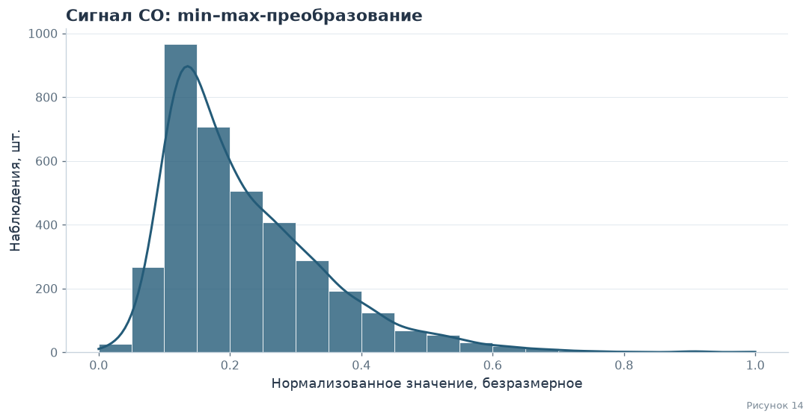

<div class="lab-result" style="white-space:pre-wrap;font-family:inherit;line-height:1.6">Минимум: 0.0<br>
Максимум: 1.0<br>
Среднее: 0.22217372772395697<br>
</div>

<a id="co-estimates" name="co-estimates" class="lab-anchor"></a>

### 5.3 · Independence & Estimations

Рассмотрим поведение среднего при росте префикса случайной перестановки конечного набора. Это эмпирическая иллюстрация устойчивости оценки среднего; независимость исходных часов такой перестановкой не проверяется.


<a id="fig15" name="fig15" class="lab-anchor"></a>

<div class="lab-caption">Рисунок 15: оценка среднего CO</div>

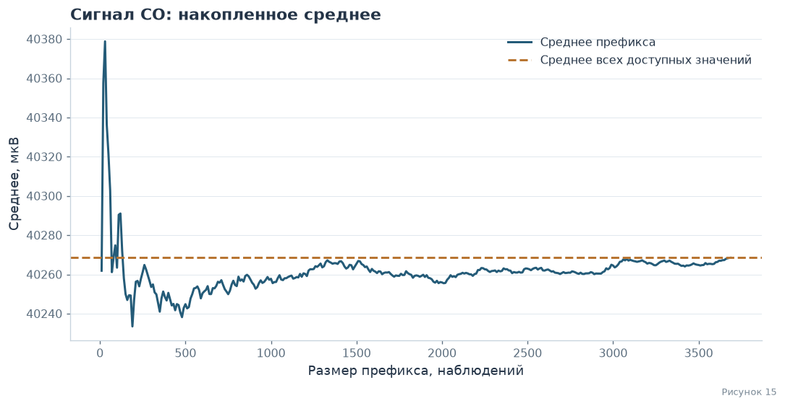

После одной случайной перестановки строк (`random_state=40`) среднее префикса приближается к среднему конечного набора. При размерах от 600 максимальное отклонение на показанном графике равно 18,589730 мкВ. Это эмпирическая иллюстрация устойчивости среднего в данном наборе, а не доказательство независимости исходных часов или универсальная гарантия точности для любого набора из 600 элементов.

Для сопоставления выбраны по 600 значений с возвращением и без него. В таблице приведены объём и все рассчитанные характеристики. Суммы наборов разной длины непосредственно не сравниваются как оценка качества выборки.


<a id="co-samples" name="co-samples" class="lab-anchor"></a>

#### 5.3.1 · Сравнение выборок

<a id="table04" name="table04" class="lab-anchor"></a>

**Таблица 10 · Сравнение выборок CO**

Объём измеряется в наблюдениях, характеристики значений — в мкВ, дисперсия — в (мкВ)².


<div class="lab-table-wrap"><div>

<table border="1" class="dataframe lab-table">
<thead>
<tr style="text-align: right;">
<th></th>
<th>Все доступные значения</th>
<th>600 без возвращения</th>
<th>600 с возвращением</th>
</tr>
</thead>
<tbody>
<tr>
<th>Объём, наблюдений</th>
<td>3686</td>
<td>600</td>
<td>600</td>
</tr>
<tr>
<th>Сумма</th>
<td>148429693.67587</td>
<td>24150222.60981</td>
<td>24170477.41736</td>
</tr>
<tr>
<th>Среднее</th>
<td>40268.500726</td>
<td>40250.371016</td>
<td>40284.129029</td>
</tr>
<tr>
<th>Медиана</th>
<td>40132.16728</td>
<td>40118.83272</td>
<td>40130.1682</td>
</tr>
<tr>
<th>Минимум</th>
<td>39358.04688</td>
<td>39426.10938</td>
<td>39416.85938</td>
</tr>
<tr>
<th>Максимум</th>
<td>43455.98346</td>
<td>42215.10938</td>
<td>43455.98346</td>
</tr>
<tr>
<th>Стандартное отклонение (ddof=1)</th>
<td>499.671763</td>
<td>492.588856</td>
<td>494.220135</td>
</tr>
<tr>
<th>95-й перцентиль</th>
<td>41247.755747</td>
<td>41234.115074</td>
<td>41255.534632</td>
</tr>
<tr>
<th>Выборочная дисперсия (ddof=1)</th>
<td>249671.870533</td>
<td>242643.781511</td>
<td>244253.54228</td>
</tr>
<tr>
<th>Мода / все равноправные моды</th>
<td>39752.20313; 39762.34375; 39777.35938; 39789.40625; 39802.5; 39827.95313; 39863.10938; 39875.03125; 39890.90625; 39892.40625; 39898.5625; 39904.85938; 39906.3125; 39927.34375; 39940.375; 39946.60938; 39949.46875; 39951; 39957.10938; 39958.21875; 39958.70313; 39965.34375; 39978.64063; 40018.3125; 40030.26563; 40037.20313; 40050.92188; 40080.84375; 40147.78125; 40176.95313; 40190.45313; 40192.15625; 40217.25; 40272.84375; 40296.1875; 40323.1875; 40370.3125; 40380.9375; 40585.76563; 40638.45313; 40816.03125; 40937.42188; 40939.85938 (частота каждого: 2)</td>
<td>Нет выделенной моды: все значения уникальны</td>
<td>39928.1057 (частота каждого: 4)</td>
</tr>
</tbody>
</table>
</div></div>

<a id="co-conclusion" name="co-conclusion" class="lab-anchor"></a>

**Вывод по сравнению выборок**

Среднее в выборке без возвращения отличается от среднего конечного набора на -0,0450%, с возвращением — на 0,0388%. Соответствующие отличия выборочной дисперсии: -2,815% и -2,170%. Разные показатели могут быть ближе в разных выборках, поэтому общего превосходства одного подхода этот единственный опыт не устанавливает.

Дублирование строк при выборе с возвращением само по себе не объясняет направление изменения дисперсии. Экстремумы и эмпирические моды чувствительны к составу выборки. Если все значения уникальны, выделенная мода отсутствует; при совпадении максимальных частот перечислены все равноправные моды.

Размер 600 даёт показанное описательное приближение к данным этого файла. Вывод не переносится автоматически на будущие часы, другие площадки или откалиброванные концентрации газов. Использованные $s^2$ и $s$ имеют делитель $n-1$; это выборочные характеристики, а не дисперсия конечной эмпирической совокупности с делителем $N$.


<a id="co-dependence" name="co-dependence" class="lab-anchor"></a>

### 5.4 · Связь CO с NO₂ и температурой внутри узла

Используется тот же совместный набор полных часов, что в разделе 4. Разные маркеры обозначают площадку. Газовые каналы показаны в мкВ, а не в единицах концентрации.

<a id="fig16" name="fig16" class="lab-anchor"></a>

**Рисунок 16 · CO и остальные каналы.**


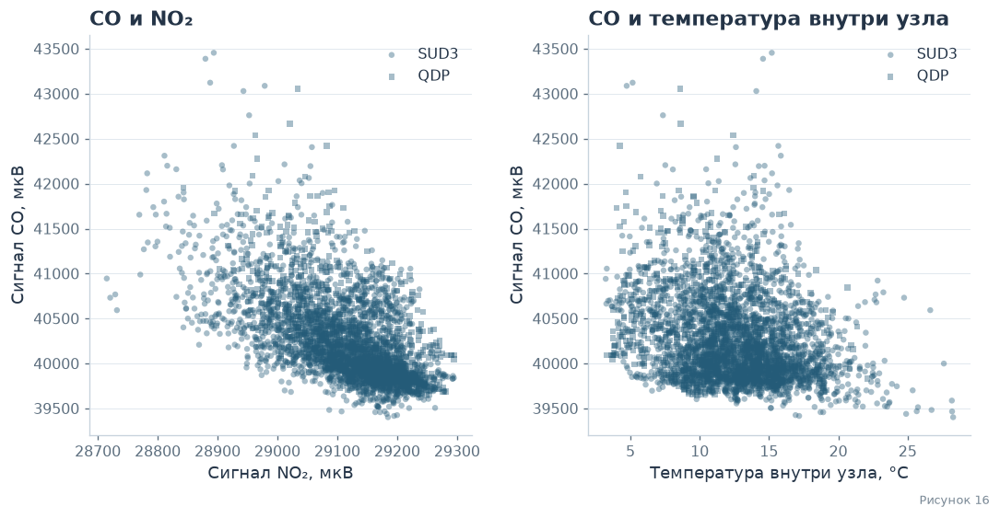

<p class="lab-native-navigation"><a href="#dependence">← Зависимость</a> · <a href="#contents">↑ Оглавление</a> · <a href="#resume">Итоги →</a></p>

<a id="resume" name="resume" class="lab-anchor"></a>

## 6 · Lab resume

Исследованы три величины: сырые сигналы NO₂ и CO в мкВ и температура внутри узла в °C. Для каждого канала определён опыт выбора доступного часа из файла, рассчитаны описательные статистики, построены гистограмма, точная ECDF без округления и min–max-преобразование.

Показано поведение среднего при росте префикса случайной перестановки. Две выборки по 600 элементов сравнивались с конечным набором значений; их различия не дают универсального преимущества выборке с возвращением или без него. Суммы учитывают разный объём, а все равноправные моды перечислены; для уникальных значений выделенной моды нет.

Normaltest даёт отклонение нормальности в учебной iid-модели всех трёх каналов. Это не доказывает асимметрию, точный закон или физическую причину: исходные часы зависимы и условия неоднородны. Skew-normal и отражённая gamma для NO₂, normal/skew-normal для температуры и lognormal/skew-normal для CO рассматриваются как описательные аппроксимации. Для CO меньший AIC у lognormal в сравнении двух заданных кандидатов.

На едином наборе полных часов рассчитаны ковариации и Pearson/Spearman всех трёх пар, в том числе NO₂–CO. Ненулевые Cov_N показывают зависимость в конечном эмпирическом распределении выбора часа. Различия по площадкам и связь соседних часов приведены явно. Из этих результатов не следуют причинные выводы или гарантии для будущих измерений, а электрические сигналы нельзя без калибровки подменять концентрациями газов.


<a id="criteria" name="criteria" class="lab-anchor"></a>

### 6.1 · cat_mark_table

| cat_id | notebook_link | coeff | comment |
|--------|-----------------|-------|---------| 
| lab.ic.01.01 | [Random Variable 01: Сигнал сенсора NO2](#rv-no2)  | 0,15 | |
| lab.ic.01.01 | [Random Variable 02: Температура внутри узла (ASE_T)](#rv-temp)  | 0,15 | |
| lab.ic.01.01 | [Random Variable 03: Сигнал сенсора CO](#rv-co)  | 0,15 | |
| lab.ic.01.02 | [Совместная связь трёх каналов](#dependence) | 0,06 | | 
| lab.ic.01.03 | Independence & Estimations: [NO2](#no2-estimates), [ASE_T](#temp-estimates), [CO](#co-estimates) | 0,05 | Отдельным заголовком для каждой величины |
| lab.ic.01.04 | EDA & Distribution: [NO2](#no2-eda), [ASE_T](#temp-eda), [CO](#co-eda) | 0,05 | Отдельным заголовком для каждой величины |
| lab.ic.01.05 | Нормализация: [NO2](#no2-normalization), [ASE_T](#temp-normalization), [CO](#co-normalization) | 0,05 | Для каждой величины подпункт с нормализацией |
| lab.ic.01.06 | Random variable [01](#rv-no2),[03](#rv-co) отличаются от [02](#rv-temp) | 0,1 | |
| lab.ic.01.07 | Математическая база распределения: [NO2](#no2-model), [ASE_T](#temp-model), [CO](#co-model) | 0,05 | Отдельным заголовком для каждой величины |
| lab.ic.01.09 | Independence & Estimations: [NO2](#no2-estimates), [ASE_T](#temp-estimates), [CO](#co-estimates) | 0,05 | |
| lab.ic.01.10 | Independence & Estimations: [NO2](#no2-estimates), [ASE_T](#temp-estimates), [CO](#co-estimates) | 0,05 | |
| lab.ic.01.11 | Проверка гипотезы нормальности: [NO2](#no2-test), [ASE_T](#temp-test), [CO](#co-test) | 0,05 | Подпункт с гипотезой для каждой величины |

<p class="lab-native-navigation"><a href="#rv-co">← CO</a> · <a href="#contents">↑ Оглавление</a></p>

<a id="sprint2" name="sprint2"></a>

# Lab01 - Sprint 2

## 7 · Генератор случайных чисел

Лабораторная работа № 1. Прикладная статистика.

[Description](#generator-description) · [Math desc](#generator-math) · [Code](#generator-code) · [Tests](#generator-tests) · [Resume](#generator-resume) · [Lab resume](#generator-lab-resume) · [cat_mark_table](#generator-criteria)

<a id="generator-description" name="generator-description"></a>

### 7.1 · Description

В основе генератора — случайная величина из первого спринта: ASE_NO2, усреднённый за час электрический сигнал электрохимического датчика NO₂ в **мкВ**. Это не концентрация NO₂ в мкг/м³. Источник — Bobbia M., Thulliez E., *Air quality low-cost sensors and monitoring stations NO2 raw dataset in Rouen (France)*, Mendeley Data, version 2, [DOI 10.17632/82dnstrd93.2](https://data.mendeley.com/datasets/82dnstrd93/2), CC BY 4.0. Взята колонка ASE_NO2 файла ASE10.csv. Исключены строки с пропуском ASE_NO2 (53); сохранено 3686 измерений без удаления крайних значений.

Цель — моделировать распределение одного показания и сравнить два способа получения одной и той же случайной величины. Временная зависимость часовых измерений не моделируется. Генерируемые числа не являются прогнозом концентрации или последовательности показаний датчика.

<a id="generator-math" name="generator-math"></a>

### 7.2 · Math desc

Наблюдаемая асимметрия отрицательна. Обычная гамма-модель с положительным масштабом имеет положительную асимметрию и плохо описывает левый хвост. Рассмотрены обычная и отражённая гамма-модели, нормальная и скошенная нормальная модели. Параметры оценены максимизацией логарифма правдоподобия; для отражённой гаммы дополнительно получены оценки методом моментов.

Выбрана учебная аппроксимация


```math
X=b-\theta G,\qquad G\sim\Gamma(a,1),\qquad a>1,\quad\theta>0.
```


Параметр a безразмерен; b и θ выражены в мкВ. Носитель — x≤b. Граница b относится к модели и не является установленным пределом измерительного прибора. Из замены переменной g=(b−x)/θ и якобиана 1/θ получаем


```math
f_X(x)=\frac{1}{\theta\Gamma(a)}\left(\frac{b-x}{\theta}\right)^{a-1}e^{-(b-x)/\theta},\quad x<b;
\qquad f_X(x)=0,\quad x\geq b.
```


Неравенство меняет направление при отражении:


```math
F_X(x)=\Pr\{G\geq(b-x)/\theta\}=1-F_G((b-x)/\theta),\quad x<b;
\qquad F_X(x)=1,\quad x\geq b.
```


В вычислениях используется survival function, чтобы не вычитать близкие к единице числа. Теоретические характеристики:


```math
\mathrm E X=b-a\theta,\quad \mathrm{Var}(X)=a\theta^2,\quad
\gamma_1(X)=-2/\sqrt a,\quad Q_X(p)=b-\theta Q_G(1-p).
```


Для оценивания MLE гамма-распределение подбирается к −X: его сдвиг равен −b. Для метода моментов используются эмпирические центральные моменты с делителем n:


```math
m_k=\frac1n\sum_i(x_i-\bar x)^k,\qquad
g_1=m_3/m_2^{3/2},\quad
\hat a_{MM}=4/g_1^2,\quad
\hat\theta_{MM}=\sqrt{m_2/\hat a_{MM}},\quad
\hat b_{MM}=\bar x+\hat a_{MM}\hat\theta_{MM}.
```


Оценки MLE: a=5,452535, b=29322,206090 мкВ, θ=38,582131 мкВ. Модель даёт среднее 29111,835670 мкВ, SD 90,091838 мкВ и асимметрию -0,856507. В данных: 29111,835658 мкВ, 90,419627 мкВ и -0,839532. Разность дисперсий модели и данных составляет -0,724%. Для отражённой гаммы D=0,020284, для скошенной нормальной D=0,013253; AIC соответственно 43174,761 и 43156,377.

Скошенная нормальная модель имеет меньшие AIC и расстояние D. Отражённая гамма выбрана для содержательного продолжения исследования алгоритмов А и GD, а не как победитель сравнения законов. Её близость по среднему, дисперсии и асимметрии оценивается количественно ниже. AIC и D здесь — описательные критерии на данных подгонки. D не превращается в стандартный KS p-value: параметры оценены по той же выборке, а исходные часовые наблюдения могут зависеть во времени.

<a id="generator-code" name="generator-code"></a>

### 7.3 · Code

**Алгоритм А.** Для a>1 берём два независимых U,V с равномерным распределением на (0,1). Предложение Коши и кандидат имеют вид


```math
Y=\tan(\pi U),\quad c=\sqrt{2a-1},\quad Z=a-1+cY.
```


При Z≤0 предложение отклоняется. Иначе принимаем Z, если


```math
V\leq(1+Y^2)\exp\left((a-1)\log\frac{Z}{a-1}-cY\right).
```


Это метод отбраковки из алгоритма А Кнута. Если h — плотность предложения, а M h≥f_G, то плотность принятых значений пропорциональна h(z)f_G(z)/(M h(z))=f_G(z)/M; после нормировки получается гамма-плотность. Указанное условие принятия — это отношение f_G/(M h) при


```math
M=\frac{\pi c(a-1)^{a-1}e^{-(a-1)}}{\Gamma(a)}.
```


**Алгоритм GD.** Используется полный метод Ahrens–Dieter: немедленное принятие, squeeze-проверка, проверка отношения плотностей и заключительное предложение из экспоненциальной оболочки. Полагаем s=√(a−1/2), а нормальное предложение T преобразуем в Z=(s+T/2)². При T≥0 кандидат принимается сразу. Для T<0 сначала применяем дешёвую squeeze-проверку, затем вычисляем логарифм отношения преобразованной гамма-плотности к нормальной.

Плотность преобразованной переменной и логарифмическая проверка основаны на


```math
g(t)=\frac{(s+t/2)^{2a-1}e^{-(s+t/2)^2}}{\Gamma(a)},\quad t>-2s,
```


```math
Q(t)=q_0-st+t^2/4+2s^2\log(1+t/(2s)),\quad
q_0=\log\frac{\sqrt{2\pi}\,s^{2a-1}e^{-s^2}}{\Gamma(a)}.
```


Если нормальное предложение не принято, оно заменяется предложением из двухсторонней экспоненциальной оболочки. Для E∼Exp(1), U∼U(−1,1) строится t=B+sign(U)SE. После проверки области t≥−0,71874483771719 и Q>0 используется условие


```math
C|U|\leq (e^{Q(t)}-1)e^{E-t^2/2}.
```


Константы B,S,C зависят от a; полиномиальные коэффициенты и три диапазона a приведены в коде по опубликованному GD. Этот шаг покрывает хвост, который нельзя получить простым повторением нормального предложения. После любого принятия возвращается Z=(s+t/2)². Для обоих алгоритмов только затем применяется X=b−θZ.

<a id="gen-table-11" name="gen-table-11"></a>

**Таблица 11 · Модели и оценки.** Для MLE приведён AIC=2k−2log L, где k — число оценённых параметров. Метод моментов показан отдельной строкой без AIC-сравнения. Меньший D означает меньшее максимальное расстояние между ECDF наблюдений и CDF модели.

<div>

<table border="1" class="dataframe">
<thead>
<tr style="text-align: right;">
<th></th>
<th>Модель</th>
<th>Параметры</th>
<th>Среднее, мкВ</th>
<th>SD, мкВ</th>
<th>Асимметрия</th>
<th>D</th>
<th>AIC</th>
</tr>
</thead>
<tbody>
<tr>
<th>0</th>
<td>Отражённая гамма, MLE</td>
<td>5.45253496, 29322.2061, 38.5821315</td>
<td>29111.835669817</td>
<td>90.091837689</td>
<td>-0.856506703</td>
<td>0.020284120</td>
<td>43174.760778</td>
</tr>
<tr>
<th>1</th>
<td>Отражённая гамма, моменты</td>
<td>5.67987351, 29327.2989, 37.9345084</td>
<td>29111.835657759</td>
<td>90.407360955</td>
<td>-0.839190703</td>
<td>0.020957685</td>
<td>—</td>
</tr>
<tr>
<th>2</th>
<td>Скошенная нормальная, MLE</td>
<td>-4.11592347, 29221.7477, 142.317021</td>
<td>29111.405111959</td>
<td>89.881355841</td>
<td>-0.794115222</td>
<td>0.013252783</td>
<td>43156.376953</td>
</tr>
<tr>
<th>3</th>
<td>Обычная гамма, MLE</td>
<td>202.40228, 27756.8728, 6.69607838</td>
<td>29112.174320465</td>
<td>95.263871837</td>
<td>0.140579597</td>
<td>0.079736528</td>
<td>43832.747661</td>
</tr>
<tr>
<th>4</th>
<td>Нормальная, MLE</td>
<td>29111.8357, 90.407361</td>
<td>29111.835657759</td>
<td>90.407360955</td>
<td>0.000000000</td>
<td>0.072856464</td>
<td>43670.303858</td>
</tr>
</tbody>
</table>
</div>

<a id="gen-figure-17" name="gen-figure-17"></a>

**Рисунок 17 · Сравнение моделей.** Показаны KDE и ECDF наблюдений, обычная гамма, отражённая гамма и скошенная нормальная. Сглаживание служит визуализации; расстояние D вычислено по несглаженным данным.

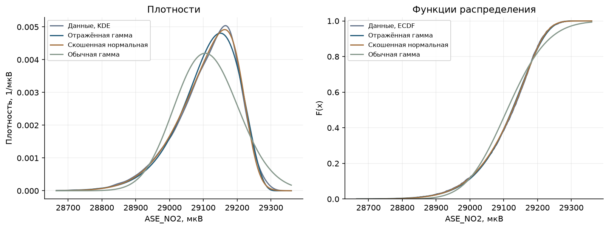

<a id="generator-tests" name="generator-tests"></a>

### 7.4 · Tests

<a id="gen-table-12" name="gen-table-12"></a>

**Таблица 12 · Данные, теория и генераторы.** Для А и GD взято N=3686, как у реальных данных; seed=40. Поэтому суммы сравнимы. Выборочная дисперсия и SD используют делитель n−1. Перечисляются все моды с наибольшей частотой; при уникальных значениях единственная эмпирическая мода отсутствует. Плотностная мода непрерывной модели и эмпирические моды имеют разный смысл. Верхняя граница b не является ожидаемым максимумом конечной выборки.

<div>

<table border="1" class="dataframe">
<thead>
<tr style="text-align: right;">
<th></th>
<th>Показатель</th>
<th>Данные</th>
<th>Модель</th>
<th>A</th>
<th>GD</th>
</tr>
</thead>
<tbody>
<tr>
<th>0</th>
<td>N</td>
<td>3686</td>
<td>3686</td>
<td>3686</td>
<td>3686</td>
</tr>
<tr>
<th>1</th>
<td>Сумма, мкВ</td>
<td>107306226</td>
<td>107306226</td>
<td>107309827</td>
<td>107311905</td>
</tr>
<tr>
<th>2</th>
<td>Среднее, мкВ</td>
<td>29111.8357</td>
<td>29111.8357</td>
<td>29112.8125</td>
<td>29113.3763</td>
</tr>
<tr>
<th>3</th>
<td>Медиана, мкВ</td>
<td>29128.0381</td>
<td>29124.5472</td>
<td>29124.4108</td>
<td>29124.4059</td>
</tr>
<tr>
<th>4</th>
<td>Стандартное отклонение, мкВ</td>
<td>90.4196271</td>
<td>90.0918377</td>
<td>88.26141</td>
<td>88.9734863</td>
</tr>
<tr>
<th>5</th>
<td>Дисперсия, мкВ²</td>
<td>8175.70896</td>
<td>8116.53922</td>
<td>7790.07649</td>
<td>7916.28127</td>
</tr>
<tr>
<th>6</th>
<td>Асимметрия</td>
<td>-0.839532385</td>
<td>-0.856506703</td>
<td>-0.788078307</td>
<td>-0.859434309</td>
</tr>
<tr>
<th>7</th>
<td>5-й процентиль, мкВ</td>
<td>28939.9492</td>
<td>28945.1421</td>
<td>28949.9414</td>
<td>28947.6183</td>
</tr>
<tr>
<th>8</th>
<td>95-й процентиль, мкВ</td>
<td>29233.1652</td>
<td>29235.1296</td>
<td>29235.1878</td>
<td>29234.2783</td>
</tr>
<tr>
<th>9</th>
<td>Минимум, мкВ</td>
<td>28715</td>
<td>—</td>
<td>28583.3947</td>
<td>28695.6058</td>
</tr>
<tr>
<th>10</th>
<td>Максимум, мкВ</td>
<td>29295.2812</td>
<td>Граница b = 29322.2061</td>
<td>29290.7865</td>
<td>29296.6125</td>
</tr>
<tr>
<th>11</th>
<td>Эмпирические моды, мкВ</td>
<td>29126.1</td>
<td>—</td>
<td>Нет повторов</td>
<td>Нет повторов</td>
</tr>
</tbody>
</table>
</div>

<a id="gen-table-13" name="gen-table-13"></a>

**Таблица 13 · Качество генерации.** D к модели сравнивает генератор с заданной CDF; D к данным сравнивает синтетическую и реальную выборки. Проверяется отсутствие значений выше b.

<div>

<table border="1" class="dataframe">
<thead>
<tr style="text-align: right;">
<th></th>
<th>D к модели</th>
<th>Асимметрия</th>
<th>Значений выше b</th>
<th>D к данным</th>
</tr>
</thead>
<tbody>
<tr>
<th>A</th>
<td>0.011845486</td>
<td>-0.788078307</td>
<td>0.0</td>
<td>0.020889853</td>
</tr>
<tr>
<th>GD</th>
<td>0.013902815</td>
<td>-0.859434309</td>
<td>0.0</td>
<td>0.019262073</td>
</tr>
</tbody>
</table>
</div>

<a id="gen-table-14" name="gen-table-14"></a>

**Таблица 14 · Расхождения и выборочная вариабельность.** Для фиксированных оценённых параметров сформированы 600 эталонных выборок того же объёма и получены 2,5%-й и 97,5%-й квантили каждой статистики. Это 95%-й диапазон выборочной вариабельности при заданной модели, а не доверительный интервал параметров и не проверка истинности подобранного закона. Числа генераторов не обязаны точно совпадать с теорией или исходной выборкой.

<div>

<table border="1" class="dataframe">
<thead>
<tr style="text-align: right;">
<th></th>
<th>Показатель</th>
<th>Данные</th>
<th>Модель</th>
<th>Данные − модель</th>
<th>95% нижняя</th>
<th>95% верхняя</th>
<th>A</th>
<th>GD</th>
</tr>
</thead>
<tbody>
<tr>
<th>0</th>
<td>Среднее, мкВ</td>
<td>29111.835657759</td>
<td>29111.835669817</td>
<td>-0.000012058</td>
<td>29108.729802267</td>
<td>29114.750531810</td>
<td>29112.812503667</td>
<td>29113.376316995</td>
</tr>
<tr>
<th>1</th>
<td>SD, мкВ</td>
<td>90.419627064</td>
<td>90.091837689</td>
<td>0.327789376</td>
<td>87.431099365</td>
<td>92.442298578</td>
<td>88.261409995</td>
<td>88.973486330</td>
</tr>
<tr>
<th>2</th>
<td>Дисперсия, мкВ²</td>
<td>8175.708958474</td>
<td>8116.539218164</td>
<td>59.169740310</td>
<td>7644.197141749</td>
<td>8545.578567217</td>
<td>7790.076494269</td>
<td>7916.281269761</td>
</tr>
<tr>
<th>3</th>
<td>Асимметрия</td>
<td>-0.839532385</td>
<td>-0.856506703</td>
<td>0.016974319</td>
<td>-0.987691336</td>
<td>-0.739958241</td>
<td>-0.788078307</td>
<td>-0.859434309</td>
</tr>
<tr>
<th>4</th>
<td>5-й процентиль, мкВ</td>
<td>28939.949220000</td>
<td>28945.142148207</td>
<td>-5.192928207</td>
<td>28935.909865295</td>
<td>28954.245200956</td>
<td>28949.941448512</td>
<td>28947.618321568</td>
</tr>
<tr>
<th>5</th>
<td>95-й процентиль, мкВ</td>
<td>29233.165215000</td>
<td>29235.129604911</td>
<td>-1.964389911</td>
<td>29231.869636430</td>
<td>29238.345905932</td>
<td>29235.187804126</td>
<td>29234.278309359</td>
</tr>
</tbody>
</table>
</div>

<a id="gen-table-15" name="gen-table-15"></a>

**Таблица 15 · Проверка закона генерации.** Проверка самих алгоритмов проводится отдельно от подгонки данных: восемь выборок по 40 000 значений, a∈{1,01;3;5,452535;200}. Проверяются положительность G, конечность чисел, среднее, дисперсия и CDF. Допуск среднего равен 6√(a/N); для дисперсии используется 6√((2a²+6a)/N). Для ECDF используется граница Дворецкого—Кифера—Вольфовица при δ=10⁻⁶ для каждой отдельной выборки:


```math
\varepsilon=\sqrt{\log(2/\delta)/(2N)},\qquad
\Pr\{\sup_x|\widehat F_N(x)-F(x)|>\varepsilon\}\leq\delta.
```


Одинаковые формулы допусков используются для каждой пары «алгоритм — a». При подстановке a,b,θ в отражение проверяются X≤b и обратимость CDF/квантилей; повторный seed должен повторять числа. Полный набор воспроизводимых проверок находится в [test_generator.py](https://github.com/EastC0ast/lab01/blob/design-layout/designer_generator/test_generator.py).

<div>

<table border="1" class="dataframe">
<thead>
<tr style="text-align: right;">
<th></th>
<th>Метод</th>
<th>a</th>
<th>N</th>
<th>D</th>
<th>Граница DKW</th>
<th>Ошибка среднего / допуск</th>
<th>Ошибка дисперсии / допуск</th>
<th>Вне поддержки</th>
</tr>
</thead>
<tbody>
<tr>
<th>0</th>
<td>A</td>
<td>1.010000000</td>
<td>40000</td>
<td>0.003242179</td>
<td>0.013466931</td>
<td>0.101856996</td>
<td>0.126207779</td>
<td>0</td>
</tr>
<tr>
<th>1</th>
<td>A</td>
<td>3.000000000</td>
<td>40000</td>
<td>0.004554989</td>
<td>0.013466931</td>
<td>0.181425406</td>
<td>0.174005304</td>
<td>0</td>
</tr>
<tr>
<th>2</th>
<td>A</td>
<td>5.452534959</td>
<td>40000</td>
<td>0.004421911</td>
<td>0.013466931</td>
<td>0.225637086</td>
<td>0.084740033</td>
<td>0</td>
</tr>
<tr>
<th>3</th>
<td>A</td>
<td>200.000000000</td>
<td>40000</td>
<td>0.007667715</td>
<td>0.013466931</td>
<td>0.324475467</td>
<td>0.103061715</td>
<td>0</td>
</tr>
<tr>
<th>4</th>
<td>GD</td>
<td>1.010000000</td>
<td>40000</td>
<td>0.004522342</td>
<td>0.013466931</td>
<td>0.188361556</td>
<td>0.053743281</td>
<td>0</td>
</tr>
<tr>
<th>5</th>
<td>GD</td>
<td>3.000000000</td>
<td>40000</td>
<td>0.005758394</td>
<td>0.013466931</td>
<td>0.357244905</td>
<td>0.185711013</td>
<td>0</td>
</tr>
<tr>
<th>6</th>
<td>GD</td>
<td>5.452534959</td>
<td>40000</td>
<td>0.004846514</td>
<td>0.013466931</td>
<td>0.170026737</td>
<td>0.084176723</td>
<td>0</td>
</tr>
<tr>
<th>7</th>
<td>GD</td>
<td>200.000000000</td>
<td>40000</td>
<td>0.005782911</td>
<td>0.013466931</td>
<td>0.283443194</td>
<td>0.157096298</td>
<td>0</td>
</tr>
</tbody>
</table>
</div>

<a id="gen-figure-18" name="gen-figure-18"></a>

**Рисунок 18 · Синтетические данные.** Для обеих выборок использованы одинаковые N и параметры модели. Сравнение с реальными данными и сравнение с теорией — разные задачи.

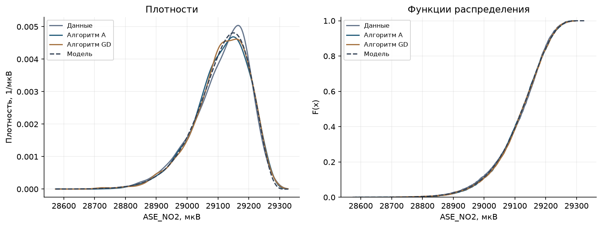

<a id="gen-figure-19" name="gen-figure-19"></a>

**Рисунок 19 · Выборочная вариабельность.** Полоса показывает 95%-й диапазон для статистики выборки N=3686 при фиксированной отражённой гамма-модели. Отдельно отмечены реальная выборка, теоретическое значение и результаты А/GD.

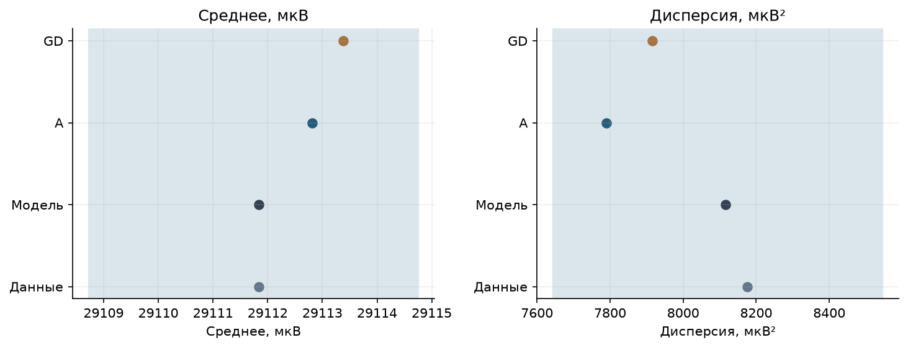

<a id="gen-table-16" name="gen-table-16"></a>

**Таблица 16 · Исследование алгоритмов.** Для каждого метода выполнены семь запусков N=3686 с seed 40…46. Показаны медиана и квартили времени на данном компьютере. Кандидатом считается каждое нормальное/кошевское предложение или предложение оболочки GD; их вычислительная стоимость различна. Число кандидатов и время поэтому интерпретируются раздельно. Относительная скорость зависит от среды и не является оценкой точности модели.

<div>

<table border="1" class="dataframe">
<thead>
<tr style="text-align: right;">
<th></th>
<th>Метод</th>
<th>N</th>
<th>Повторений</th>
<th>Медиана времени, с</th>
<th>Q25 времени, с</th>
<th>Q75 времени, с</th>
<th>Медиана кандидатов</th>
</tr>
</thead>
<tbody>
<tr>
<th>0</th>
<td>A</td>
<td>3686</td>
<td>7</td>
<td>0.0711271</td>
<td>0.0652899</td>
<td>0.0718393</td>
<td>6757.0</td>
</tr>
<tr>
<th>1</th>
<td>GD</td>
<td>3686</td>
<td>7</td>
<td>0.0225438</td>
<td>0.0191787</td>
<td>0.0242889</td>
<td>3843.0</td>
</tr>
</tbody>
</table>
</div>

<a id="generator-resume" name="generator-resume"></a>

### 7.5 · Resume

Обычная гамма не передавала отрицательную асимметрию. Отражение позволило получить модель с близкими средним и разбросом, однако скошенная нормальная описывает эту выборку лучше по AIC. Для N=3686 и seed=40 алгоритм А дал среднее 29112,812504 мкВ и дисперсию 7790,076494 мкВ²; GD — 29113,376317 мкВ и 7916,281270 мкВ². Значений выше b нет у обоих методов. В восьми контрольных выборках поддержка, моменты и CDF удовлетворили указанным допускам; это численная проверка реализации, а не доказательство истинности модели реальных данных. Сравнение эффективности приведено для семи запусков на одном компьютере.

<a id="generator-lab-resume" name="generator-lab-resume"></a>

### 7.6 · Lab resume

Для выбранной в первом спринте величины построен генератор её одномерного приближения. Направление асимметрии согласовано с наблюдениями с помощью отражения. Два алгоритма получают одну целевую модель, а проверка их реализации отделена от качества модели данных. Конечная выборка даёт случайные отклонения метрик; точного совпадения всех статистик не заявляется. Исследование не описывает временную зависимость, перенос калибровки датчика или распределение концентрации в мкг/м³.

<a id="generator-criteria" name="generator-criteria"></a>

### 7.7 · cat_mark_table

| cat_id | notebook_link | coeff | comment |
| --- | --- | --- | --- |
| — | [Description](#generator-description) | — | Генерируется электрический сигнал ASE_NO2, мкВ |
| — | [Math desc](#generator-math) | — | Отражённая гамма; сравнение с нормальной, обычной гамма и скошенной нормальной моделями |
| — | [Code](#generator-code) | — | Алгоритм А и полный GD с общим преобразованием X=b−θG |
| — | [Tests](#generator-tests) | — | Метрики при N=3686; поддержка, моменты, CDF и воспроизводимость |
| — | [Исследование алгоритмов](#gen-table-16) | — | По семь запусков А и GD; медиана и квартили времени |
| — | [Resume](#generator-resume), [Lab resume](#generator-lab-resume) | — | Ограничения аппроксимации и итог сравнения |


### Источники и материалы

1. Bobbia M., Thulliez E. Датасет датчиков NO₂, Mendeley Data, version 2. [DOI 10.17632/82dnstrd93.2](https://data.mendeley.com/datasets/82dnstrd93/2).
2. Кнут Д. Э. *Искусство программирования*. Т. 2, § 3.4.1, алгоритм А.
3. Ahrens J. H., Dieter U. *Generating gamma variates by a modified rejection technique*. Communications of the ACM 25(1), 47–54, 1982. [DOI 10.1145/358315.358390](https://doi.org/10.1145/358315.358390). [Референс R: GammaDist](https://stat.ethz.ch/R-manual/R-devel/library/stats/html/GammaDist.html).
4. SciPy. [Gamma](https://docs.scipy.org/doc/scipy/reference/generated/scipy.stats.gamma.html), [skew-normal](https://docs.scipy.org/doc/scipy/reference/generated/scipy.stats.skewnorm.html), [MLE и ограничения численного оценивания](https://docs.scipy.org/doc/scipy/reference/generated/scipy.stats.rv_continuous.fit.html).
5. Massart P. *The tight constant in the Dvoretzky–Kiefer–Wolfowitz inequality*. Annals of Probability 18(3), 1269–1283, 1990. [DOI 10.1214/aop/1176990746](https://doi.org/10.1214/aop/1176990746).

[Приложение](https://marimo.app/github/EastC0ast/lab01/blob/design-layout/designer_generator/browser_app.py/wasm?embed=true&mode=read&include-code=false&show-code=false) · [Исполняемый ноутбук](https://github.com/EastC0ast/lab01/blob/design-layout/designer_generator/sprint2_calculations.ipynb) · [Читательский ноутбук](https://github.com/EastC0ast/lab01/blob/design-layout/designer_generator/sprint2.ipynb) · [Полные результаты](https://github.com/EastC0ast/lab01/blob/design-layout/designer_generator/results.json) · [Код алгоритмов](https://github.com/EastC0ast/lab01/blob/design-layout/designer_generator/algorithms.py)

[К оглавлению Sprint 2](#sprint2)

<a id="additional-assignment" name="additional-assignment" class="lab-anchor"></a>

## 8 · Дополнительное задание КТвД

### 8.1 · Рукописные знаки: две величины

Исследованы **120 записей строчной латинской `a` от 60 авторов** из открытого UCI UJI Pen Characters 2. Две величины — ширина и высота буквы в миллиметрах экранной системы планшета. Учтены разные масштабы площадок и два повторения каждого автора.

Средняя ширина — **5,094 мм**, высота — **4,610 мм**. При проверке связи по средним авторов с учётом площадки получены ранговая оценка **0,215** и **p = 0,0906**. При уровне 0,05 значимая ранговая связь не обнаружена; независимость этим не доказана.

[Открыть полное исследование КТвД](https://github.com/EastC0ast/lab01/blob/design-layout/design/handwriting/README.md) · [Расчёты](https://github.com/EastC0ast/lab01/blob/design-layout/design/handwriting/handwriting_calculations.ipynb)

### 8.2 · Интерактивное представление генератора

[Открыть генератор marimo](https://marimo.app/github/EastC0ast/lab01/blob/design-layout/designer_generator/browser_app.py/wasm?embed=true&mode=read&include-code=false&show-code=false).

Дождитесь загрузки приложения, задайте параметры и нажмите «Сгенерировать».
Таблицы и графики обновятся после нажатия кнопки.

Приложение позволяет сравнить алгоритмы А и GD для отражённой гамма-модели
сигнала NO₂. [Математическое описание, расчёты и выводы](#sprint2).


<a id="figure-index" name="figure-index" class="lab-anchor"></a>

## Указатель рисунков и таблиц

Рисунки

- [Рисунки 01–02: распределение и функция распределения NO2](#fig01)
- [Рисунок 03: нормализация NO2](#fig03)
- [Рисунок 04: оценка среднего NO2](#fig04)
- [Рисунки 05–06: распределение и функция распределения температуры](#fig05)
- [Рисунок 07: нормализация температуры](#fig07)
- [Рисунок 08: оценка среднего температуры](#fig08)
- [Рисунок 09: зависимость NO2 от температуры](#fig09)
- [Рисунок 10: матрица корреляции](#fig10)
- [Рисунки 11–12: распределение и функция распределения CO](#fig11)
- [Рисунок 13: сравнение моделей CO](#fig13)
- [Рисунок 14: нормализация CO](#fig14)
- [Рисунок 15: оценка среднего CO](#fig15)
- [Рисунок 16 · CO и остальные каналы.](#fig16)
- [Рисунок 17 · Сравнение моделей.](#gen-figure-17)
- [Рисунок 18 · Синтетические данные.](#gen-figure-18)
- [Рисунок 19 · Выборочная вариабельность.](#gen-figure-19)

Таблицы

- [Таблица 01 · Первые пять строк исходного датасета](#table01)
- [Таблица 02 · Площадки и доступные наблюдения](#research-table02)
- [Таблица 03 · Связь соседних часов; коэффициенты безразмерны](#research-table03)
- [Таблица 04 · Сигнал NO₂: параметры моделей и AIC](#research-table04)
- [Таблица 05 · Сравнение выборок NO₂](#table02)
- [Таблица 06 · Температура внутри узла: параметры моделей и AIC](#research-table06)
- [Таблица 07 · Сравнение выборок температуры внутри узла](#table03)
- [Таблица 08 · Все три пары и обе площадки.](#research-table08)
- [Таблица 09 · Сигнал CO: параметры моделей и AIC](#research-table09)
- [Таблица 10 · Сравнение выборок CO](#table04)
- [Таблица 11 · Модели и оценки.](#gen-table-11)
- [Таблица 12 · Данные, теория и генераторы.](#gen-table-12)
- [Таблица 13 · Качество генерации.](#gen-table-13)
- [Таблица 14 · Расхождения и выборочная вариабельность.](#gen-table-14)
- [Таблица 15 · Проверка закона генерации.](#gen-table-15)
- [Таблица 16 · Исследование алгоритмов.](#gen-table-16)

[К оглавлению](#contents)
