

Прикладная статистика · ИнфоХимия / КТвД

<h1>Лабораторная работа 01</h1>

Исследование трёх случайных величин Первый спринт

Авторы и группы: <em>заполняются командой</em> Данные: <code>ASE10.csv</code> · Формат: Jupyter Notebook

## Оглавление

**[1. Исходные данные](#data)**  

**[2. Сигнал сенсора NO2](#rv-no2)**  
[Описание](#no2-description) · [EDA](#no2-eda) · [Распределение](#no2-model) · [Гипотеза](#no2-test) · [Нормализация](#no2-normalization) · [Оценки](#no2-estimates) · [Выборки](#no2-samples)

**[3. Сигнал сенсора температуры (ASE_T)](#rv-temp)**  
[Описание](#temp-description) · [EDA](#temp-eda) · [Распределение](#temp-model) · [Гипотеза](#temp-test) · [Нормализация](#temp-normalization) · [Оценки](#temp-estimates) · [Выборки](#temp-samples)

**[4. Зависимость NO2 от температуры](#dependence)**  
[Корреляция](#dependence-test) · [Графики](#dependence-plots) · [Вывод](#dependence-conclusion)

**[5. Сигнал сенсора CO](#rv-co)**  
[Описание](#co-description) · [EDA](#co-eda) · [Распределение](#co-model) · [Гипотеза](#co-test) · [Нормализация](#co-normalization) · [Оценки](#co-estimates) · [Выборки](#co-samples)

**[6. Lab resume](#resume)**  
[Таблица критериев](#criteria)

**[7. Дополнительное задание КТвД](#additional-assignment)**  
[Рукописные знаки](#additional-assignment) · [Генератор marimo](#additional-assignment)

[Указатель рисунков и таблиц](#figure-index)

В читательской версии код отсутствует; результаты расчётов оставлены видимыми. Навигационные ссылки размещены в начале и конце крупных разделов.

> **Режим чтения — без кода.** Текст, формулы, таблицы и графики сохранены. Для пересчёта откройте [полный исполняемый ноутбук](https://github.com/EastC0ast/lab01/blob/design-layout/lab01_calculations.ipynb). Эта версия содержит только сохранённые результаты.

# Lab01 - Sprint 1

## 1 · Исходные данные

### 1.1 · Обозначения, единицы и формулы

`ASE_NO2`, `ASE_T` и `ASE_CO` — названия столбцов в `ASE10.csv`.
В файле данных нет описания физических единиц. Подписи «мкВ» и трактовка
`ASE_T` как напряжения сохранены из версии команды и требуют подтверждения
инфохимиками. Числовые шкалы и результаты ниже не менялись.
На рисунках 02, 06 и 12 показаны накопленные частоты **после округления
значений до целых**. Вопрос о положении ступеней вынесен на согласование.

Для чтения таблиц 02–04: среднее, медиана, минимум, максимум, мода,
перцентиль и стандартное отклонение имеют единицу исходного столбца;
дисперсия — её квадрат. Объём выборки измеряется в наблюдениях.
Нормализованные значения, накопленная доля и корреляция безразмерны.

Используемые обозначения: $n$ — число наблюдений после удаления пропусков,
$x_i$ — значение наблюдения, $\bar{x}$ — выборочное среднее.
Справочные формулы соответствуют операциям в расчётном ноутбуке:

$$\bar{x}=\frac{1}{n}\sum_{i=1}^{n}x_i,\qquad
s^2=\frac{1}{n-1}\sum_{i=1}^{n}(x_i-\bar{x})^2,\qquad s=\sqrt{s^2}.$$

$$z_i=\frac{x_i-\min_j x_j}{\max_j x_j-\min_j x_j},\qquad
\max_j x_j>\min_j x_j.$$

Накопленные частоты округлённых данных в узлах:

$$\widehat F_{n,\mathrm{round}}(t)=\frac{1}{n}
\sum_{i=1}^{n}\mathbf{1}\{\operatorname{round}(x_i)\le t\}.$$

Коэффициент Пирсона для пар наблюдений без пропусков:

$$r=\frac{\sum_{i=1}^{n}(x_i-\bar{x})(y_i-\bar{y})}
{\sqrt{\sum_{i=1}^{n}(x_i-\bar{x})^2\sum_{i=1}^{n}(y_i-\bar{y})^2}}.$$

В формулах плотности skew-normal в разделах 2.2.1 и 3.2.1 предполагается
$\omega>0$. Этот справочный блок поясняет обозначения и не заменяет
авторские интерпретации. [Вопросы для согласования](https://github.com/EastC0ast/lab01/blob/design-layout/design/REVIEW_NOTES.md).

**Таблица 01 · Первые пять строк исходного датасета**

<table border="1" class="dataframe lab-table">
<thead>
<tr style="text-align: right;">
<th></th>
<th>date</th>
<th>ASE_NO2</th>
<th>ASE_NO</th>
<th>ASE_CO</th>
<th>ASE_Ox</th>
<th>ASE_T</th>
<th>ASE_HR</th>
<th>ASE_PA</th>
<th>SUD3_NO2</th>
<th>SUD3_NO</th>
<th>QDP_NO</th>
<th>QDP_NO2</th>
<th>QDP_CO</th>
<th>Location</th>
</tr>
</thead>
<tbody>
<tr>
<th>0</th>
<td>2021-10-20 14:00</td>
<td>29123.75000</td>
<td>43733.48438</td>
<td>40791.60938</td>
<td>29087.65625</td>
<td>23.253516</td>
<td>54.889016</td>
<td>1006.269444</td>
<td>11.2</td>
<td>3.5</td>
<td>15.6</td>
<td>22.7</td>
<td>0.139</td>
<td>SUD3</td>
</tr>
<tr>
<th>1</th>
<td>2021-10-20 15:00</td>
<td>29084.31434</td>
<td>42984.14706</td>
<td>40922.12408</td>
<td>29067.22335</td>
<td>22.838591</td>
<td>56.928588</td>
<td>1005.413194</td>
<td>17.8</td>
<td>6.2</td>
<td>20.7</td>
<td>27.1</td>
<td>0.148</td>
<td>SUD3</td>
</tr>
<tr>
<th>2</th>
<td>2021-10-20 16:00</td>
<td>29119.26563</td>
<td>42667.14063</td>
<td>40680.23438</td>
<td>29099.71875</td>
<td>22.751450</td>
<td>54.193586</td>
<td>1004.264236</td>
<td>13.3</td>
<td>2.1</td>
<td>23.9</td>
<td>30.2</td>
<td>0.178</td>
<td>SUD3</td>
</tr>
<tr>
<th>3</th>
<td>2021-10-20 17:00</td>
<td>29110.03125</td>
<td>42470.15625</td>
<td>40709.89063</td>
<td>29097.42188</td>
<td>22.614907</td>
<td>54.335088</td>
<td>1002.840972</td>
<td>13.4</td>
<td>1.1</td>
<td>12.6</td>
<td>28.7</td>
<td>0.129</td>
<td>SUD3</td>
</tr>
<tr>
<th>4</th>
<td>2021-10-20 18:00</td>
<td>29108.90165</td>
<td>42257.46048</td>
<td>40683.00092</td>
<td>29086.15717</td>
<td>21.929122</td>
<td>55.553496</td>
<td>1001.325000</td>
<td>11.8</td>
<td>0.9</td>
<td>8.3</td>
<td>32.6</td>
<td>0.122</td>
<td>SUD3</td>
</tr>
</tbody>
</table>

<nav class="lab-nav" aria-label="Навигация по отчёту"><a href="#contents">↑ Оглавление</a><a href="#rv-no2">NO2 →</a></nav>

## 2 · Random Variable 01: Сигнал сенсора NO2

### 2.1 · Description

Случайная величина 1 - значение напряжения на электрохимическом сенсоре NO2, измеряемое на автомобильном перекрестке. Показание сенсора нельзя рассчитать по формуле, так как на концентрацию газа в воздухе влияет количество машин на светофоре и порывы ветра. Также присутствует погрешность самого сенсора и броуновское движение молекул газа.

Связанные разделы: <a href="#rv-temp">температура</a> · <a href="#rv-co">сигнал CO</a> · <a href="#dependence">зависимость от температуры</a>

### 2.2 · EDA & Distribution

Рисунки 01–02: распределение и функция распределения NO2

 
Размер данных до очистки: 3739 наблюдений. 
Размер данных после очистки: 3686 наблюдений. 
 

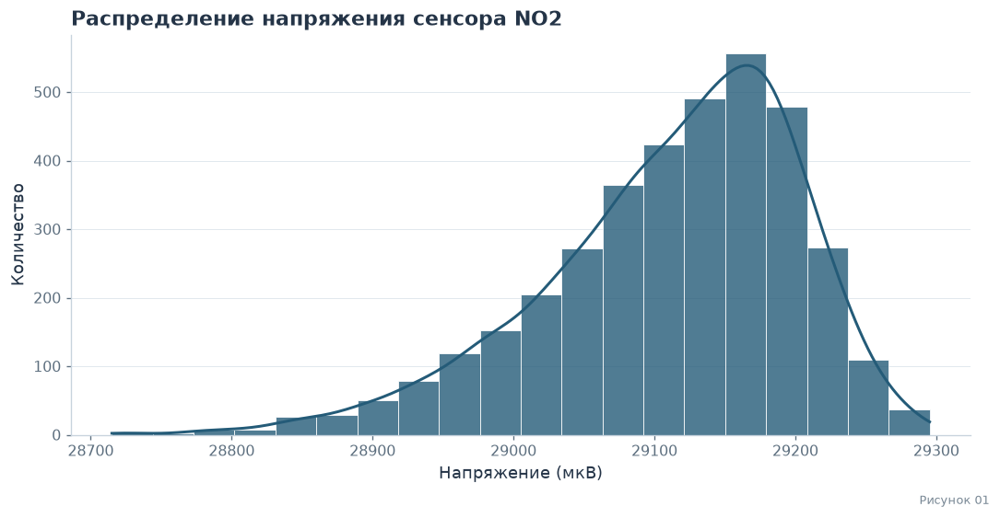

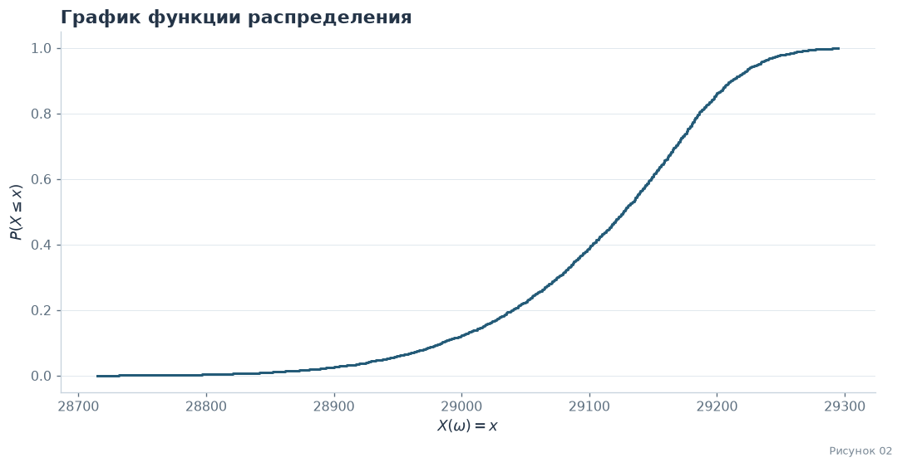

 
Сумма: 107306226.23449999 
Среднее: 29111.835657759086 
Медиана: 29128.038145 
Минимум: 28715.0 
Максимум: 29295.28125 
Стандартное отклонение: 90.41962706444696 
95-й перцентиль: 29233.165215 
Дисперсия: 8175.708958473668 
Мода: 29126.09375 

#### 2.2.1 · Математическая база распределения

Сенсор измеряет напряжение электрода, на что влияет множество мелких случайных факторов (ветер, машины, погрешность прибора). Если случайная величина формируется под воздействием множества независимых факторов, ее распределение стремится к нормальному.
Но физически - повышение концентрации NO2 понижает показатель датчика. Эти скачки концентрации (например, из-за частых автомобильных пробок в месте измерения) привело к ассиметрии графика распределения и образованию вытянутого левого хвоста.

Математически плотность вероятности ассиметричного нормального распределение задается:
$$f(x) = \frac{2}{\omega} \phi\left(\frac{x - \xi}{\omega}\right) \Phi\left(\alpha \left(\frac{x - \xi}{\omega}\right)\right)$$

Где:
* $\phi(t)$ — стандартная нормальная плотность распределения.
* $\Phi(t)$ — функция распределения стандартного нормального закона.
* $\xi$ — параметр сдвига.
* $\omega$ — параметр масштаба.
* $\alpha$ — параметр асимметрии.

Нулевая гипотеза: распределение напряжения сенсора NO2 соответствует нормальному
Альтернативная: распределение отличается от нормального, присутствует ассиметрия

Связанные разделы: <a href="#no2-test">проверка гипотезы</a> · <a href="#no2-normalization">нормализация</a>

#### 2.2.2 · Проверка гипотезы

Статистика критерия: 377.24614043412896 
p-value: 1.2079291032735805e-82 
Нулевая гипотеза не верна 

#### 2.2.3 · Нормализация

Рисунок 03: нормализация NO2

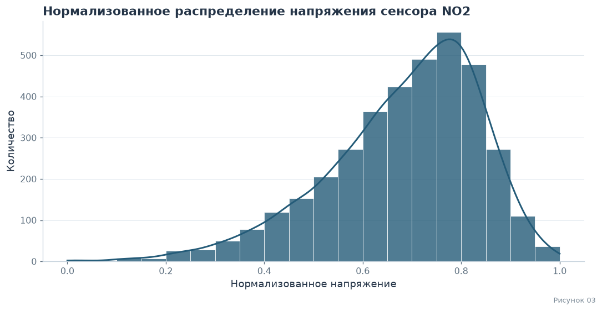

Новый минимум: 0.0 
Новый максимум: 1.0 
Новое среднее: 0.6838677930039768 

### 2.3 · Independence & Estimations

Для проверки состоятельности оценки проверим, как среднее значение ведет себя при увеличении количества случайных показаний сенсора.

Связанные разделы: <a href="#no2-samples">сравнение выборок</a> · <a href="#no2-conclusion">вывод</a>

Рисунок 04: оценка среднего NO2

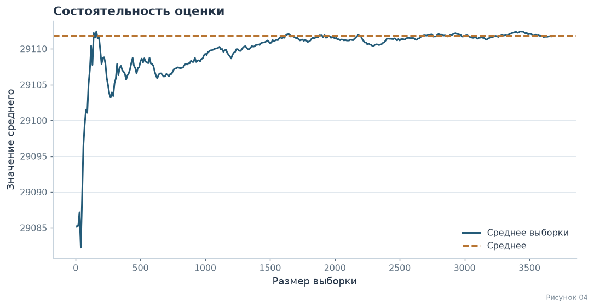

Можно заметить, как значение среднего перестает колебаться и сводится к исходному при увеличении размера выборки.
После отметки в 600 показаний, среднее перестает сильно колебаться. Возьмем выборку размером в 600 значений и проверим ее статистику.

#### 2.3.1 · Сравнение выборок

**Таблица 02 · Сравнение выборок NO2**

<table border="1" class="dataframe lab-table">
<thead>
<tr style="text-align: right;">
<th></th>
<th>Генеральная совокупность</th>
<th>Без возвращения</th>
<th>С возвращением</th>
</tr>
</thead>
<tbody>
<tr>
<th>Сумма</th>
<td>1.073062e+08</td>
<td>1.746457e+07</td>
<td>1.746633e+07</td>
</tr>
<tr>
<th>Среднее</th>
<td>2.911184e+04</td>
<td>2.910761e+04</td>
<td>2.911055e+04</td>
</tr>
<tr>
<th>Медиана</th>
<td>2.912804e+04</td>
<td>2.912511e+04</td>
<td>2.912652e+04</td>
</tr>
<tr>
<th>Минимум</th>
<td>2.871500e+04</td>
<td>2.873198e+04</td>
<td>2.879690e+04</td>
</tr>
<tr>
<th>Максимум</th>
<td>2.929528e+04</td>
<td>2.929450e+04</td>
<td>2.927598e+04</td>
</tr>
<tr>
<th>Стандартное отклонение</th>
<td>9.041963e+01</td>
<td>9.166015e+01</td>
<td>8.787437e+01</td>
</tr>
<tr>
<th>95-й перцентиль</th>
<td>2.923317e+04</td>
<td>2.922880e+04</td>
<td>2.922898e+04</td>
</tr>
<tr>
<th>Дисперсия</th>
<td>8.175709e+03</td>
<td>8.401583e+03</td>
<td>7.721905e+03</td>
</tr>
<tr>
<th>Мода</th>
<td>2.912609e+04</td>
<td>2.906138e+04</td>
<td>2.921608e+04</td>
</tr>
</tbody>
</table>

**Вывод по сравнению выборок**

Все данные, кроме суммы, очень близки к генеральной совокупности, что показывает выборку объемом 600 подходящей для суждения о ней.
Дисперсия выборки с возвращением заметно ниже, так как в нее могли попасть продублированные строки, в остальном данные не отличаются.
Выборка без возвращения в целом более похожа на оригинальную

<nav class="lab-nav" aria-label="Навигация по отчёту"><a href="#data">← Исходные данные</a><a href="#contents">↑ Оглавление</a><a href="#rv-temp">Температура →</a></nav>

## 3 · Random Variable 02: Сигнал сенсора температуры (ASE_T)

### 3.1 · Description

Случайная величина 2 — значение напряжения на сенсоре температуры, измеряемое на автомобильном перекрестке. Показание сенсора нельзя просто рассчитать по формуле, так как температура воздуха зависит от многих факторов: погоды, времени суток, количества машин и ветра. Также присутствует погрешность самого сенсора и броуновское движение молекул воздуха

Связанные разделы: <a href="#rv-no2">сигнал NO2</a> · <a href="#dependence">исследование связи</a>

### 3.2 · EDA & Distribution

Рисунки 05–06: распределение и функция распределения температуры

 
Размер данных до очистки: 3739 наблюдений. 
Размер данных после очистки: 3736 наблюдений. 
 

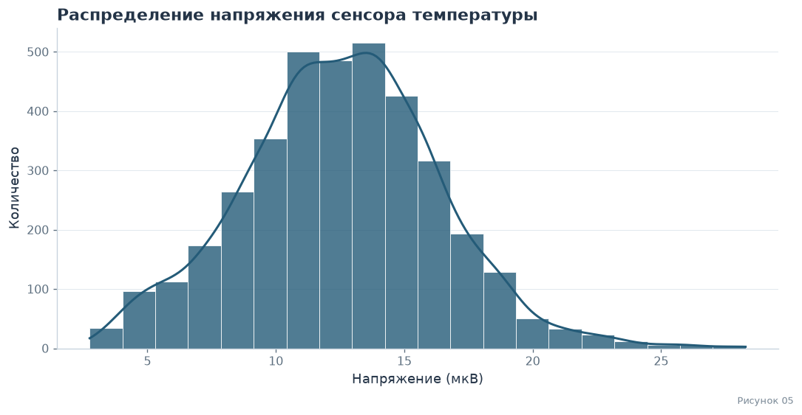

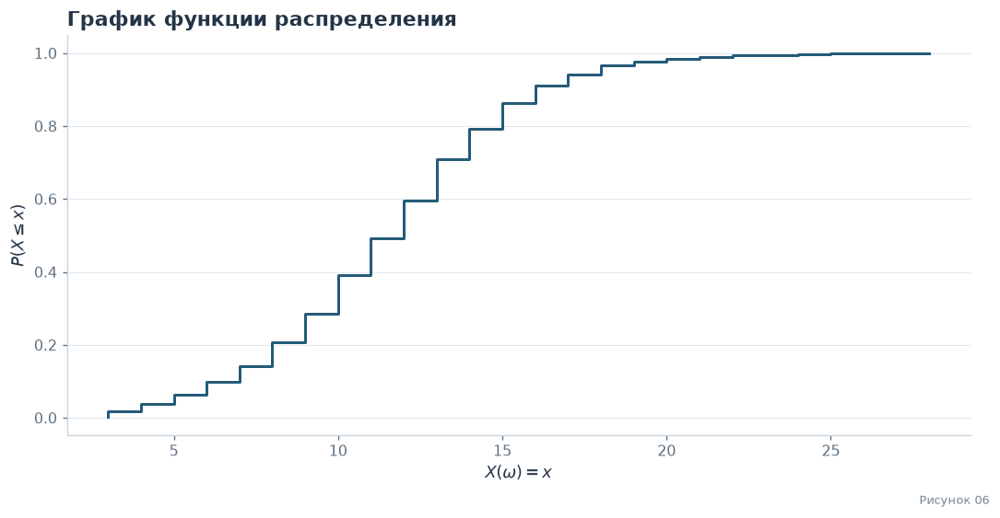

 
Сумма: 46886.3627801 
Среднее: 12.549882971118842 
Медиана: 12.594052795 
Минимум: 2.752066326 
Максимум: 28.28757534 
Стандартное отклонение: 3.842404111246628 
95-й перцентиль: 18.747636445 
Дисперсия: 14.76406935412499 
Мода: 8.736985326 

#### 3.2.1 · Математическая база распределения

Сенсор измеряет напряжение, на что влияет множество мелких случайных факторов (погода, ветер, машины, погрешность прибора). Если случайная величина формируется под воздействием множества независимых факторов, ее распределение стремится к нормальному

Физически - температура воздуха на перекрестке меняется в течение дня, а также под влиянием автомобильных выбросов тепла. Эти колебания (например, из-за частых машин) приводят к асимметрии графика распределения и образованию вытянутого хвоста

Математически плотность вероятности асимметричного нормального распределения задается:
$$f(x) = \frac{2}{\omega} \phi\left(\frac{x - \xi}{\omega}\right) \Phi\left(\alpha \left(\frac{x - \xi}{\omega}\right)\right)$$

Где:
* $\phi(t)$ — стандартная нормальная плотность распределения.
* $\Phi(t)$ — функция распределения стандартного нормального закона.
* $\xi$ — параметр сдвига.
* $\omega$ — параметр масштаба.
* $\alpha$ — параметр асимметрии.

Нулевая гипотеза: распределение напряжения сенсора температуры соответствует нормальному, альтернативная: распределение отличается от нормального, присутствует асимметрия

Связанные разделы: <a href="#temp-test">проверка гипотезы</a> · <a href="#temp-normalization">нормализация</a>

#### 3.2.2 · Проверка гипотезы

Статистика критерия: 33.48183282258036 
p-value: 5.364291633817727e-08 
Нулевая гипотеза не верна 

#### 3.2.3 · Нормализация

Рисунок 07: нормализация температуры

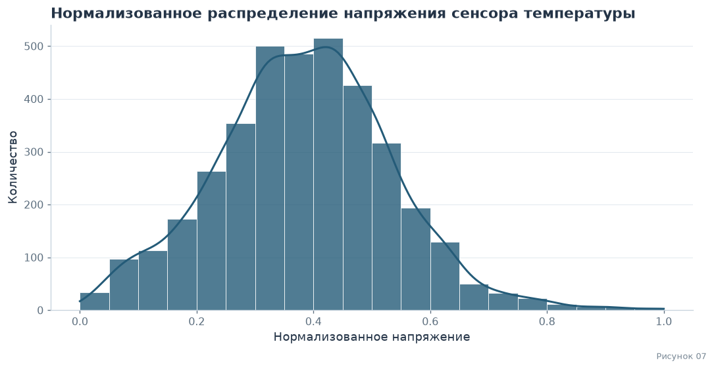

Новый минимум: 0.0 
Новый максимум: 1.0 
Новое среднее: 0.38369380613275145 

### 3.3 · Independence & Estimations

Для проверки состоятельности оценки проверим, как среднее значение ведет себя при увеличении количества случайных показаний сенсора

Связанные разделы: <a href="#temp-samples">сравнение выборок</a> · <a href="#temp-conclusion">вывод</a>

Рисунок 08: оценка среднего температуры

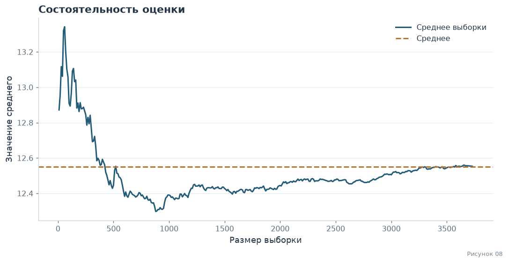

Можно заметить, как значение среднего перестает колебаться и сводится к исходному при увеличении размера выборки.
После отметки в 600 показаний, среднее перестает сильно колебаться. Возьмем выборку размером в 600 значений и проверим ее статистику

#### 3.3.1 · Сравнение выборок

**Таблица 03 · Сравнение выборок температуры**

<table border="1" class="dataframe lab-table">
<thead>
<tr style="text-align: right;">
<th></th>
<th>Генеральная совокупность</th>
<th>Без возвращения</th>
<th>С возвращением</th>
</tr>
</thead>
<tbody>
<tr>
<th>Сумма</th>
<td>46886.362780</td>
<td>7430.257399</td>
<td>7604.712319</td>
</tr>
<tr>
<th>Среднее</th>
<td>12.549883</td>
<td>12.383762</td>
<td>12.674521</td>
</tr>
<tr>
<th>Медиана</th>
<td>12.594053</td>
<td>12.568173</td>
<td>12.834649</td>
</tr>
<tr>
<th>Минимум</th>
<td>2.752066</td>
<td>3.220754</td>
<td>2.752066</td>
</tr>
<tr>
<th>Максимум</th>
<td>28.287575</td>
<td>26.637090</td>
<td>25.848898</td>
</tr>
<tr>
<th>Стандартное отклонение</th>
<td>3.842404</td>
<td>3.698433</td>
<td>3.764880</td>
</tr>
<tr>
<th>95-й перцентиль</th>
<td>18.747636</td>
<td>18.123621</td>
<td>18.818729</td>
</tr>
<tr>
<th>Дисперсия</th>
<td>14.764069</td>
<td>13.678408</td>
<td>14.174325</td>
</tr>
<tr>
<th>Мода</th>
<td>8.736985</td>
<td>3.220754</td>
<td>13.043959</td>
</tr>
</tbody>
</table>

**Вывод по сравнению выборок**

Все данные, кроме суммы, очень близки к генеральной совокупности, что показывает выборку объемом 600 подходящей.
Дисперсия выборки с возвращением заметно ниже, так как в нее могли попасть продублированные строки, в остальном данные не отличаются.
Выборка без возвращения в целом более похожа на оригинальную. Также заметим что, в отличие от NO2, распределение температуры имеет несколько пиков, что физически объясняется изменением температуры в течение суток, а тест на нормальность подтверждает, что распределение не является нормальным

<nav class="lab-nav" aria-label="Навигация по отчёту"><a href="#rv-no2">← NO2</a><a href="#contents">↑ Оглавление</a><a href="#dependence">Зависимость →</a></nav>

## 4 · Зависимость NO2 от температуры

Исследуем, влияет ли температура воздуха на показания сенсора NO2

Связанные разделы: <a href="#no2-description">описание NO2</a> · <a href="#temp-description">описание температуры</a> · <a href="#dependence-conclusion">вывод</a>

### 4.1 · Коэффициент корреляции

Коэффициент корреляции Пирсона (r): -0.2372 
p-value: 2.6736e-48 
Вывод: Связь статистически значима (p-value &lt; 0.05). 
Направление связи: Обратная (при росте температуры NO2 падает). 

### 4.2 · Визуализация зависимости

Рисунок 09: зависимость NO2 от температуры

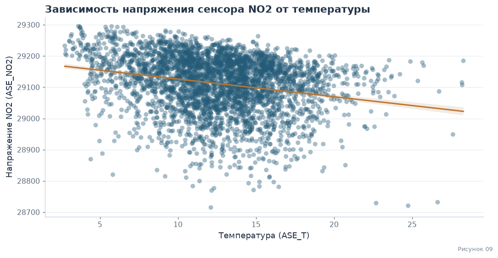

Рисунок 10: матрица корреляции

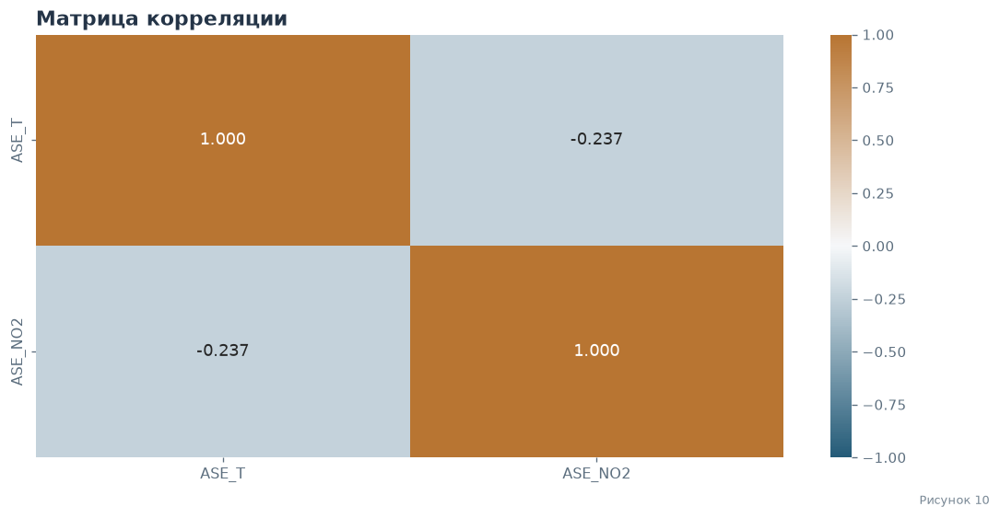

### 4.3 · Вывод по зависимости NO2 от температуры

Получилось, связь между температурой и показаниями сенсора NO2 все таки есть, об этом говорит и наклон красной линии тренда на графике, и коэффициент корреляции -0.237 , так как p-value < 0.05, то связь не случайная

Поскольку связь все равно слабая, сама температура воздуха не главная причина изменения концентрации NO2. Например, в холода машины дольше греются, а выхлопные газы рассеиваются хуже, из-за чего уровень газа в воздухе в среднем выше, чем в теплую погоду. Также возможна ошибка прибора, что сам датчик может менять показания в зависимости от температуры

<nav class="lab-nav" aria-label="Навигация по отчёту"><a href="#rv-temp">← Температура</a><a href="#contents">↑ Оглавление</a><a href="#rv-co">CO →</a></nav>

## 5 · Random Variable 03: Сигнал сенсора CO

### 5.1 · Description

Случайная величина 3 - сигнал электрохимического сенсора CO (`ASE_CO`), который снимается каждый час на автомобильном перекрестке. Вычислить его по формуле нельзя: значение зависит, в частности, от того, сколько машин проехало и как дует ветер, и к этому добавляется собственный шум прибора.

Связанные разделы: <a href="#rv-no2">сигнал NO2</a> · <a href="#rv-temp">температура</a>

### 5.2 · EDA & Distribution

Рисунки 11–12: распределение и функция распределения CO

 
Размер данных до очистки: 3739 наблюдений. 
Размер данных после очистки: 3686 наблюдений. 
 

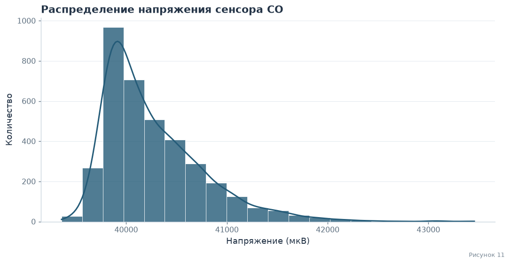

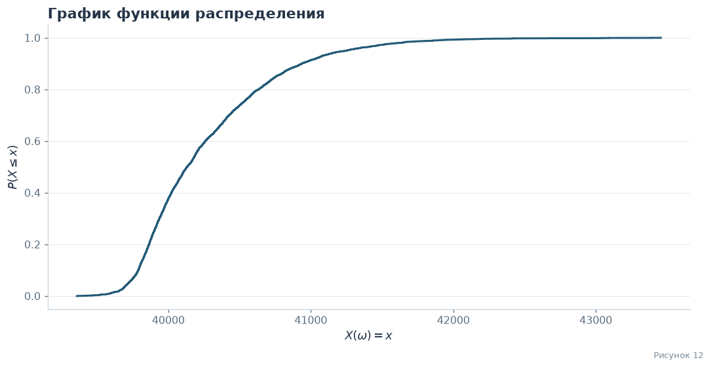

 
Сумма: 148429693.67587 
Среднее: 40268.50072595497 
Медиана: 40132.16728 
Минимум: 39358.04688 
Максимум: 43455.98346 
Стандартное отклонение: 499.6717627929245 
95-й перцентиль: 41247.7557475 
Дисперсия: 249671.87053258857 
Мода: 39752.20313 

#### 5.2.1 · Математическая база распределения

Проверим гипотезу о нормальности.
$H_0$: распределение сигнала CO нормальное.
$H_1$: распределение отличается от нормального.

Связанные разделы: <a href="#co-test">проверка гипотезы</a> · <a href="#co-fit">сравнение моделей</a>

#### 5.2.2 · Проверка гипотезы

Статистика критерия: 1028.7669622714538 
p-value: 4.037314305072088e-224 
Нулевая гипотеза отвергается: распределение не нормальное 

#### 5.2.3 · Сравнение теоретических распределений

Рисунок 13: сравнение моделей CO

Skew-normal: alpha = 7.688, xi = 39687.0, omega = 766.6 
Асимметрия модели skew-normal: 0.93 
Асимметрия данных: 1.467 
AIC skew-normal: 54990.6 
AIC lognormal:   54961.4 

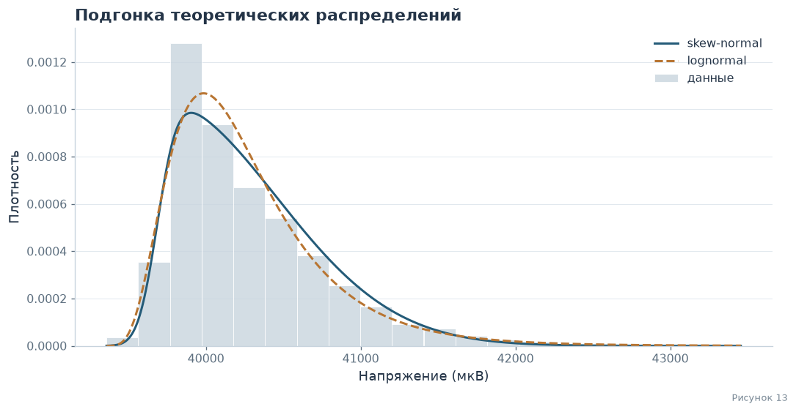

#### 5.2.4 · Повторная проверка гипотезы

Статистика критерия: 1028.7669622714538 
p-value: 4.037314305072088e-224 
Нулевая гипотеза отвергается: распределение не нормальное 

#### 5.2.5 · Нормализация

Рисунок 14: нормализация CO

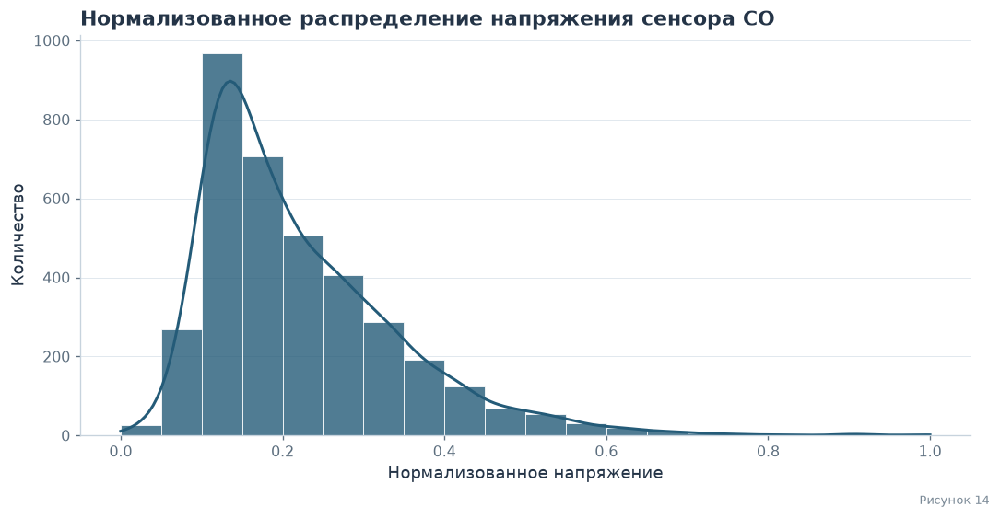

Новый минимум: 0.0 
Новый максимум: 1.0 
Новое среднее: 0.22217372772395697 

### 5.3 · Independence & Estimations

Проверим состоятельность оценки: посмотрим, как выборочное среднее приближается к среднему всей совокупности при росте числа случайно выбранных показаний.

Связанные разделы: <a href="#co-samples">сравнение выборок</a> · <a href="#co-conclusion">вывод</a>

Рисунок 15: оценка среднего CO

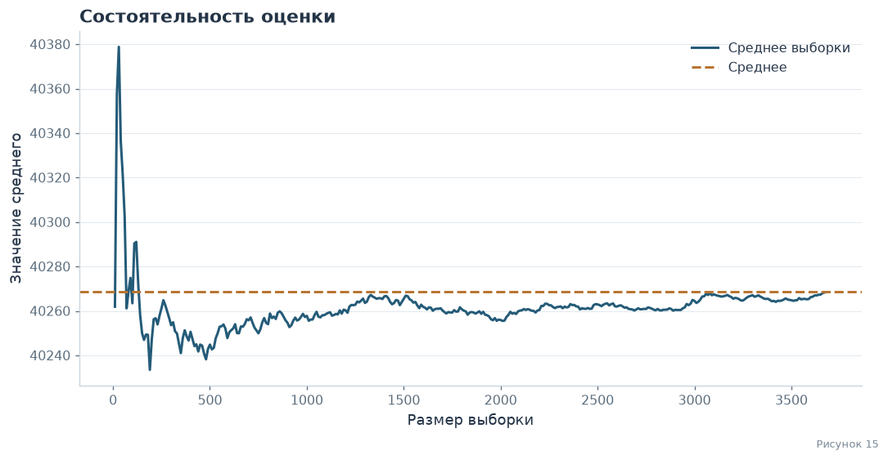

На графике видно, что колебания среднего с ростом размера выборки затухают, и оно стабилизируется около среднего по всем данным. Начиная примерно с 600 показаний отклонение не превышает около 20 отсч. (меньше 0.05% от среднего). Поэтому для следующего шага возьмем выборку из 600 значений и сравним ее характеристики с генеральными.

#### 5.3.1 · Сравнение выборок

**Таблица 04 · Сравнение выборок CO**

<table border="1" class="dataframe lab-table">
<thead>
<tr style="text-align: right;">
<th></th>
<th>Генеральная совокупность</th>
<th>Без возвращения</th>
<th>С возвращением</th>
</tr>
</thead>
<tbody>
<tr>
<th>Сумма</th>
<td>1.484297e+08</td>
<td>2.415022e+07</td>
<td>2.417048e+07</td>
</tr>
<tr>
<th>Среднее</th>
<td>4.026850e+04</td>
<td>4.025037e+04</td>
<td>4.028413e+04</td>
</tr>
<tr>
<th>Медиана</th>
<td>4.013217e+04</td>
<td>4.011883e+04</td>
<td>4.013017e+04</td>
</tr>
<tr>
<th>Минимум</th>
<td>3.935805e+04</td>
<td>3.942611e+04</td>
<td>3.941686e+04</td>
</tr>
<tr>
<th>Максимум</th>
<td>4.345598e+04</td>
<td>4.221511e+04</td>
<td>4.345598e+04</td>
</tr>
<tr>
<th>Стандартное отклонение</th>
<td>4.996718e+02</td>
<td>4.925889e+02</td>
<td>4.942201e+02</td>
</tr>
<tr>
<th>95-й перцентиль</th>
<td>4.124776e+04</td>
<td>4.123412e+04</td>
<td>4.125553e+04</td>
</tr>
<tr>
<th>Дисперсия</th>
<td>2.496719e+05</td>
<td>2.426438e+05</td>
<td>2.442535e+05</td>
</tr>
<tr>
<th>Мода</th>
<td>3.975220e+04</td>
<td>3.942611e+04</td>
<td>3.992811e+04</td>
</tr>
</tbody>
</table>

**Вывод по сравнению выборок**

Основные показатели выборки из 600 значений очень близки к показателям генеральной совокупности: среднее отличается меньше чем на 0.1%. Значит, выборки такого объема подходят для суждения о всех данных.
Дисперсия выборки немного ниже генеральной (примерно на 2-3%), это обычный разброс при таком размере выборки. Максимум и мода отличаются, так как редкие значения могли не попасть в выборку.

<nav class="lab-nav" aria-label="Навигация по отчёту"><a href="#dependence">← Зависимость</a><a href="#contents">↑ Оглавление</a><a href="#resume">Итоги →</a></nav>

## 6 · Lab resume

В процессе 1 спринта лабораторной работы были исследованы 3 случайной величины: показания датчика NO2, температуры и CO.
Выполнен первичный анализ, подсчитан размер достоверных данных из датасета, подсчитана сумма, среднее, медиана и прочие метрики.
Построен график распределения каждой величины. В случае сенсоров NO2 и CO, наблюдается распределение с ассиметрией. NO2 является окислителем, а CO - восстановителем, повышение их концентраций по разному влияет на датчик, поэтому в графике распределения мы видим хвосты в противоположных сторонах.
В распределении температуры ассиметрия выражена меньше. Ни один из графиков не показывает нормальное распределение, так как помимо множества мелких независящих факторов на датчики влияли автомобильные пробки около места сбора.
Для подтверждения ассиметричности графиков были проверены соответствующие гипотезы.
Для проверки состоятельности оценки построены графики зависимости выборочного среднего от размера выборки, и показана его близость к истинному среднему.
После выбора подходящего, на наш взгляд, размера выборки, для нее были посчитаны все изначальные статистики, что позволило точно убедиться в возможности суждения о генеральной совокупности по выборочной. В каждом случае все данные, кроме суммы, почти совпадали с генеральной совокупностью. Подход без возвращения был более похож на оригинальную выборку.
Для температуры была исследована зависимость ее значения от показателей датчика NO2, для чего была построена матрица корреляции. Результаты показали, что при росте температуры показатель NO2 падает, эта связь не случайна, но слаба. Сама температура не является главной причиной изменения концентрации газа, но на их скачки влияли одни и те же события.

Связанные разделы: <a href="#no2-conclusion">результаты NO2</a> · <a href="#temp-conclusion">результаты температуры</a> · <a href="#dependence-conclusion">зависимость</a> · <a href="#co-conclusion">результаты CO</a>

### 6.1 · cat_mark_table

| cat_id | notebook_link | coeff | comment |
|--------|-----------------|-------|---------| 
| lab.ic.01.01 | [Random Variable 01: Сигнал сенсора NO2](#rv-no2)  | 0,15 | |
| lab.ic.01.01 | [Random Variable 02: Сигнал сенсора температуры (ASE_T)](#rv-temp)  | 0,15 | |
| lab.ic.01.01 | [Random Variable 03: Сигнал сенсора CO](#rv-co)  | 0,15 | |
| lab.ic.01.02 | [Зависимость NO2 от температуры](#dependence) | 0,06 | | 
| lab.ic.01.03 | Independence & Estimations: [NO2](#no2-estimates), [ASE_T](#temp-estimates), [CO](#co-estimates) | 0,05 | Отдельным заголовком для каждой величины |
| lab.ic.01.04 | EDA & Distribution: [NO2](#no2-eda), [ASE_T](#temp-eda), [CO](#co-eda) | 0,05 | Отдельным заголовком для каждой величины |
| lab.ic.01.05 | Математическая база распределения: [NO2](#no2-model), [ASE_T](#temp-model), [CO](#co-model) | 0,05 | Для каждой величины подпункт с нормализацией |
| lab.ic.01.06 | Random variable [01](#rv-no2),[03](#rv-co) отличаются от [02](#rv-temp) | 0,1 | |
| lab.ic.01.07 | Математическая база распределения: [NO2](#no2-model), [ASE_T](#temp-model), [CO](#co-model) | 0,05 | Отдельным заголовком для каждой величины |
| lab.ic.01.09 | Independence & Estimations: [NO2](#no2-estimates), [ASE_T](#temp-estimates), [CO](#co-estimates) | 0,05 | |
| lab.ic.01.10 | Independence & Estimations: [NO2](#no2-estimates), [ASE_T](#temp-estimates), [CO](#co-estimates) | 0,05 | |
| lab.ic.01.11 | Математическая база распределения: [NO2](#no2-model), [ASE_T](#temp-model), [CO](#co-model) | 0,05 | Подпункт с гипотезой для каждой величины |

<nav class="lab-nav" aria-label="Навигация по отчёту"><a href="#rv-co">← CO</a><a href="#contents">↑ Оглавление</a></nav>

## 7 · Дополнительное задание КТвД

### 7.1 · Рукописные знаки: две величины

Исходные определения двух величин и измерения не обнаружены в проверенной
истории репозитория. Поэтому восстановленные числовые результаты здесь
не заявлены. [Протокол поиска и заготовка исследования](https://github.com/EastC0ast/lab01/blob/design-layout/design/handwriting/README.md)
содержат статус и форму для исходных измерений. Для завершения исследования
нужны исходные записи команды.

### 7.2 · Интерактивное представление генератора

[Приложение marimo и запуск](https://github.com/EastC0ast/lab01/blob/design-layout/designer_generator/README.md)
представляют методы А и GD из ветки `generator` отдельно от основного анализа.
Параметры и начальное состояние генератора можно менять в интерфейсе.
Расхождение между формулой GD в тексте и реализацией команды отмечено явно;
оно не исправлялось без согласования. Ветки не объединялись.

## Указатель рисунков и таблиц

[Рисунки 01–02: распределение и функция распределения NO2](#fig01)  
[Рисунок 03: нормализация NO2](#fig03)  
[Рисунок 04: оценка среднего NO2](#fig04)  
[Рисунки 05–06: распределение и функция распределения температуры](#fig05)  
[Рисунок 07: нормализация температуры](#fig07)  
[Рисунок 08: оценка среднего температуры](#fig08)  
[Рисунок 09: зависимость NO2 от температуры](#fig09)  
[Рисунок 10: матрица корреляции](#fig10)  
[Рисунки 11–12: распределение и функция распределения CO](#fig11)  
[Рисунок 13: сравнение моделей CO](#fig13)  
[Рисунок 14: нормализация CO](#fig14)  
[Рисунок 15: оценка среднего CO](#fig15)  

[Таблица 01 · Первые пять строк исходного датасета](#table01)  
[Таблица 02 · Сравнение выборок NO2](#table02)  
[Таблица 03 · Сравнение выборок температуры](#table03)  
[Таблица 04 · Сравнение выборок CO](#table04)  

<nav class="lab-nav" aria-label="Навигация по отчёту"><a href="#resume">← Итоги</a><a href="#contents">↑ Оглавление</a></nav>
