<a id="top" name="top" class="lab-anchor"></a>

# Лабораторная работа № 1

Прикладная статистика. Итоговый отчёт.

Исследование трёх случайных величин

**Авторы исследования**

Случайная величина 1 (`ASE_NO2`) — Булавкин Никита — ИСУ 501711.<br/>
Случайная величина 2 (`ASE_T`) — Коненкова Элла — ИСУ 502460.<br/>
Случайная величина 3 (`ASE_CO`) — Пашкова Ксения — ИСУ 505309.<br/>

**КТвД: оформление и дополнительное дизайнерское задание**

Янковская Катерина — ИСУ 409951; Шерстнев Игорь — ИСУ 504632.

Данные: `ASE10.csv`.

<a id="contents" name="contents" class="lab-anchor"></a>

## Оглавление

**[1. Исходные данные](#data)**

**[2. Сигнал сенсора NO2](#rv-no2)**

[Описание](#no2-description) · [EDA](#no2-eda) · [Распределение](#no2-model) · [Гипотеза](#no2-test) · [Нормализация](#no2-normalization) · [Оценки](#no2-estimates) · [Выборки](#no2-samples)

**[3. Сигнал сенсора температуры (ASE_T)](#rv-temp)**

[Описание](#temp-description) · [EDA](#temp-eda) · [Распределение](#temp-model) · [Гипотеза](#temp-test) · [Нормализация](#temp-normalization) · [Оценки](#temp-estimates) · [Выборки](#temp-samples)

**[4. Зависимость NO2 от температуры](#dependence)**

[Корреляция](#dependence-test) · [Графики](#dependence-plots) · [Вывод](#dependence-conclusion)

**[5. Сигнал сенсора CO](#rv-co)**

[Описание](#co-description) · [EDA](#co-eda) · [Распределение](#co-model) · [Гипотеза](#co-test) · [Нормализация](#co-normalization) · [Оценки](#co-estimates) · [Выборки](#co-samples)

**[6. Lab resume — спринт 1](#resume)**

[Таблица критериев](#criteria)

**[7. Генератор — спринт 2](#sprint2)**

[Description](#generator-description) · [Math Desc](#generator-math) · [Code](#generator-code) · [Tests](#generator-tests) · [Resume](#generator-resume) · [Lab resume](#generator-lab-resume) · [Таблица критериев](#generator-criteria)

[Указатель рисунков и таблиц](#figure-index)

<a id="sprint1" name="sprint1" class="lab-anchor"></a>

# Lab01 - Sprint 1

<a id="data" name="data" class="lab-anchor"></a>

## 1 · Исходные данные

[Оглавление](#contents) · [2. Сигнал сенсора NO2 →](#rv-no2)

<a id="table01" name="table01" class="lab-anchor"></a>

<p class="lab-caption">Таблица 01 · Первые строки исходных данных</p>

<div>

<table border="1" class="dataframe">
<thead>
<tr style="text-align: right;">
<th></th>
<th>date</th>
<th>ASE_NO2</th>
<th>ASE_NO</th>
<th>ASE_CO</th>
<th>ASE_Ox</th>
<th>ASE_T</th>
<th>ASE_HR</th>
<th>ASE_PA</th>
<th>SUD3_NO2</th>
<th>SUD3_NO</th>
<th>QDP_NO</th>
<th>QDP_NO2</th>
<th>QDP_CO</th>
<th>Location</th>
</tr>
</thead>
<tbody>
<tr>
<th>0</th>
<td>2021-10-20 14:00</td>
<td>29123.75000</td>
<td>43733.48438</td>
<td>40791.60938</td>
<td>29087.65625</td>
<td>23.253516</td>
<td>54.889016</td>
<td>1006.269444</td>
<td>11.2</td>
<td>3.5</td>
<td>15.6</td>
<td>22.7</td>
<td>0.139</td>
<td>SUD3</td>
</tr>
<tr>
<th>1</th>
<td>2021-10-20 15:00</td>
<td>29084.31434</td>
<td>42984.14706</td>
<td>40922.12408</td>
<td>29067.22335</td>
<td>22.838591</td>
<td>56.928588</td>
<td>1005.413194</td>
<td>17.8</td>
<td>6.2</td>
<td>20.7</td>
<td>27.1</td>
<td>0.148</td>
<td>SUD3</td>
</tr>
<tr>
<th>2</th>
<td>2021-10-20 16:00</td>
<td>29119.26563</td>
<td>42667.14063</td>
<td>40680.23438</td>
<td>29099.71875</td>
<td>22.751450</td>
<td>54.193586</td>
<td>1004.264236</td>
<td>13.3</td>
<td>2.1</td>
<td>23.9</td>
<td>30.2</td>
<td>0.178</td>
<td>SUD3</td>
</tr>
<tr>
<th>3</th>
<td>2021-10-20 17:00</td>
<td>29110.03125</td>
<td>42470.15625</td>
<td>40709.89063</td>
<td>29097.42188</td>
<td>22.614907</td>
<td>54.335088</td>
<td>1002.840972</td>
<td>13.4</td>
<td>1.1</td>
<td>12.6</td>
<td>28.7</td>
<td>0.129</td>
<td>SUD3</td>
</tr>
<tr>
<th>4</th>
<td>2021-10-20 18:00</td>
<td>29108.90165</td>
<td>42257.46048</td>
<td>40683.00092</td>
<td>29086.15717</td>
<td>21.929122</td>
<td>55.553496</td>
<td>1001.325000</td>
<td>11.8</td>
<td>0.9</td>
<td>8.3</td>
<td>32.6</td>
<td>0.122</td>
<td>SUD3</td>
</tr>
</tbody>
</table>
</div>

<a id="rv-no2" name="rv-no2" class="lab-anchor"></a>

<p class="lab-section-label">Раздел 2</p>

[← 1. Исходные данные](#data) · [Оглавление](#contents) · [3. Сигнал сенсора температуры (ASE_T) →](#rv-temp)

## <a name="variable1"></a> Random Variable 01: Сигнал сенсора NO2

<a id="no2-description" name="no2-description" class="lab-anchor"></a>

### Description
Случайная величина 1 - значение напряжения на электрохимическом сенсоре NO2, измеряемое на автомобильном перекрестке. Показание сенсора нельзя рассчитать по формуле, так как на концентрацию газа в воздухе влияет количество машин на светофоре и порывы ветра. Также присутствует погрешность самого сенсора и броуновское движение молекул газа.

<a id="no2-eda" name="no2-eda" class="lab-anchor"></a>

### EDA & Distribution

<a id="fig01" name="fig01" class="lab-anchor"></a>

<p class="lab-caption">Рисунок 01 · Распределение напряжения сенсора NO2</p>

<a id="fig02" name="fig02" class="lab-anchor"></a>

<p class="lab-caption">Рисунок 02 · График функции распределения NO2</p>

<div class="lab-result" style="white-space:pre-wrap;font-family:inherit;line-height:1.6"><br>
Размер данных до очистки: 3739 наблюдений.<br>
Размер данных после очистки: 3686 наблюдений.<br>
<br>
</div>

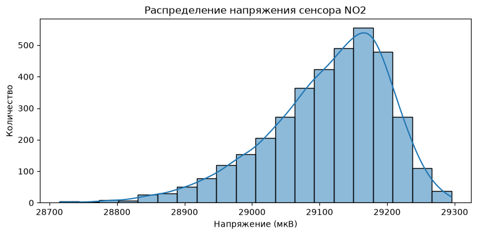

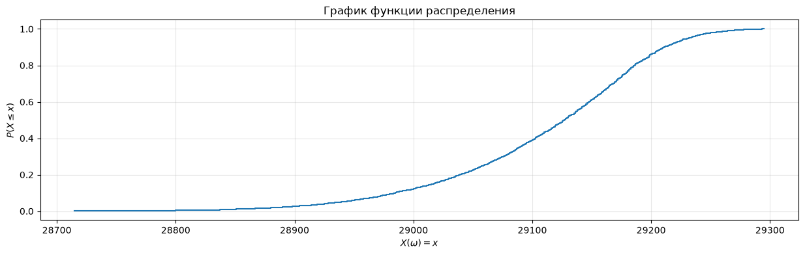

<div class="lab-result" style="white-space:pre-wrap;font-family:inherit;line-height:1.6"><br>
Сумма: 107306226.23449999<br>
Среднее: 29111.835657759086<br>
Медиана: 29128.038145<br>
Минимум: 28715.0<br>
Максимум: 29295.28125<br>
Стандартное отклонение: 90.41962706444696<br>
95-й перцентиль: 29233.165215<br>
Дисперсия: 8175.708958473668<br>
Мода: 29126.09375<br>
</div>

<a id="no2-model" name="no2-model" class="lab-anchor"></a>

#### Математическая база распределения
Сенсор измеряет напряжение электрода, на что влияет множество мелких случайных факторов (ветер, машины, погрешность прибора). Если случайная величина формируется под воздействием множества независимых факторов, ее распределение стремится к нормальному.
Но физически - повышение концентрации NO2 понижает показатель датчика. Эти скачки концентрации (например, из-за частых автомобильных пробок в месте измерения) привело к ассиметрии графика распределения и образованию вытянутого левого хвоста.

Математически плотность вероятности ассиметричного нормального распределение задается:


```math
f(x) = \frac{2}{\omega} \phi\left(\frac{x - \xi}{\omega}\right) \Phi\left(\alpha \left(\frac{x - \xi}{\omega}\right)\right)
```


Где:
* $\phi(t)$ — стандартная нормальная плотность распределения.
* $\Phi(t)$ — функция распределения стандартного нормального закона.
* $\xi$ — параметр сдвига.
* $\omega$ — параметр масштаба.
* $\alpha$ — параметр асимметрии.

Нулевая гипотеза: распределение напряжения сенсора NO2 соответствует нормальному
Альтернативная: распределение отличается от нормального, присутствует ассиметрия

<a id="no2-test" name="no2-test" class="lab-anchor"></a>

<div class="lab-result" style="white-space:pre-wrap;font-family:inherit;line-height:1.6">Статистика критерия: 377.24614043412896<br>
p-value: 1.2079291032735805e-82<br>
Нулевая гипотеза не верна<br>
</div>

<a id="no2-normalization" name="no2-normalization" class="lab-anchor"></a>

<a id="fig03" name="fig03" class="lab-anchor"></a>

<p class="lab-caption">Рисунок 03 · Нормализованное распределение напряжения сенсора NO2</p>

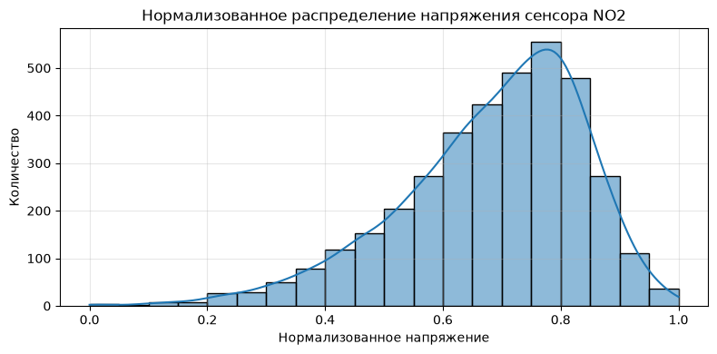

<div class="lab-result" style="white-space:pre-wrap;font-family:inherit;line-height:1.6">Новый минимум: 0.0<br>
Новый максимум: 1.0<br>
Новое среднее: 0.6838677930039768<br>
</div>

<a id="no2-estimates" name="no2-estimates" class="lab-anchor"></a>

### Independence & Estimations
Для проверки состоятельности оценки проверим, как среднее значение ведет себя при увеличении количества случайных показаний сенсора.

<a id="fig04" name="fig04" class="lab-anchor"></a>

<p class="lab-caption">Рисунок 04 · Состоятельность оценки для NO2</p>

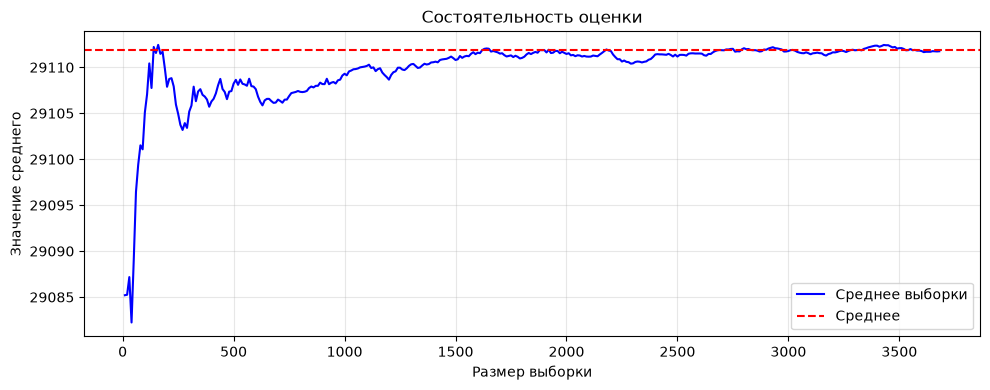

Можно заметить, как значение среднего перестает колебаться и сводится к исходному при увеличении размера выборки.
После отметки в 600 показаний, среднее перестает сильно колебаться. Возьмем выборку размером в 600 значений и проверим ее статистику.

<a id="no2-samples" name="no2-samples" class="lab-anchor"></a>

<a id="table02" name="table02" class="lab-anchor"></a>

<p class="lab-caption">Таблица 02 · Статистики NO2 и выборок</p>

<div>

<table border="1" class="dataframe">
<thead>
<tr style="text-align: right;">
<th></th>
<th>Генеральная совокупность</th>
<th>Без возвращения</th>
<th>С возвращением</th>
</tr>
</thead>
<tbody>
<tr>
<th>Сумма</th>
<td>1.073062e+08</td>
<td>1.746457e+07</td>
<td>1.746633e+07</td>
</tr>
<tr>
<th>Среднее</th>
<td>2.911184e+04</td>
<td>2.910761e+04</td>
<td>2.911055e+04</td>
</tr>
<tr>
<th>Медиана</th>
<td>2.912804e+04</td>
<td>2.912511e+04</td>
<td>2.912652e+04</td>
</tr>
<tr>
<th>Минимум</th>
<td>2.871500e+04</td>
<td>2.873198e+04</td>
<td>2.879690e+04</td>
</tr>
<tr>
<th>Максимум</th>
<td>2.929528e+04</td>
<td>2.929450e+04</td>
<td>2.927598e+04</td>
</tr>
<tr>
<th>Стандартное отклонение</th>
<td>9.041963e+01</td>
<td>9.166015e+01</td>
<td>8.787437e+01</td>
</tr>
<tr>
<th>95-й перцентиль</th>
<td>2.923317e+04</td>
<td>2.922880e+04</td>
<td>2.922898e+04</td>
</tr>
<tr>
<th>Дисперсия</th>
<td>8.175709e+03</td>
<td>8.401583e+03</td>
<td>7.721905e+03</td>
</tr>
<tr>
<th>Мода</th>
<td>2.912609e+04</td>
<td>2.906138e+04</td>
<td>2.921608e+04</td>
</tr>
</tbody>
</table>
</div>

Все данные, кроме суммы, очень близки к генеральной совокупности, что показывает выборку объемом 600 подходящей для суждения о ней.
Дисперсия выборки с возвращением заметно ниже, так как в нее могли попасть продублированные строки, в остальном данные не отличаются.
Выборка без возвращения в целом более похожа на оригинальную

<a id="rv-temp" name="rv-temp" class="lab-anchor"></a>

<p class="lab-section-label">Раздел 3</p>

[← 2. Сигнал сенсора NO2](#rv-no2) · [Оглавление](#contents) · [4. Зависимость NO2 от температуры →](#dependence)

## Random Variable 02: Сигнал сенсора температуры (ASE_T)

<a id="temp-description" name="temp-description" class="lab-anchor"></a>

### Description
Случайная величина 2 — значение напряжения на сенсоре температуры, измеряемое на автомобильном перекрестке. Показание сенсора нельзя просто рассчитать по формуле, так как температура воздуха зависит от многих факторов: погоды, времени суток, количества машин и ветра. Также присутствует погрешность самого сенсора и броуновское движение молекул воздуха

<a id="temp-eda" name="temp-eda" class="lab-anchor"></a>

### EDA & Distribution

<a id="fig05" name="fig05" class="lab-anchor"></a>

<p class="lab-caption">Рисунок 05 · Распределение напряжения сенсора температуры</p>

<a id="fig06" name="fig06" class="lab-anchor"></a>

<p class="lab-caption">Рисунок 06 · График функции распределения температуры</p>

<div class="lab-result" style="white-space:pre-wrap;font-family:inherit;line-height:1.6"><br>
Размер данных до очистки: 3739 наблюдений.<br>
Размер данных после очистки: 3736 наблюдений.<br>
<br>
</div>

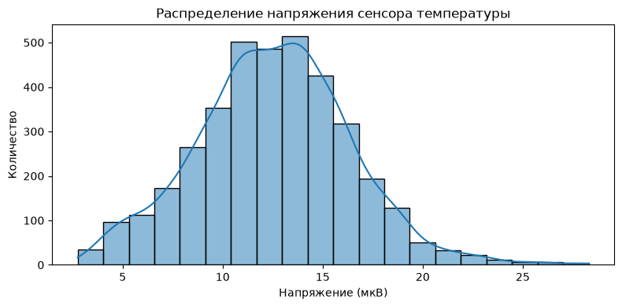

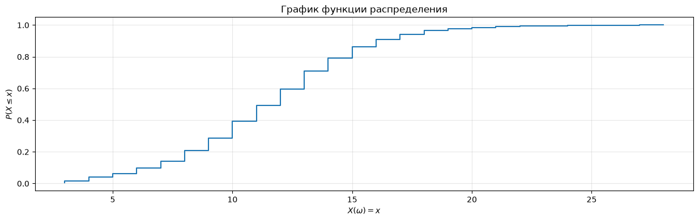

<div class="lab-result" style="white-space:pre-wrap;font-family:inherit;line-height:1.6"><br>
Сумма: 46886.3627801<br>
Среднее: 12.549882971118842<br>
Медиана: 12.594052795<br>
Минимум: 2.752066326<br>
Максимум: 28.28757534<br>
Стандартное отклонение: 3.842404111246628<br>
95-й перцентиль: 18.747636445<br>
Дисперсия: 14.76406935412499<br>
Мода: 8.736985326<br>
</div>

<a id="temp-model" name="temp-model" class="lab-anchor"></a>

#### Математическая база распределения
Сенсор измеряет напряжение, на что влияет множество мелких случайных факторов (погода, ветер, машины, погрешность прибора). Если случайная величина формируется под воздействием множества независимых факторов, ее распределение стремится к нормальному

Физически - температура воздуха на перекрестке меняется в течение дня, а также под влиянием автомобильных выбросов тепла. Эти колебания (например, из-за частых машин) приводят к асимметрии графика распределения и образованию вытянутого хвоста

Математически плотность вероятности асимметричного нормального распределения задается:


```math
f(x) = \frac{2}{\omega} \phi\left(\frac{x - \xi}{\omega}\right) \Phi\left(\alpha \left(\frac{x - \xi}{\omega}\right)\right)
```


Где:
* $\phi(t)$ — стандартная нормальная плотность распределения.
* $\Phi(t)$ — функция распределения стандартного нормального закона.
* $\xi$ — параметр сдвига.
* $\omega$ — параметр масштаба.
* $\alpha$ — параметр асимметрии.

Нулевая гипотеза: распределение напряжения сенсора температуры соответствует нормальному, альтернативная: распределение отличается от нормального, присутствует асимметрия

<a id="temp-test" name="temp-test" class="lab-anchor"></a>

<div class="lab-result" style="white-space:pre-wrap;font-family:inherit;line-height:1.6">Статистика критерия: 33.48183282258027<br>
p-value: 5.3642916338179505e-08<br>
Нулевая гипотеза не верна<br>
</div>

<a id="temp-normalization" name="temp-normalization" class="lab-anchor"></a>

<a id="fig07" name="fig07" class="lab-anchor"></a>

<p class="lab-caption">Рисунок 07 · Нормализованное распределение напряжения сенсора температуры</p>

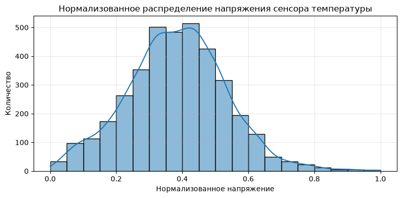

<div class="lab-result" style="white-space:pre-wrap;font-family:inherit;line-height:1.6">Новый минимум: 0.0<br>
Новый максимум: 1.0<br>
Новое среднее: 0.38369380613275145<br>
</div>

<a id="temp-estimates" name="temp-estimates" class="lab-anchor"></a>

### Independence & Estimations
Для проверки состоятельности оценки проверим, как среднее значение ведет себя при увеличении количества случайных показаний сенсора

<a id="fig08" name="fig08" class="lab-anchor"></a>

<p class="lab-caption">Рисунок 08 · Состоятельность оценки для температуры</p>

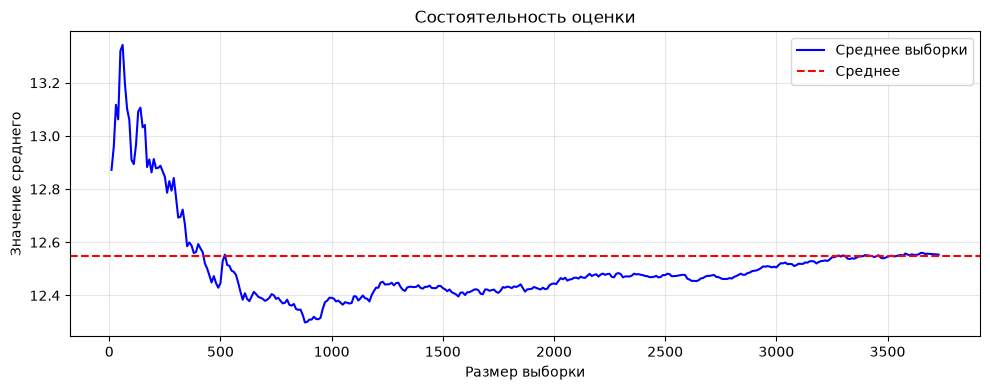

Можно заметить, как значение среднего перестает колебаться и сводится к исходному при увеличении размера выборки.
После отметки в 600 показаний, среднее перестает сильно колебаться. Возьмем выборку размером в 600 значений и проверим ее статистику

<a id="temp-samples" name="temp-samples" class="lab-anchor"></a>

<a id="table03" name="table03" class="lab-anchor"></a>

<p class="lab-caption">Таблица 03 · Статистики температуры и выборок</p>

<div>

<table border="1" class="dataframe">
<thead>
<tr style="text-align: right;">
<th></th>
<th>Генеральная совокупность</th>
<th>Без возвращения</th>
<th>С возвращением</th>
</tr>
</thead>
<tbody>
<tr>
<th>Сумма</th>
<td>46886.362780</td>
<td>7430.257399</td>
<td>7604.712319</td>
</tr>
<tr>
<th>Среднее</th>
<td>12.549883</td>
<td>12.383762</td>
<td>12.674521</td>
</tr>
<tr>
<th>Медиана</th>
<td>12.594053</td>
<td>12.568173</td>
<td>12.834649</td>
</tr>
<tr>
<th>Минимум</th>
<td>2.752066</td>
<td>3.220754</td>
<td>2.752066</td>
</tr>
<tr>
<th>Максимум</th>
<td>28.287575</td>
<td>26.637090</td>
<td>25.848898</td>
</tr>
<tr>
<th>Стандартное отклонение</th>
<td>3.842404</td>
<td>3.698433</td>
<td>3.764880</td>
</tr>
<tr>
<th>95-й перцентиль</th>
<td>18.747636</td>
<td>18.123621</td>
<td>18.818729</td>
</tr>
<tr>
<th>Дисперсия</th>
<td>14.764069</td>
<td>13.678408</td>
<td>14.174325</td>
</tr>
<tr>
<th>Мода</th>
<td>8.736985</td>
<td>3.220754</td>
<td>13.043959</td>
</tr>
</tbody>
</table>
</div>

Все данные, кроме суммы, очень близки к генеральной совокупности, что показывает выборку объемом 600 подходящей.
Дисперсия выборки с возвращением заметно ниже, так как в нее могли попасть продублированные строки, в остальном данные не отличаются.
Выборка без возвращения в целом более похожа на оригинальную. Также заметим что, в отличие от NO2, распределение температуры имеет несколько пиков, что физически объясняется изменением температуры в течение суток, а тест на нормальность подтверждает, что распределение не является нормальным

<a id="dependence" name="dependence" class="lab-anchor"></a>

<p class="lab-section-label">Раздел 4</p>

[← 3. Сигнал сенсора температуры (ASE_T)](#rv-temp) · [Оглавление](#contents) · [5. Сигнал сенсора CO →](#rv-co)

## Зависимость NO2 от температуры
Исследуем, влияет ли температура воздуха на показания сенсора NO2

<a id="dependence-test" name="dependence-test" class="lab-anchor"></a>

<div class="lab-result" style="white-space:pre-wrap;font-family:inherit;line-height:1.6">Коэффициент корреляции Пирсона (r): -0.2372<br>
p-value: 2.6736e-48<br>
Вывод: Связь статистически значима (p-value &lt; 0.05).<br>
Направление связи: Обратная (при росте температуры NO2 падает).<br>
</div>

<a id="dependence-plots" name="dependence-plots" class="lab-anchor"></a>

<a id="fig09" name="fig09" class="lab-anchor"></a>

<p class="lab-caption">Рисунок 09 · Зависимость напряжения сенсора NO2 от температуры</p>

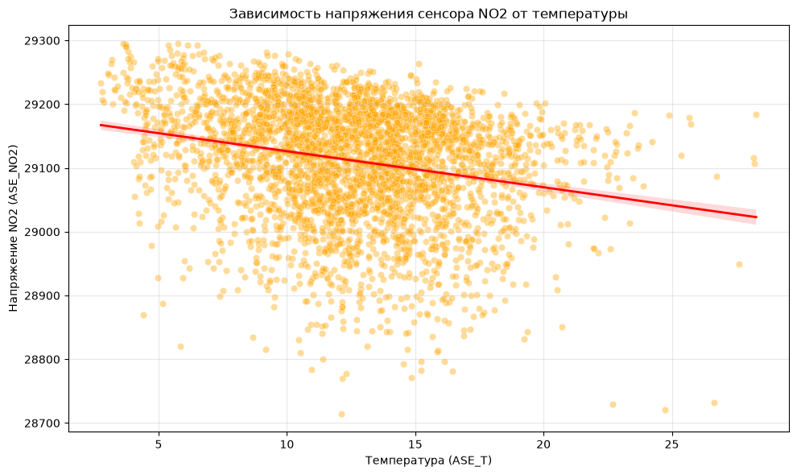

<a id="fig10" name="fig10" class="lab-anchor"></a>

<p class="lab-caption">Рисунок 10 · Матрица корреляции</p>

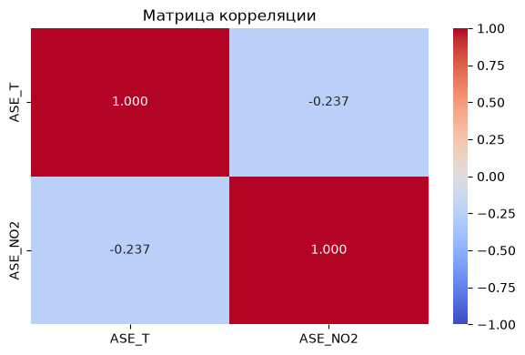

<a id="dependence-conclusion" name="dependence-conclusion" class="lab-anchor"></a>

### Вывод по зависимости NO2 от температуры

Получилось, связь между температурой и показаниями сенсора NO2 все таки есть, об этом говорит и наклон красной линии тренда на графике, и коэффициент корреляции -0.237 , так как p-value < 0.05, то связь не случайная

Поскольку связь все равно слабая, сама температура воздуха не главная причина изменения концентрации NO2. Например, в холода машины дольше греются, а выхлопные газы рассеиваются хуже, из-за чего уровень газа в воздухе в среднем выше, чем в теплую погоду. Также возможна ошибка прибора, что сам датчик может менять показания в зависимости от температуры

<a id="rv-co" name="rv-co" class="lab-anchor"></a>

<p class="lab-section-label">Раздел 5</p>

[← 4. Зависимость NO2 от температуры](#dependence) · [Оглавление](#contents) · [6. Lab resume — спринт 1 →](#resume)

## Random Variable 03: Сигнал сенсора CO

<a id="co-description" name="co-description" class="lab-anchor"></a>

### Description
Случайная величина 3 - сигнал электрохимического сенсора CO (`ASE_CO`), который снимается каждый час на автомобильном перекрестке. Вычислить его по формуле нельзя: значение зависит, в частности, от того, сколько машин проехало и как дует ветер, и к этому добавляется собственный шум прибора.

<a id="co-eda" name="co-eda" class="lab-anchor"></a>

### EDA & Distribution

<a id="fig11" name="fig11" class="lab-anchor"></a>

<p class="lab-caption">Рисунок 11 · Распределение напряжения сенсора CO</p>

<a id="fig12" name="fig12" class="lab-anchor"></a>

<p class="lab-caption">Рисунок 12 · График функции распределения CO</p>

<div class="lab-result" style="white-space:pre-wrap;font-family:inherit;line-height:1.6"><br>
Размер данных до очистки: 3739 наблюдений.<br>
Размер данных после очистки: 3686 наблюдений.<br>
<br>
</div>

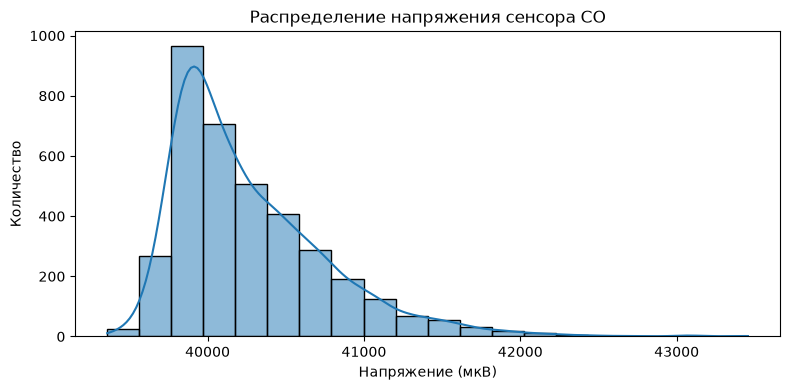

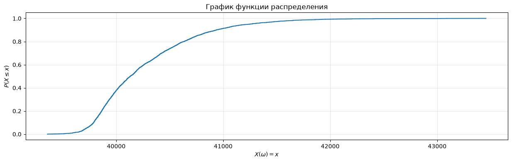

<div class="lab-result" style="white-space:pre-wrap;font-family:inherit;line-height:1.6"><br>
Сумма: 148429693.67587<br>
Среднее: 40268.50072595497<br>
Медиана: 40132.16728<br>
Минимум: 39358.04688<br>
Максимум: 43455.98346<br>
Стандартное отклонение: 499.6717627929245<br>
95-й перцентиль: 41247.7557475<br>
Дисперсия: 249671.87053258857<br>
Мода: 39752.20313<br>
</div>

<a id="co-model" name="co-model" class="lab-anchor"></a>

#### Математическая база распределения

Проверим гипотезу о нормальности.
$H_0$: распределение сигнала CO нормальное.
$H_1$: распределение отличается от нормального.

<a id="co-test" name="co-test" class="lab-anchor"></a>

<div class="lab-result" style="white-space:pre-wrap;font-family:inherit;line-height:1.6">Статистика критерия: 1028.7669622714538<br>
p-value: 4.037314305072088e-224<br>
Нулевая гипотеза отвергается: распределение не нормальное<br>
</div>

<a id="fig13" name="fig13" class="lab-anchor"></a>

<p class="lab-caption">Рисунок 13 · Подгонка теоретических распределений</p>

<div class="lab-result" style="white-space:pre-wrap;font-family:inherit;line-height:1.6">Skew-normal: alpha = 7.688, xi = 39687.0, omega = 766.6<br>
Асимметрия модели skew-normal: 0.93<br>
Асимметрия данных: 1.467<br>
AIC skew-normal: 54990.6<br>
AIC lognormal:   54961.4<br>
</div>

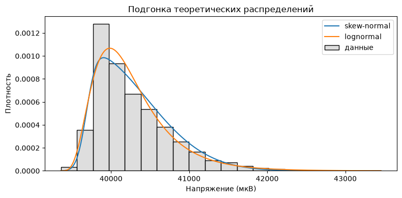

<div class="lab-result" style="white-space:pre-wrap;font-family:inherit;line-height:1.6">Статистика критерия: 1028.7669622714538<br>
p-value: 4.037314305072088e-224<br>
Нулевая гипотеза отвергается: распределение не нормальное<br>
</div>

<a id="co-normalization" name="co-normalization" class="lab-anchor"></a>

<a id="fig14" name="fig14" class="lab-anchor"></a>

<p class="lab-caption">Рисунок 14 · Нормализованное распределение напряжения сенсора CO</p>

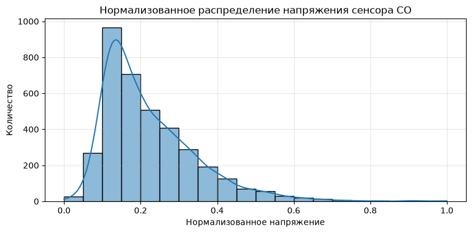

<div class="lab-result" style="white-space:pre-wrap;font-family:inherit;line-height:1.6">Новый минимум: 0.0<br>
Новый максимум: 1.0<br>
Новое среднее: 0.22217372772395697<br>
</div>

<a id="co-estimates" name="co-estimates" class="lab-anchor"></a>

### Independence & Estimations
Проверим состоятельность оценки: посмотрим, как выборочное среднее приближается к среднему всей совокупности при росте числа случайно выбранных показаний.

<a id="fig15" name="fig15" class="lab-anchor"></a>

<p class="lab-caption">Рисунок 15 · Состоятельность оценки для CO</p>

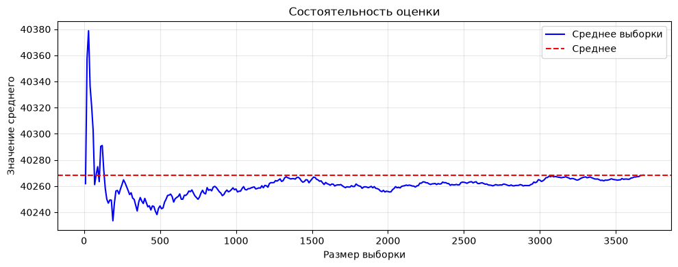

На графике видно, что колебания среднего с ростом размера выборки затухают, и оно стабилизируется около среднего по всем данным. Начиная примерно с 600 показаний отклонение не превышает около 20 отсч. (меньше 0.05% от среднего). Поэтому для следующего шага возьмем выборку из 600 значений и сравним ее характеристики с генеральными.

<a id="co-samples" name="co-samples" class="lab-anchor"></a>

<a id="table04" name="table04" class="lab-anchor"></a>

<p class="lab-caption">Таблица 04 · Статистики CO и выборок</p>

<div>

<table border="1" class="dataframe">
<thead>
<tr style="text-align: right;">
<th></th>
<th>Генеральная совокупность</th>
<th>Без возвращения</th>
<th>С возвращением</th>
</tr>
</thead>
<tbody>
<tr>
<th>Сумма</th>
<td>1.484297e+08</td>
<td>2.415022e+07</td>
<td>2.417048e+07</td>
</tr>
<tr>
<th>Среднее</th>
<td>4.026850e+04</td>
<td>4.025037e+04</td>
<td>4.028413e+04</td>
</tr>
<tr>
<th>Медиана</th>
<td>4.013217e+04</td>
<td>4.011883e+04</td>
<td>4.013017e+04</td>
</tr>
<tr>
<th>Минимум</th>
<td>3.935805e+04</td>
<td>3.942611e+04</td>
<td>3.941686e+04</td>
</tr>
<tr>
<th>Максимум</th>
<td>4.345598e+04</td>
<td>4.221511e+04</td>
<td>4.345598e+04</td>
</tr>
<tr>
<th>Стандартное отклонение</th>
<td>4.996718e+02</td>
<td>4.925889e+02</td>
<td>4.942201e+02</td>
</tr>
<tr>
<th>95-й перцентиль</th>
<td>4.124776e+04</td>
<td>4.123412e+04</td>
<td>4.125553e+04</td>
</tr>
<tr>
<th>Дисперсия</th>
<td>2.496719e+05</td>
<td>2.426438e+05</td>
<td>2.442535e+05</td>
</tr>
<tr>
<th>Мода</th>
<td>3.975220e+04</td>
<td>3.942611e+04</td>
<td>3.992811e+04</td>
</tr>
</tbody>
</table>
</div>

Основные показатели выборки из 600 значений очень близки к показателям генеральной совокупности: среднее отличается меньше чем на 0.1%. Значит, выборки такого объема подходят для суждения о всех данных.
Дисперсия выборки немного ниже генеральной (примерно на 2-3%), это обычный разброс при таком размере выборки. Максимум и мода отличаются, так как редкие значения могли не попасть в выборку.

<a id="resume" name="resume" class="lab-anchor"></a>

<p class="lab-section-label">Раздел 6</p>

[← 5. Сигнал сенсора CO](#rv-co) · [Оглавление](#contents) · [7. Генератор — спринт 2 →](#sprint2)

## Lab resume
В процессе 1 спринта лабораторной работы были исследованы 3 случайной величины: показания датчика NO2, температуры и CO.
Выполнен первичный анализ, подсчитан размер достоверных данных из датасета, подсчитана сумма, среднее, медиана и прочие метрики.
Построен график распределения каждой величины. В случае сенсоров NO2 и CO, наблюдается распределение с ассиметрией. NO2 является окислителем, а CO - восстановителем, повышение их концентраций по разному влияет на датчик, поэтому в графике распределения мы видим хвосты в противоположных сторонах.
В распределении температуры ассиметрия выражена меньше. Ни один из графиков не показывает нормальное распределение, так как помимо множества мелких независящих факторов на датчики влияли автомобильные пробки около места сбора.
Для подтверждения ассиметричности графиков были проверены соответствующие гипотезы.
Для проверки состоятельности оценки построены графики зависимости выборочного среднего от размера выборки, и показана его близость к истинному среднему.
После выбора подходящего, на наш взгляд, размера выборки, для нее были посчитаны все изначальные статистики, что позволило точно убедиться в возможности суждения о генеральной совокупности по выборочной. В каждом случае все данные, кроме суммы, почти совпадали с генеральной совокупностью. Подход без возвращения был более похож на оригинальную выборку.
Для температуры была исследована зависимость ее значения от показателей датчика NO2, для чего была построена матрица корреляции. Результаты показали, что при росте температуры показатель NO2 падает, эта связь не случайна, но слаба. Сама температура не является главной причиной изменения концентрации газа, но на их скачки влияли одни и те же события.

<a id="criteria" name="criteria" class="lab-anchor"></a>

### cat_mark_table
| cat_id | notebook_link | coeff | comment |
|--------|-----------------|-------|---------| 
| lab.ic.01.01 | Random Variable 01: Сигнал сенсора NO2  | 0,15 | |
| lab.ic.01.01 | Random Variable 02: Сигнал сенсора температуры (ASE_T)  | 0,15 | |
| lab.ic.01.01 | Random Variable 03: Сигнал сенсора CO  | 0,15 | |
| lab.ic.01.02 | Зависимость NO2 от температуры | 0,06 | | 
| lab.ic.01.03 | Independence & Estimations | 0,05 | Отдельным заголовком для каждой величины |
| lab.ic.01.04 | EDA & Distribution | 0,05 | Отдельным заголовком для каждой величины |
| lab.ic.01.05 | Математическая база распределения | 0,05 | Для каждой величины подпункт с нормализацией |
| lab.ic.01.06 | Random variable 01,03 отличаются от 02 | 0,1 | |
| lab.ic.01.07 | Математическая база распределения | 0,05 | Отдельным заголовком для каждой величины |
| lab.ic.01.09 | Independence & Estimations | 0,05 | |
| lab.ic.01.10 | Independence & Estimations | 0,05 | |
| lab.ic.01.11 | Математическая база распределения | 0,05 | Подпункт с гипотезой для каждой величины |

<a id="sprint2" name="sprint2" class="lab-anchor"></a>

<p class="lab-section-label">Раздел 7</p>

[← 6. Lab resume — спринт 1](#resume) · [Оглавление](#contents)

# Lab01 - sprint 2

## random 01

<a id="generator-description" name="generator-description" class="lab-anchor"></a>

### Description
Для создания генератора за основу возьмем random valuable 01 - Сигнал датчика NO2

В 1 спринте мы описали распределение этой величины как нормальное с ассиметрией. Для генератора будем считать его близким к гамма-распределению. Гамма-распределение с целым параметром формы a можно получить как сумму a независимых экспоненциальных величин, поэтому по центральной предельной теореме при большом a оно становится похожим на нормальное, но небольшая ассиметрия остается (коэффициент ассиметрии равен $2/\sqrt{a}$). Поэтому в первом приближении такая модель подходит для нашей величины, которая почти нормальная, но несимметричная. При этом у реальных данных ассиметрия заметно сильнее (около -0.84 против $2/\sqrt{a} \approx 0.14$ у модели), поэтому генератор хорошо повторяет среднее и разброс, но он хуже описывает длинный левый хвост. Так как хвост у NO2 вытянут влево, в алгоритме GD сгенерированные значения отражаются относительно среднего.

Для генерации случайной величины воспользуемся алгоритмом И. Г. Арсена для гамма-распределения порядка a>1, описанным во 2 томе Кнута "Искусство программирования.
Для доп. генератора, Кнут в том же параграфе упоминает статью И. Г. Аренса, в который описывается усложненный, но еще более быстрый **алгоритм GD**.

<a id="generator-math" name="generator-math" class="lab-anchor"></a>

### Math Desc
Гамма-распределение порядка $a > 0$ определяется как:


```math
F(x) = \frac{1}{\Gamma(a)} \int_{0}^{x} t^{a-1}e^{-t} \,dt, \quad x \geq 0
```


Простой метод логарифма для генерации гамма-распределения, где a - целое число, очень медленный если a - большое, поскольку он требутет [a] равномерно распределенных случайных величин.


```math
X = \sum_{i=1}^{a} (-\ln U_i) = -\ln\left(\prod_{i=1}^{a} U_i\right) = -\ln(U_1 \cdot U_2 \cdot \dots \cdot U_a)
```


Посчитаем параметры гамма-распределения для нашей величины:

<div class="lab-result" style="white-space:pre-wrap;font-family:inherit;line-height:1.6">Параметр формы (a): 202.40228003336605<br>
Параметр сдвига (loc): 27756.872789469173<br>
Параметр масштаба (scale): 6.6960783780309026<br>
</div>

Т.к. параметр формы велик, Д. Кнутом предлагается использовать **Алгоритм А**.
1. **Шаг А1:** 
   Генерируется стандартная равномерная случайная величина $U \sim U(0, 1)$. На её основе рассчитывается промежуточная переменная $Y$ и формируется число-кандидат $X$:


```math
Y \leftarrow \tan(\pi U)
```


```math
X \leftarrow \sqrt{2a - 1}Y + a - 1
```


2. **Шаг А2:** 
   * Если $X \leq 0$, алгоритм принудительно возвращается к шагу **А1**.
   * Если $X > 0$, генерируется вторая независимая равномерная случайная величина $V$. 
   * Проверяется экспоненциальное условие отбора:


```math
V > (1 + Y^2) \exp\left((a - 1)\ln\left(\frac{X}{a - 1}\right) - \sqrt{2a - 1}Y\right)
```


     то происходит возврат к шагу **А1**. Иначе - значение $X$ успешно принимается в качестве сгенерированного числа.


В статье предложен усовершенствованный **Алгоритм GD**.
Его суть заключается в существовании преобразования квадратного корня случайной величины с мат. ожиданием $a - \frac{1}{2}$, которое делает плотность вероятности максимально близкой к стандартной нормальной $N(0, 1)$.

Преобразование плотности:


```math
x = \left(s + \frac{t}{2}\right)^2, \quad \text{где } s = \sqrt{a - \frac{1}{2}}
```


Тогда она принимает вид:


```math
g(t) = \frac{1}{\Gamma(a)} \left(s + \frac{t}{2}\right)^{2s^2} \exp\left(-\left(s + \frac{t}{2}\right)^2\right)
```


Функция $g(t)$ пересекает стандартную нормальную плотность $f(t) = \frac{1}{\sqrt{2\pi}} e^{-t^2/2}$ ровно один раз в отрицательной точке, из за чего можно сказать: $g(t) \geq f(t)$ для всех $t \geq 0$. 

Тогда можно увеличить скорость алгоритма: 
1. Если сгенерированная стандартная нормальная величина $T \geq 0$, кандидат принимается мгновенно без вычисления логарифмов.
2. Если $T < 0$, применяется процедура отбора. Для ускорения расчетов авторы вводят быструю оценку $z(t)$:


```math
z(t) = 1 + \frac{t^3}{12s - 4\sqrt{2}} \leq \frac{g(t)}{f(t)}
```


3. Если кандидат не проходит быструю оценку, вычисляется точное отношение плотностей и проверяется условие: $\ln(1 - U) \leq Q$.


<a id="generator-code" name="generator-code" class="lab-anchor"></a>

### Code

<a id="generator-tests" name="generator-tests" class="lab-anchor"></a>

### tests

<a id="fig16" name="fig16" class="lab-anchor"></a>

<p class="lab-caption">Рисунок 16 · Сравнение сгенерированных данных</p>

<a id="table05" name="table05" class="lab-anchor"></a>

<p class="lab-caption">Таблица 05 · Статистики исходных и сгенерированных данных NO2</p>

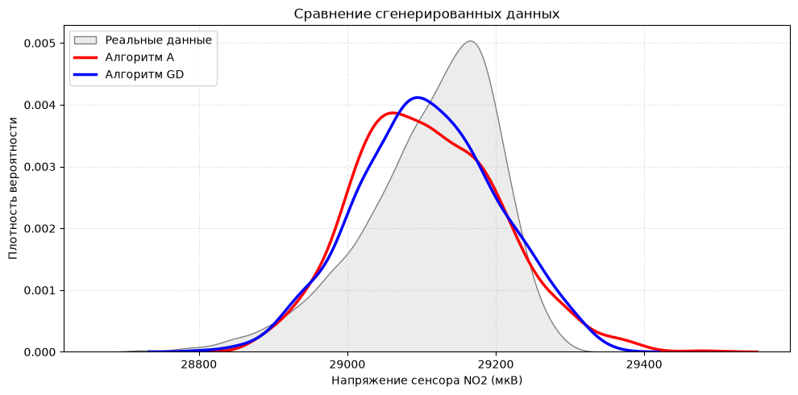

<div>

<table border="1" class="dataframe">
<thead>
<tr style="text-align: right;">
<th></th>
<th>Реальные данные NO2</th>
<th>Алгоритм А</th>
<th>Алгоритм GD</th>
</tr>
</thead>
<tbody>
<tr>
<th>Сумма</th>
<td>1.073062e+08</td>
<td>2.910758e+07</td>
<td>2.910848e+07</td>
</tr>
<tr>
<th>Среднее</th>
<td>2.911184e+04</td>
<td>2.910758e+04</td>
<td>2.910848e+04</td>
</tr>
<tr>
<th>Медиана</th>
<td>2.912804e+04</td>
<td>2.910327e+04</td>
<td>2.910674e+04</td>
</tr>
<tr>
<th>Минимум</th>
<td>2.871500e+04</td>
<td>2.887838e+04</td>
<td>2.880363e+04</td>
</tr>
<tr>
<th>Максимум</th>
<td>2.929528e+04</td>
<td>2.947910e+04</td>
<td>2.934891e+04</td>
</tr>
<tr>
<th>Стандартное отклонение</th>
<td>9.041963e+01</td>
<td>9.661213e+01</td>
<td>9.408463e+01</td>
</tr>
<tr>
<th>95-й перцентиль</th>
<td>2.923317e+04</td>
<td>2.927477e+04</td>
<td>2.926597e+04</td>
</tr>
<tr>
<th>Дисперсия</th>
<td>8.175709e+03</td>
<td>9.333904e+03</td>
<td>8.851917e+03</td>
</tr>
<tr>
<th>Мода</th>
<td>2.912609e+04</td>
<td>2.887838e+04</td>
<td>2.880363e+04</td>
</tr>
</tbody>
</table>
</div>

<div class="lab-result" style="white-space:pre-wrap;font-family:inherit;line-height:1.6"><br>
Для генерации N = 100 чисел:<br>
Алгоритм А отработал за: 0.444312 сек<br>
Алгоритм GD отработал за: 0.164058 сек<br>
Алгоритм GD в 2.71 раз быстрее!<br>
<br>
Для генерации N = 1000 чисел:<br>
  - Алгоритм А сделал  1843 попыток (Эффективность: 54.26%)<br>
  - Алгоритм GD сделал 1007 попыток (Эффективность: 99.30%)<br>
Алгоритм GD выполнил на 836 циклов меньше<br>
</div>

<a id="generator-resume" name="generator-resume" class="lab-anchor"></a>

### resume
Для генерации были взяты 2 алгоритма: алгоритм А и алгоритм GD. По результатам автотестов алгоритм GD оказался лучше алгоритма А почти по всем метрикам- стандартное отклонение, дисперсия, медиана, минимум, максимум и 95-й перцентиль у него ближе к реальным данным, а среднее у обоих генераторов почти совпадает с реальным. Как и описано в математической базе, алгоритм GD намного быстрее, так как совершает меньше циклов. Автотестами было посчитано время работы и количество циклов: GD отработал примерно в 2.7 раза быстрее, и на 1000 чисел ему понадобилось 1007 попыток, а алгоритму А-1843

<a id="generator-lab-resume" name="generator-lab-resume" class="lab-anchor"></a>

## Lab resume
В процессе 2 спринта был разработан генератор случайных чисел на основе первой величины- показаний датчика NO2. В 1 спринте распределение этой величины было описано как нормальное с ассиметрией, а для генератора было принято считать его близким к гамма-распределению, то есть при большом параметре формы оно почти не отличается от нормального, но сохраняет ассиметрию. Параметры гамма-распределения были подобраны по реальным данным, параметр формы получился большим (около 202), поэтому простой метод логарифма не подходит, так как он требует слишком много равномерных случайных чисел на одно значение. Поэтому сначала был реализован алгоритм А из 2 тома Кнута, который предназначен как раз для больших значений параметра. Затем в качестве дополнительного генератора был реализован алгоритм GD из статьи Аренса и Дитера, который за счет преобразования квадратного корня и быстрых предварительных проверок принимает большинство чисел сразу, без вычисления логарифмов. Так как у датчика NO2 хвост распределения вытянут влево, сгенерированные значения отражались относительно среднего. Для сравнения генераторов были написаны автотесты: сравнивались основные метрики сгенерированных и реальных данных, время работы и количество циклов. Алгоритм А на каждые 1000 чисел отбраковывал почти половину кандидатов, а алгоритм GD почти каждый кандидат принимал с первой попытки, поэтому он оказался быстрее почти в 3 раза. При этом метрики выборки GD оказались ближе к реальным данным, поэтому в качестве основного генератора был выбран алгоритм GD.
* Кнут Д. Э. Искусство программирования, том 2. Получисленные алгоритмы / 3.4.1 Численные распределения, Е. Другие непрерывные распределения, Алгоритм А
* [Ahrens, J. H. and Dieter, U. / Generating gamma variates by a modified rejection technique / 1982 / 25(1)](https://doi.org/10.1145/358315.358390)

<a id="generator-criteria" name="generator-criteria" class="lab-anchor"></a>

### cat_mark_table
| cat_id | notebook_link | coeff | comment |
|--------|-----------------|-------|---------| 
| lab.ic.01.13 | Description + code | 0,15 | |
| lab.ic.01.14 | Description + code | 0,18 | |
| lab.ic.01.15 | Сравнение сгенерированных данных  | 0,05 | график и таблица метрик |
| lab.ic.01.16 | Сравнение сгенерированных данных  | 0,08 | график и таблица метрик |
| lab.ic.01.17 | Description | 1,1 | нашли еще алгоритм из статьи |
| lab.ic.01.18 | Math desc| 0,05 |  |
| lab.ic.01.19 | Ссылки на материалы | 0,2 | в Description и в списке использованной литературы |
| lab.ic.01.21 | Список использованной литературы | 0,8 |  |
| lab.ic.01.22 | tests | 0,3 |  |
| lab.ic.01.23 | версирование и итеративный подход | 0,2 |  на протяжении всего проекта  |
| lab.ic.01.24 | Сравнение сгенерированных данных + tests | 0,2 |  |

<a id="figure-index" name="figure-index" class="lab-anchor"></a>

## Указатель рисунков и таблиц

Рисунки

- [Рисунок 01 · Распределение напряжения сенсора NO2](#fig01)
- [Рисунок 02 · График функции распределения NO2](#fig02)
- [Рисунок 03 · Нормализованное распределение напряжения сенсора NO2](#fig03)
- [Рисунок 04 · Состоятельность оценки для NO2](#fig04)
- [Рисунок 05 · Распределение напряжения сенсора температуры](#fig05)
- [Рисунок 06 · График функции распределения температуры](#fig06)
- [Рисунок 07 · Нормализованное распределение напряжения сенсора температуры](#fig07)
- [Рисунок 08 · Состоятельность оценки для температуры](#fig08)
- [Рисунок 09 · Зависимость напряжения сенсора NO2 от температуры](#fig09)
- [Рисунок 10 · Матрица корреляции](#fig10)
- [Рисунок 11 · Распределение напряжения сенсора CO](#fig11)
- [Рисунок 12 · График функции распределения CO](#fig12)
- [Рисунок 13 · Подгонка теоретических распределений](#fig13)
- [Рисунок 14 · Нормализованное распределение напряжения сенсора CO](#fig14)
- [Рисунок 15 · Состоятельность оценки для CO](#fig15)
- [Рисунок 16 · Сравнение сгенерированных данных](#fig16)

Таблицы

- [Таблица 01 · Первые строки исходных данных](#table01)
- [Таблица 02 · Статистики NO2 и выборок](#table02)
- [Таблица 03 · Статистики температуры и выборок](#table03)
- [Таблица 04 · Статистики CO и выборок](#table04)
- [Таблица 05 · Статистики исходных и сгенерированных данных NO2](#table05)

[К оглавлению](#contents)
