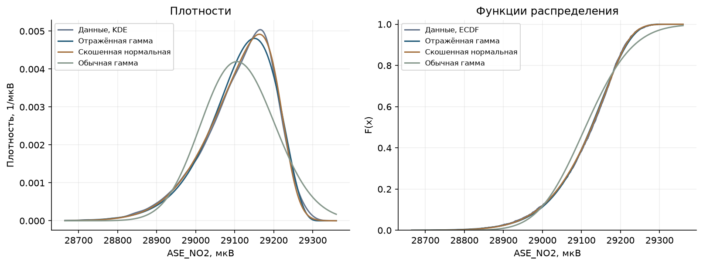
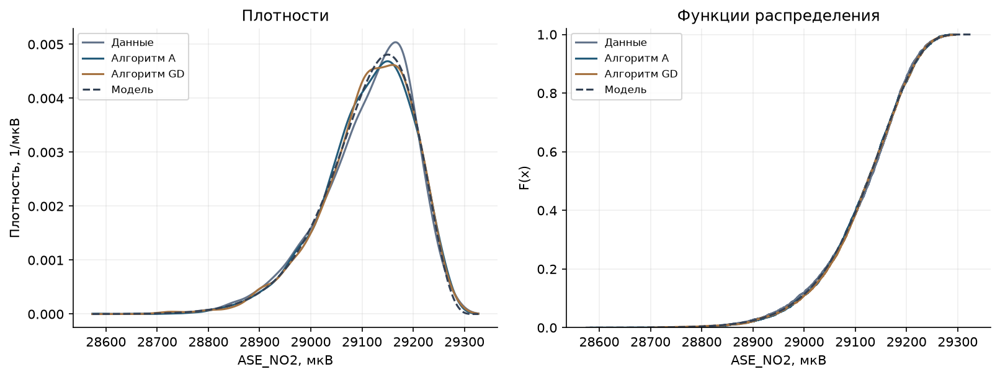
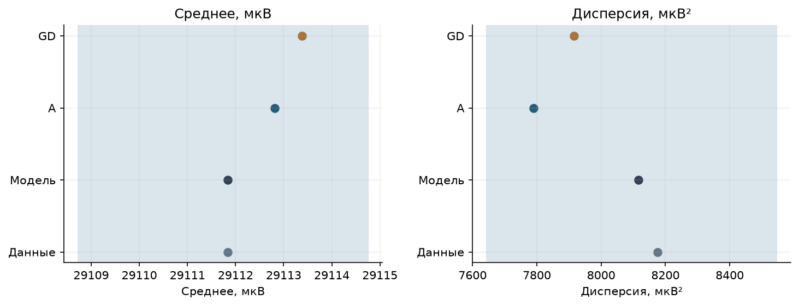

<a id="sprint2" name="sprint2"></a>

# Lab01 - Sprint 2

## 7 · Генератор случайных чисел

Лабораторная работа № 1. Прикладная статистика.

[Description](#generator-description) · [Math desc](#generator-math) · [Code](#generator-code) · [Tests](#generator-tests) · [Resume](#generator-resume) · [Lab resume](#generator-lab-resume) · [cat_mark_table](#generator-criteria)

<a id="generator-description" name="generator-description"></a>

### 7.1 · Description

В основе генератора — случайная величина из первого спринта: ASE_NO2, усреднённый за час электрический сигнал электрохимического датчика NO₂ в **мкВ**. Это не концентрация NO₂ в мкг/м³. Источник — Bobbia M., Thulliez E., *Air quality low-cost sensors and monitoring stations NO2 raw dataset in Rouen (France)*, Mendeley Data, version 2, [DOI 10.17632/82dnstrd93.2](https://data.mendeley.com/datasets/82dnstrd93/2), CC BY 4.0. Взята колонка ASE_NO2 файла ASE10.csv. Исключены строки с пропуском ASE_NO2 (53); сохранено 3686 измерений без удаления крайних значений.

Цель — моделировать распределение одного показания и сравнить два способа получения одной и той же случайной величины. Временная зависимость часовых измерений не моделируется. Генерируемые числа не являются прогнозом концентрации или последовательности показаний датчика.

<a id="generator-math" name="generator-math"></a>

### 7.2 · Math desc

Наблюдаемая асимметрия отрицательна. Обычная гамма-модель с положительным масштабом имеет положительную асимметрию и плохо описывает левый хвост. Рассмотрены обычная и отражённая гамма-модели, нормальная и скошенная нормальная модели. Параметры оценены максимизацией логарифма правдоподобия; для отражённой гаммы дополнительно получены оценки методом моментов.

Выбрана учебная аппроксимация


```math
X=b-\theta G,\qquad G\sim\Gamma(a,1),\qquad a>1,\quad\theta>0.
```
Параметр a безразмерен; b и θ выражены в мкВ. Носитель — x≤b. Граница b относится к модели и не является установленным пределом измерительного прибора. Из замены переменной g=(b−x)/θ и якобиана 1/θ получаем


```math
f_X(x)=\frac{1}{\theta\Gamma(a)}\left(\frac{b-x}{\theta}\right)^{a-1}e^{-(b-x)/\theta},\quad x<b;
\qquad f_X(x)=0,\quad x\geq b.
```
Неравенство меняет направление при отражении:


```math
F_X(x)=\Pr\{G\geq(b-x)/\theta\}=1-F_G((b-x)/\theta),\quad x<b;
\qquad F_X(x)=1,\quad x\geq b.
```
В вычислениях используется survival function, чтобы не вычитать близкие к единице числа. Теоретические характеристики:


```math
\mathrm E X=b-a\theta,\quad \mathrm{Var}(X)=a\theta^2,\quad
\gamma_1(X)=-2/\sqrt a,\quad Q_X(p)=b-\theta Q_G(1-p).
```
Для оценивания MLE гамма-распределение подбирается к −X: его сдвиг равен −b. Для метода моментов используются эмпирические центральные моменты с делителем n:


```math
m_k=\frac1n\sum_i(x_i-\bar x)^k,\qquad
g_1=m_3/m_2^{3/2},\quad
\hat a_{MM}=4/g_1^2,\quad
\hat\theta_{MM}=\sqrt{m_2/\hat a_{MM}},\quad
\hat b_{MM}=\bar x+\hat a_{MM}\hat\theta_{MM}.
```
Оценки MLE: a=5,452535, b=29322,206090 мкВ, θ=38,582131 мкВ. Модель даёт среднее 29111,835670 мкВ, SD 90,091838 мкВ и асимметрию -0,856507. В данных: 29111,835658 мкВ, 90,419627 мкВ и -0,839532. Разность дисперсий модели и данных составляет -0,724%. Для отражённой гаммы D=0,020284, для скошенной нормальной D=0,013253; AIC соответственно 43174,761 и 43156,377.

Скошенная нормальная модель имеет меньшие AIC и расстояние D. Отражённая гамма выбрана для содержательного продолжения исследования алгоритмов А и GD, а не как победитель сравнения законов. Её близость по среднему, дисперсии и асимметрии оценивается количественно ниже. AIC и D здесь — описательные критерии на данных подгонки. D не превращается в стандартный KS p-value: параметры оценены по той же выборке, а исходные часовые наблюдения могут зависеть во времени.

<a id="generator-code" name="generator-code"></a>

### 7.3 · Code

**Алгоритм А.** Для a>1 берём два независимых U,V с равномерным распределением на (0,1). Предложение Коши и кандидат имеют вид


```math
Y=\tan(\pi U),\quad c=\sqrt{2a-1},\quad Z=a-1+cY.
```
При Z≤0 предложение отклоняется. Иначе принимаем Z, если


```math
V\leq(1+Y^2)\exp\left((a-1)\log\frac{Z}{a-1}-cY\right).
```
Это метод отбраковки из алгоритма А Кнута. Если h — плотность предложения, а M h≥f_G, то плотность принятых значений пропорциональна h(z)f_G(z)/(M h(z))=f_G(z)/M; после нормировки получается гамма-плотность. Указанное условие принятия — это отношение f_G/(M h) при


```math
M=\frac{\pi c(a-1)^{a-1}e^{-(a-1)}}{\Gamma(a)}.
```
**Алгоритм GD.** Используется полный метод Ahrens–Dieter: немедленное принятие, squeeze-проверка, проверка отношения плотностей и заключительное предложение из экспоненциальной оболочки. Полагаем s=√(a−1/2), а нормальное предложение T преобразуем в Z=(s+T/2)². При T≥0 кандидат принимается сразу. Для T<0 сначала применяем дешёвую squeeze-проверку, затем вычисляем логарифм отношения преобразованной гамма-плотности к нормальной.

Плотность преобразованной переменной и логарифмическая проверка основаны на


```math
g(t)=\frac{(s+t/2)^{2a-1}e^{-(s+t/2)^2}}{\Gamma(a)},\quad t>-2s,
```
```math
Q(t)=q_0-st+t^2/4+2s^2\log(1+t/(2s)),\quad
q_0=\log\frac{\sqrt{2\pi}\,s^{2a-1}e^{-s^2}}{\Gamma(a)}.
```
Если нормальное предложение не принято, оно заменяется предложением из двухсторонней экспоненциальной оболочки. Для E∼Exp(1), U∼U(−1,1) строится t=B+sign(U)SE. После проверки области t≥−0,71874483771719 и Q>0 используется условие


```math
C|U|\leq (e^{Q(t)}-1)e^{E-t^2/2}.
```
Константы B,S,C зависят от a; полиномиальные коэффициенты и три диапазона a приведены в коде по опубликованному GD. Этот шаг покрывает хвост, который нельзя получить простым повторением нормального предложения. После любого принятия возвращается Z=(s+t/2)². Для обоих алгоритмов только затем применяется X=b−θZ.

<a id="gen-table-11" name="gen-table-11"></a>

**Таблица 11 · Модели и оценки.** Для MLE приведён AIC=2k−2log L, где k — число оценённых параметров. Метод моментов показан отдельной строкой без AIC-сравнения. Меньший D означает меньшее максимальное расстояние между ECDF наблюдений и CDF модели.

<div>
<style scoped>
    .dataframe tbody tr th:only-of-type {
        vertical-align: middle;
    }

    .dataframe tbody tr th {
        vertical-align: top;
    }

    .dataframe thead th {
        text-align: right;
    }
</style>
<table border="1" class="dataframe">
  <thead>
    <tr style="text-align: right;">
      <th></th>
      <th>Модель</th>
      <th>Параметры</th>
      <th>Среднее, мкВ</th>
      <th>SD, мкВ</th>
      <th>Асимметрия</th>
      <th>D</th>
      <th>AIC</th>
    </tr>
  </thead>
  <tbody>
    <tr>
      <th>0</th>
      <td>Отражённая гамма, MLE</td>
      <td>5.45253496, 29322.2061, 38.5821315</td>
      <td>29111.835669817</td>
      <td>90.091837689</td>
      <td>-0.856506703</td>
      <td>0.020284120</td>
      <td>43174.760778</td>
    </tr>
    <tr>
      <th>1</th>
      <td>Отражённая гамма, моменты</td>
      <td>5.67987351, 29327.2989, 37.9345084</td>
      <td>29111.835657759</td>
      <td>90.407360955</td>
      <td>-0.839190703</td>
      <td>0.020957685</td>
      <td>—</td>
    </tr>
    <tr>
      <th>2</th>
      <td>Скошенная нормальная, MLE</td>
      <td>-4.11592347, 29221.7477, 142.317021</td>
      <td>29111.405111959</td>
      <td>89.881355841</td>
      <td>-0.794115222</td>
      <td>0.013252783</td>
      <td>43156.376953</td>
    </tr>
    <tr>
      <th>3</th>
      <td>Обычная гамма, MLE</td>
      <td>202.40228, 27756.8728, 6.69607838</td>
      <td>29112.174320465</td>
      <td>95.263871837</td>
      <td>0.140579597</td>
      <td>0.079736528</td>
      <td>43832.747661</td>
    </tr>
    <tr>
      <th>4</th>
      <td>Нормальная, MLE</td>
      <td>29111.8357, 90.407361</td>
      <td>29111.835657759</td>
      <td>90.407360955</td>
      <td>0.000000000</td>
      <td>0.072856464</td>
      <td>43670.303858</td>
    </tr>
  </tbody>
</table>
</div>

<a id="gen-figure-17" name="gen-figure-17"></a>

**Рисунок 17 · Сравнение моделей.** Показаны KDE и ECDF наблюдений, обычная гамма, отражённая гамма и скошенная нормальная. Сглаживание служит визуализации; расстояние D вычислено по несглаженным данным.



<a id="generator-tests" name="generator-tests"></a>

### 7.4 · Tests

<a id="gen-table-12" name="gen-table-12"></a>

**Таблица 12 · Данные, теория и генераторы.** Для А и GD взято N=3686, как у реальных данных; seed=40. Поэтому суммы сравнимы. Выборочная дисперсия и SD используют делитель n−1. Перечисляются все моды с наибольшей частотой; при уникальных значениях единственная эмпирическая мода отсутствует. Плотностная мода непрерывной модели и эмпирические моды имеют разный смысл. Верхняя граница b не является ожидаемым максимумом конечной выборки.

<div>
<style scoped>
    .dataframe tbody tr th:only-of-type {
        vertical-align: middle;
    }

    .dataframe tbody tr th {
        vertical-align: top;
    }

    .dataframe thead th {
        text-align: right;
    }
</style>
<table border="1" class="dataframe">
  <thead>
    <tr style="text-align: right;">
      <th></th>
      <th>Показатель</th>
      <th>Данные</th>
      <th>Модель</th>
      <th>A</th>
      <th>GD</th>
    </tr>
  </thead>
  <tbody>
    <tr>
      <th>0</th>
      <td>N</td>
      <td>3686</td>
      <td>3686</td>
      <td>3686</td>
      <td>3686</td>
    </tr>
    <tr>
      <th>1</th>
      <td>Сумма, мкВ</td>
      <td>107306226</td>
      <td>107306226</td>
      <td>107309827</td>
      <td>107311905</td>
    </tr>
    <tr>
      <th>2</th>
      <td>Среднее, мкВ</td>
      <td>29111.8357</td>
      <td>29111.8357</td>
      <td>29112.8125</td>
      <td>29113.3763</td>
    </tr>
    <tr>
      <th>3</th>
      <td>Медиана, мкВ</td>
      <td>29128.0381</td>
      <td>29124.5472</td>
      <td>29124.4108</td>
      <td>29124.4059</td>
    </tr>
    <tr>
      <th>4</th>
      <td>Стандартное отклонение, мкВ</td>
      <td>90.4196271</td>
      <td>90.0918377</td>
      <td>88.26141</td>
      <td>88.9734863</td>
    </tr>
    <tr>
      <th>5</th>
      <td>Дисперсия, мкВ²</td>
      <td>8175.70896</td>
      <td>8116.53922</td>
      <td>7790.07649</td>
      <td>7916.28127</td>
    </tr>
    <tr>
      <th>6</th>
      <td>Асимметрия</td>
      <td>-0.839532385</td>
      <td>-0.856506703</td>
      <td>-0.788078307</td>
      <td>-0.859434309</td>
    </tr>
    <tr>
      <th>7</th>
      <td>5-й процентиль, мкВ</td>
      <td>28939.9492</td>
      <td>28945.1421</td>
      <td>28949.9414</td>
      <td>28947.6183</td>
    </tr>
    <tr>
      <th>8</th>
      <td>95-й процентиль, мкВ</td>
      <td>29233.1652</td>
      <td>29235.1296</td>
      <td>29235.1878</td>
      <td>29234.2783</td>
    </tr>
    <tr>
      <th>9</th>
      <td>Минимум, мкВ</td>
      <td>28715</td>
      <td>—</td>
      <td>28583.3947</td>
      <td>28695.6058</td>
    </tr>
    <tr>
      <th>10</th>
      <td>Максимум, мкВ</td>
      <td>29295.2812</td>
      <td>Граница b = 29322.2061</td>
      <td>29290.7865</td>
      <td>29296.6125</td>
    </tr>
    <tr>
      <th>11</th>
      <td>Эмпирические моды, мкВ</td>
      <td>29126.1</td>
      <td>—</td>
      <td>Нет повторов</td>
      <td>Нет повторов</td>
    </tr>
  </tbody>
</table>
</div>

<a id="gen-table-13" name="gen-table-13"></a>

**Таблица 13 · Качество генерации.** D к модели сравнивает генератор с заданной CDF; D к данным сравнивает синтетическую и реальную выборки. Проверяется отсутствие значений выше b.

<div>
<style scoped>
    .dataframe tbody tr th:only-of-type {
        vertical-align: middle;
    }

    .dataframe tbody tr th {
        vertical-align: top;
    }

    .dataframe thead th {
        text-align: right;
    }
</style>
<table border="1" class="dataframe">
  <thead>
    <tr style="text-align: right;">
      <th></th>
      <th>D к модели</th>
      <th>Асимметрия</th>
      <th>Значений выше b</th>
      <th>D к данным</th>
    </tr>
  </thead>
  <tbody>
    <tr>
      <th>A</th>
      <td>0.011845486</td>
      <td>-0.788078307</td>
      <td>0.0</td>
      <td>0.020889853</td>
    </tr>
    <tr>
      <th>GD</th>
      <td>0.013902815</td>
      <td>-0.859434309</td>
      <td>0.0</td>
      <td>0.019262073</td>
    </tr>
  </tbody>
</table>
</div>

<a id="gen-table-14" name="gen-table-14"></a>

**Таблица 14 · Расхождения и выборочная вариабельность.** Для фиксированных оценённых параметров сформированы 600 эталонных выборок того же объёма и получены 2,5%-й и 97,5%-й квантили каждой статистики. Это 95%-й диапазон выборочной вариабельности при заданной модели, а не доверительный интервал параметров и не проверка истинности подобранного закона. Числа генераторов не обязаны точно совпадать с теорией или исходной выборкой.

<div>
<style scoped>
    .dataframe tbody tr th:only-of-type {
        vertical-align: middle;
    }

    .dataframe tbody tr th {
        vertical-align: top;
    }

    .dataframe thead th {
        text-align: right;
    }
</style>
<table border="1" class="dataframe">
  <thead>
    <tr style="text-align: right;">
      <th></th>
      <th>Показатель</th>
      <th>Данные</th>
      <th>Модель</th>
      <th>Данные − модель</th>
      <th>95% нижняя</th>
      <th>95% верхняя</th>
      <th>A</th>
      <th>GD</th>
    </tr>
  </thead>
  <tbody>
    <tr>
      <th>0</th>
      <td>Среднее, мкВ</td>
      <td>29111.835657759</td>
      <td>29111.835669817</td>
      <td>-0.000012058</td>
      <td>29108.729802267</td>
      <td>29114.750531810</td>
      <td>29112.812503667</td>
      <td>29113.376316995</td>
    </tr>
    <tr>
      <th>1</th>
      <td>SD, мкВ</td>
      <td>90.419627064</td>
      <td>90.091837689</td>
      <td>0.327789376</td>
      <td>87.431099365</td>
      <td>92.442298578</td>
      <td>88.261409995</td>
      <td>88.973486330</td>
    </tr>
    <tr>
      <th>2</th>
      <td>Дисперсия, мкВ²</td>
      <td>8175.708958474</td>
      <td>8116.539218164</td>
      <td>59.169740310</td>
      <td>7644.197141749</td>
      <td>8545.578567217</td>
      <td>7790.076494269</td>
      <td>7916.281269761</td>
    </tr>
    <tr>
      <th>3</th>
      <td>Асимметрия</td>
      <td>-0.839532385</td>
      <td>-0.856506703</td>
      <td>0.016974319</td>
      <td>-0.987691336</td>
      <td>-0.739958241</td>
      <td>-0.788078307</td>
      <td>-0.859434309</td>
    </tr>
    <tr>
      <th>4</th>
      <td>5-й процентиль, мкВ</td>
      <td>28939.949220000</td>
      <td>28945.142148207</td>
      <td>-5.192928207</td>
      <td>28935.909865295</td>
      <td>28954.245200956</td>
      <td>28949.941448512</td>
      <td>28947.618321568</td>
    </tr>
    <tr>
      <th>5</th>
      <td>95-й процентиль, мкВ</td>
      <td>29233.165215000</td>
      <td>29235.129604911</td>
      <td>-1.964389911</td>
      <td>29231.869636430</td>
      <td>29238.345905932</td>
      <td>29235.187804126</td>
      <td>29234.278309359</td>
    </tr>
  </tbody>
</table>
</div>

<a id="gen-table-15" name="gen-table-15"></a>

**Таблица 15 · Проверка закона генерации.** Проверка самих алгоритмов проводится отдельно от подгонки данных: восемь выборок по 40 000 значений, a∈{1,01;3;5,452535;200}. Проверяются положительность G, конечность чисел, среднее, дисперсия и CDF. Допуск среднего равен 6√(a/N); для дисперсии используется 6√((2a²+6a)/N). Для ECDF используется граница Дворецкого—Кифера—Вольфовица при δ=10⁻⁶ для каждой отдельной выборки:


```math
\varepsilon=\sqrt{\log(2/\delta)/(2N)},\qquad
\Pr\{\sup_x|\widehat F_N(x)-F(x)|>\varepsilon\}\leq\delta.
```
Одинаковые формулы допусков используются для каждой пары «алгоритм — a». При подстановке a,b,θ в отражение проверяются X≤b и обратимость CDF/квантилей; повторный seed должен повторять числа. Полный набор воспроизводимых проверок находится в [test_generator.py](https://github.com/EastC0ast/lab01/blob/design-layout/designer_generator/test_generator.py).

<div>
<style scoped>
    .dataframe tbody tr th:only-of-type {
        vertical-align: middle;
    }

    .dataframe tbody tr th {
        vertical-align: top;
    }

    .dataframe thead th {
        text-align: right;
    }
</style>
<table border="1" class="dataframe">
  <thead>
    <tr style="text-align: right;">
      <th></th>
      <th>Метод</th>
      <th>a</th>
      <th>N</th>
      <th>D</th>
      <th>Граница DKW</th>
      <th>Ошибка среднего / допуск</th>
      <th>Ошибка дисперсии / допуск</th>
      <th>Вне поддержки</th>
    </tr>
  </thead>
  <tbody>
    <tr>
      <th>0</th>
      <td>A</td>
      <td>1.010000000</td>
      <td>40000</td>
      <td>0.003242179</td>
      <td>0.013466931</td>
      <td>0.101856996</td>
      <td>0.126207779</td>
      <td>0</td>
    </tr>
    <tr>
      <th>1</th>
      <td>A</td>
      <td>3.000000000</td>
      <td>40000</td>
      <td>0.004554989</td>
      <td>0.013466931</td>
      <td>0.181425406</td>
      <td>0.174005304</td>
      <td>0</td>
    </tr>
    <tr>
      <th>2</th>
      <td>A</td>
      <td>5.452534959</td>
      <td>40000</td>
      <td>0.004421911</td>
      <td>0.013466931</td>
      <td>0.225637086</td>
      <td>0.084740033</td>
      <td>0</td>
    </tr>
    <tr>
      <th>3</th>
      <td>A</td>
      <td>200.000000000</td>
      <td>40000</td>
      <td>0.007667715</td>
      <td>0.013466931</td>
      <td>0.324475467</td>
      <td>0.103061715</td>
      <td>0</td>
    </tr>
    <tr>
      <th>4</th>
      <td>GD</td>
      <td>1.010000000</td>
      <td>40000</td>
      <td>0.004522342</td>
      <td>0.013466931</td>
      <td>0.188361556</td>
      <td>0.053743281</td>
      <td>0</td>
    </tr>
    <tr>
      <th>5</th>
      <td>GD</td>
      <td>3.000000000</td>
      <td>40000</td>
      <td>0.005758394</td>
      <td>0.013466931</td>
      <td>0.357244905</td>
      <td>0.185711013</td>
      <td>0</td>
    </tr>
    <tr>
      <th>6</th>
      <td>GD</td>
      <td>5.452534959</td>
      <td>40000</td>
      <td>0.004846514</td>
      <td>0.013466931</td>
      <td>0.170026737</td>
      <td>0.084176723</td>
      <td>0</td>
    </tr>
    <tr>
      <th>7</th>
      <td>GD</td>
      <td>200.000000000</td>
      <td>40000</td>
      <td>0.005782911</td>
      <td>0.013466931</td>
      <td>0.283443194</td>
      <td>0.157096298</td>
      <td>0</td>
    </tr>
  </tbody>
</table>
</div>

<a id="gen-figure-18" name="gen-figure-18"></a>

**Рисунок 18 · Синтетические данные.** Для обеих выборок использованы одинаковые N и параметры модели. Сравнение с реальными данными и сравнение с теорией — разные задачи.



<a id="gen-figure-19" name="gen-figure-19"></a>

**Рисунок 19 · Выборочная вариабельность.** Полоса показывает 95%-й диапазон для статистики выборки N=3686 при фиксированной отражённой гамма-модели. Отдельно отмечены реальная выборка, теоретическое значение и результаты А/GD.



<a id="gen-table-16" name="gen-table-16"></a>

**Таблица 16 · Исследование алгоритмов.** Для каждого метода выполнены семь запусков N=3686 с seed 40…46. Показаны медиана и квартили времени на данном компьютере. Кандидатом считается каждое нормальное/кошевское предложение или предложение оболочки GD; их вычислительная стоимость различна. Число кандидатов и время поэтому интерпретируются раздельно. Относительная скорость зависит от среды и не является оценкой точности модели.

<div>
<style scoped>
    .dataframe tbody tr th:only-of-type {
        vertical-align: middle;
    }

    .dataframe tbody tr th {
        vertical-align: top;
    }

    .dataframe thead th {
        text-align: right;
    }
</style>
<table border="1" class="dataframe">
  <thead>
    <tr style="text-align: right;">
      <th></th>
      <th>Метод</th>
      <th>N</th>
      <th>Повторений</th>
      <th>Медиана времени, с</th>
      <th>Q25 времени, с</th>
      <th>Q75 времени, с</th>
      <th>Медиана кандидатов</th>
    </tr>
  </thead>
  <tbody>
    <tr>
      <th>0</th>
      <td>A</td>
      <td>3686</td>
      <td>7</td>
      <td>0.0711271</td>
      <td>0.0652899</td>
      <td>0.0718393</td>
      <td>6757.0</td>
    </tr>
    <tr>
      <th>1</th>
      <td>GD</td>
      <td>3686</td>
      <td>7</td>
      <td>0.0225438</td>
      <td>0.0191787</td>
      <td>0.0242889</td>
      <td>3843.0</td>
    </tr>
  </tbody>
</table>
</div>

<a id="generator-resume" name="generator-resume"></a>

### 7.5 · Resume

Обычная гамма не передавала отрицательную асимметрию. Отражение позволило получить модель с близкими средним и разбросом, однако скошенная нормальная описывает эту выборку лучше по AIC. Для N=3686 и seed=40 алгоритм А дал среднее 29112,812504 мкВ и дисперсию 7790,076494 мкВ²; GD — 29113,376317 мкВ и 7916,281270 мкВ². Значений выше b нет у обоих методов. В восьми контрольных выборках поддержка, моменты и CDF удовлетворили указанным допускам; это численная проверка реализации, а не доказательство истинности модели реальных данных. Сравнение эффективности приведено для семи запусков на одном компьютере.

<a id="generator-lab-resume" name="generator-lab-resume"></a>

### 7.6 · Lab resume

Для выбранной в первом спринте величины построен генератор её одномерного приближения. Направление асимметрии согласовано с наблюдениями с помощью отражения. Два алгоритма получают одну целевую модель, а проверка их реализации отделена от качества модели данных. Конечная выборка даёт случайные отклонения метрик; точного совпадения всех статистик не заявляется. Исследование не описывает временную зависимость, перенос калибровки датчика или распределение концентрации в мкг/м³.

<a id="generator-criteria" name="generator-criteria"></a>

### 7.7 · cat_mark_table

| cat_id | notebook_link | coeff | comment |
| --- | --- | --- | --- |
| — | [Description](#generator-description) | — | Генерируется электрический сигнал ASE_NO2, мкВ |
| — | [Math desc](#generator-math) | — | Отражённая гамма; сравнение с нормальной, обычной гамма и скошенной нормальной моделями |
| — | [Code](#generator-code) | — | Алгоритм А и полный GD с общим преобразованием X=b−θG |
| — | [Tests](#generator-tests) | — | Метрики при N=3686; поддержка, моменты, CDF и воспроизводимость |
| — | [Исследование алгоритмов](#gen-table-16) | — | По семь запусков А и GD; медиана и квартили времени |
| — | [Resume](#generator-resume), [Lab resume](#generator-lab-resume) | — | Ограничения аппроксимации и итог сравнения |


### Источники и материалы

1. Bobbia M., Thulliez E. Датасет датчиков NO₂, Mendeley Data, version 2. [DOI 10.17632/82dnstrd93.2](https://data.mendeley.com/datasets/82dnstrd93/2).
2. Кнут Д. Э. *Искусство программирования*. Т. 2, § 3.4.1, алгоритм А.
3. Ahrens J. H., Dieter U. *Generating gamma variates by a modified rejection technique*. Communications of the ACM 25(1), 47–54, 1982. [DOI 10.1145/358315.358390](https://doi.org/10.1145/358315.358390). [Референс R: GammaDist](https://stat.ethz.ch/R-manual/R-devel/library/stats/html/GammaDist.html).
4. SciPy. [Gamma](https://docs.scipy.org/doc/scipy/reference/generated/scipy.stats.gamma.html), [skew-normal](https://docs.scipy.org/doc/scipy/reference/generated/scipy.stats.skewnorm.html), [MLE и ограничения численного оценивания](https://docs.scipy.org/doc/scipy/reference/generated/scipy.stats.rv_continuous.fit.html).
5. Massart P. *The tight constant in the Dvoretzky–Kiefer–Wolfowitz inequality*. Annals of Probability 18(3), 1269–1283, 1990. [DOI 10.1214/aop/1176990746](https://doi.org/10.1214/aop/1176990746).

[Приложение](https://marimo.app/github/EastC0ast/lab01/blob/design-layout/designer_generator/browser_app.py/wasm?embed=true&mode=read&include-code=false&show-code=false) · [Исполняемый ноутбук](https://github.com/EastC0ast/lab01/blob/design-layout/designer_generator/sprint2_calculations.ipynb) · [Читательский ноутбук](https://github.com/EastC0ast/lab01/blob/design-layout/designer_generator/sprint2.ipynb) · [Полные результаты](https://github.com/EastC0ast/lab01/blob/design-layout/designer_generator/results.json) · [Код алгоритмов](https://github.com/EastC0ast/lab01/blob/design-layout/designer_generator/algorithms.py)

[К оглавлению Sprint 2](#sprint2)
